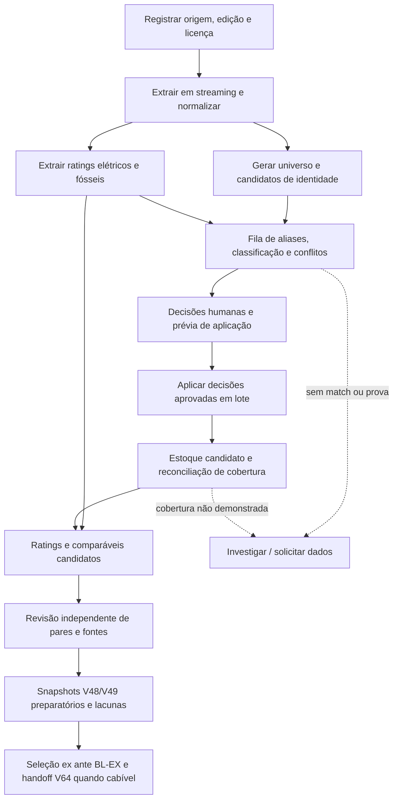

# BL-DATA-01 — pipeline de preparação em massa da frota nacional EVR e ratings PBEV

**Status:** especificação de implementação P0, 26/11/2026. Base main `20d6e7515a88087bed12744f09a6ee75f2f86682`, após merge do PR #351. Amplia [frota ex ante](CF-UX-TECH-001-FROTA-BASELINE-EX-ANTE.md) e D19. Não implementa o pipeline, não importa dados nem admite fontes neste PR. Owners #94 (identidade, estoque, cobertura), #95 (ratings, comparáveis e ponderação), #92 (originais, extração, licenças e parecer de origem), #124 (UX), #101 (homologação). #40/#97 consomem referências, não duplicam catálogo. Priorizar primeira vertical em paralelo ao caminho crítico UX-08D.1/BL-EX-01/02; não exigir MR para preparar a base. 

**Decisão de produto:** evitar digitação de cada veículo/modelo da frota aberta. O catálogo deve ser preparado uma vez por recorte/versão autorizada e reutilizado em projetos compatíveis. Automatizar aquisição assistida, processamento, geração de candidatos, aplicação de decisões humanas em lote, diagnóstico e atualização anual. Nunca substituir decisão técnica por correspondência textual. Não cadastrar placas/VIN/clientes da rede OPEN. Reutilização entre organizações depende de autorização/licença própria, não é implícita.

## 1. Inventário verificado

| Artefato existente | Capacidade e lacuna |
|---|---|
| [inspect_senatran_stock_sample.py](../scripts/inspect_senatran_stock_sample.py) | Leitura streaming do ZIP, seleção/amostra, agregados e locators; não prova circulação ativa |
| [build_evr_stock_csv.py](../scripts/build_evr_stock_csv.py) | Requer lista explícita de nomes literais (--model), período YYYY-MM; produz CSV e manifesto, não cadastra modelos |
| [extract_pbev_electric.py](../scripts/extract_pbev_electric.py) | Extrai linhas VE de PDF para candidatos JSON; não escreve no banco nem extrai automaticamente toda a população fóssil |
| [match_senatran_pbev.py](../scripts/match_senatran_pbev.py) | Propõe matches e lote JSON --emit-import; não aprova; NONE fora do payload exige fila de investigação |
| [build_fleet_model_registrations.py](../scripts/build_fleet_model_registrations.py) | Gera corpos de requisição a partir de candidatos ACCEPTED e arquivo humano de decisões; não envia requisições |
| [reconcile_fleet_catalog.py](../scripts/reconcile_fleet_catalog.py) | Dossiês e plano offline, evidência da linha PBEV, reconciliação de fabricante, recusas e classificação humana |
| [Fila de aliases](../frontend/src/platform-alias-candidates.html) / V108–110 | Já importa lote JSON, revisa candidato, seleciona linha e registra fundamento; reaproveitar, não criar segunda fila |
| [Frota EVR](../frontend/src/platform-fleet.html) / V48 | Identidade, alias, classificação, fonte tabular, snapshot e decisão de cobertura; cadastro unitário |
| [Ratings PBEV](../frontend/src/platform-ratings.html) / V49 | Rating de linha autorizada, pares, revisão independente, cálculo ponderado e snapshot; handoff V64 |
| [Cobertura nacional](CF-OPEN-005-NATIONAL-COVERAGE-DECISION.md) | NOT_COVERED ou NO_OFFICIAL_TOTAL; ausência OFFICIAL_TOTAL_NOT_VERIFIED; não há decisão positiva nacional comprovada nesta fatia |

## 2. Dados reais e limites de admissibilidade

[Estudo de viabilidade de 23/11/2026](CF-OPEN-005-BR-DATA-FEASIBILITY.md): arquivo nacional RENAVAM setembro/2026 tem 22.849.046 linhas e 136.424.856 registros de veículos, total igual ao agregado por combustível. **Não é denominador BEV LDV DCFC em circulação.** O ZIP tem cerca de 137 MB e TXT interno cerca de 1,22 GB; não cabe no fluxo tabular #92 de 2 MiB/2.000 linhas. Não fazer upload bruto por essa rota, não aumentar limite sem avaliação e não contornar criptografia/direitos via SQL ou filesystem. Usar staging autorizado e processamento streaming local/controlado (primeira vertical) com manifesto de origem íntegro; evolução de armazenamento/worker/conector no owner #92 após benchmark. Não versionar arquivos brutos protegidos no Git.

O arquivo por modelo contém UF, município, marca/modelo, ano de fabricação e quantidade; não contém chave de combustível, situação ativa, categoria ou recarga. A planilha combustível não contém modelo. **Não fazer join por município** para classificar propulsão; não promover registrado a ativo por igualdade de totais. Preservar desconhecidos, rótulos de localização e fabricação. Não somar meses como estoque anual nem confundir ano de fabricação, edição PBEV e observação. Regra da observação requerida pelo pack/contexto, não escolher mês mais recente sem decisão.

PBEV não prova circulação nem compatibilidade DCFC; correspondência de nome, ciclo ou categoria sozinha não prova comparabilidade. O estudo registra licença RENAVAM declarada no catálogo e rodapé PBEV CC BY-ND 3.0; não deduzir direito de derivar/redistribuir. #92 deve avaliar operação, organização, finalidade, fonte e edição, direitos de STORE_ORIGINAL/EXTRACT_TEXT/SHOW_EXCERPTS/EXPORT_DERIVATIVES e demais incidentes. Sem autorização, bloquear operação e manter relatório de lacuna. Não fazer download/importação real neste PR. Solicitar evidência adicional de circulação, categoria, propulsão e DCFC conforme método, versões e cobertura. Se inexistente, manter candidato/pendência, não inventar solução normativa.

## 3. Fluxo operacional

As setas representam dependências lógicas; ratings podem ser preparados antes de estoque completo. Revisão/admissão por owner e escopo continuam separadas. Um catálogo preparatório não equivale a E8 admitido.

## 4. Subfatias implementáveis

| ID | Entrega e owner | Aceite de saída |
|---|---|---|
| BL-DATA-01A | #92/#94/#95 — sessão de processamento e manifesto, adapters dos scripts existentes | Reproduzir amostra real autorizada/fixture, hashes, período, versões de parser, contagens, direito e erros; nenhuma escrita canônica |
| BL-DATA-01B | #94 — extrair universo agregado de chaves, gerar lista candidata e CSV sem lista --model digitada | Cobrir universo declarado, listar incluídas/excluídas/pendentes e reconciliar totais; não afirmar cobertura metodológica |
| BL-DATA-01C | #94/#95 — reconciliação e fila existente V108–110 | EXACT/AMBIGUOUS/NONE e colisões com evidências; agrupar por candidato, contagem e prioridade de impacto, nenhuma aprovação pelo score |
| BL-DATA-01D | #94/#92 — aplicar em massa decisões humanas ao catálogo existente | Dry-run, diff, criação/reuso de identidade/aliases/classificação por comando autorizado, idempotência, conflitos e retomada |
| BL-DATA-01E | #94 — ingestão segmentada de estoque e cobertura | Manifesto e chunks reconciliados, vetor completo do recorte declarado, decisão independente e lacunas sem falso denominador nacional |
| BL-DATA-01F | #95/#92 — extração/ingestão assistida de ratings elétricos e fósseis | Linhas autorizadas e locators, edições/ciclos/unidades, candidatos de comparabilidade; sem aprovação automática |
| BL-DATA-01G | #95 — revisão assistida de pares e snapshots V49 | Evidência de equivalência/serviço/capacidade/ciclo/combustível, review segregado, ponderação canônica ou nulo |
| BL-DATA-01H | #94/#95/#40/#97/#124 — publicação preparatória e atualização anual | Referências exatas por escopo, diff com versão anterior, stale dirigido e integração BL-EX/V64 sem MR fictício |
| BL-DATA-QA | #101/#45/#49 — testes, benchmark, homologação | Critérios abaixo e documentação de operação real |

Todos P0 no caminho de dados do marco; A–D primeira vertical para acabar com cadastro unitário, F pode avançar paralelamente. A falta de fonte admissível não impede implementar e testar os contratos com fixture isolada. Ingestão automática via conectores oficiais e worker remoto depende de direitos/capacidade; não prometer já existente. Reaproveitar CLI Python como núcleo determinístico/testável, Quarkus como autoridade de escrita/ACL, PostgreSQL como registro e Angular como workbench. Decidir entre worker controlado e execução offline com upload de manifesto após benchmark/segurança; nenhuma credencial no script ou payload. Primeira entrega não precisa executar Python arbitrário em servidor.

## 5. Contratos operacionais

### 5.1 Sessão/lote de preparação
Proposta lógica (não API existente): FleetPreparationBatch id, org/environment, sourceRefs@version, observationPeriod, observationYear, scope/pack/edition, manifestHash, parserVersions, step, status, counters, artifactRefs, createdBy, revision, errors/reasons. Artefatos temporários autorizados, expiração, limites de ZIP expansion/zip-slip, streaming, MIME e integridade; não armazenar PII. Reutilizar ingestão #92 e objetos V108–110; só persistir novo controle de execução se necessário, sem novo catálogo.
- Universo: agrupar chaves literais/quantidades por período e locators; explicitamente UNKNOWN, candidato BEV/LDV/DCFC, exclusão fundamentada ou pendente. Não filtrar somente modelos já encontrados em PBEV; versões antigas/sem match permanecem no relatório. Match normalizado é candidato, não alias canônico. Registrar algoritmo e versão, linha/edição e alternativa; não unir versões automaticamente. Controle de negativos como AGRALE/MAXIBUS DOLPHIN e RENAULT/KWID EVOLUTION.
- Revisão: fila existente com filtros por status, fonte/ano, fabricante e estoque afetado (somente autorizado), candidatos e provas lado a lado, decisão/reason/locator e autor. Agrupar tarefas não significa aprovar em massa. Importação de arquivo de decisões humanas com IDs/versões e fundamento por item pode poupar digitação; validar identidade, competência, base INDEPENDENT/OWNER_INTERNAL e guardas existentes. Aceite de alias não equivale a classificação, licença, rating, par ou cobertura. Evidência insuficiente → UNKNOWN/pendente. Não substituir review independente por declaração do proprietário.
- Aplicação: dry-run mostra CREATE/REUSE/NOOP/CONFLICT/REFUSED, efeito em identidade, alias e classificação, sem escrita. Confirmar plano versionado e executar comandos canônicos (mesmas validações por item). Restringir ao gestor de fontes com MFA e organização autorizada; If-Match/Idempotency-Key estáveis por item/versão, auditoria, checkpoint e resultado por item. Política de atomicidade explícita: unidade de identidade+alias+classificação coerente ou estado parcial rastreável, não marcar lote completo se falhou; reexecução retoma apenas pendentes, não sobrescreve decisões/histórico. Não criar modelo fictício ou aprovar por similaridade. Sem acesso direto de scripts ao banco.
- Ingestão: se tabular exceder limite #92, lotes autorizados com manifesto pai, ordem, hash e linhas; reconciliar quantidade por chave, duplicatas, integridade e cobertura de todos os chunks antes de publicar snapshot. Não calcular pesos de chunks isolados como nacional; se contrato atual exige snapshot de uma fonte integral, evoluir aditivamente #92/#94 antes de publicar. Dados brutos grandes via staging autorizado, sem burlar limites.
- Ratings: extrair candidatos BEV e fósseis com fonte, linha/página, marca/modelo/versão, categoria, assentos, combustível, ciclo documentado, unidade e período; extrator atual somente VE, expandir com fixtures e QA de contagem. Não usar km/L equivalente elétrico como MPG. Ranking de pares por atributos e exclusão motivada; nenhum pareamento automático apto. Revisão independente e regras conservadoras do owner. Valores AFEC/MPG calculados pelo serviço existente em precisão canônica, só quando vetor completo e permitido; ausente/restrito é nulo, nunca zero.

### 5.2 Atualização periódica
Nova fonte/observação → comparar identidade, aliases, classificação, estoque, ratings, cobertura/licença, mudanças e modelos novos/descontinuados; propor reaproveitar decisões anteriores como referências históricas sujeitas a contexto e rechecagem, sem copiar aprovação automaticamente. Aplicar somente deltas confirmados; snapshots V48/V49 imutáveis. Regra de calendário e cobertura do pack governa escolha. PD congelado não muda; #40 e #97 selecionam versões incidentes, V64 continua com energia e período reais; PT-01 plano anual IR permanece plano, não prova de atualização. Registrar relatório de diferenças, pendências, universo não reconciliado e resultados/revisões.

## 6. UX administrativa — preparação da frota nacional

Reutilizar Admin CarbonFlow → Fontes e prontidão → Frota EVR e Ratings PBEV; integrar a fila de aliases existente. Não criar outro menu duplicado nem expor catálogo restrito ao preparador.

| Etapa | Tela / ação |
|---|---|
| 1. Fontes e direitos | Selecionar originais/edições autorizados, observação e licenças; listar lacunas e responsável |
| 2. Processamento | Carregar manifesto/artefatos autorizados, executar ou importar resultado offline, ver progresso real por etapa e erros |
| 3. Revisão de identidade | Lista paginada dos candidatos, ambiguidade e sem match, evidência, quantidade afetada, decidir/solicitar |
| 4. Aplicação | Prévia dry-run: criar, reutilizar, conflitos, recusas; confirmar decisões existentes, ver resultado e retomar |
| 5. Estoque e cobertura | Reconciliar totais, universo e exclusões/pendências, locators, decisão de cobertura independente |
| 6. Ratings e comparáveis | Linhas, ciclos, evidências, pares candidatos, revisão e lacunas |
| 7. Versões e publicação | Snapshot preparatório e limites; comparar edição anterior, fontes e referência para projeto |

Cada etapa apresenta fonte/versão, escopo e contadores autorizados, próximo passo, relatório exportável se permitido e histórico. Sem dados, orientar aquisição; acesso restrito ≠ ausência. Nenhum botão anuncia conclusão antes de resposta real; cancelamento, erro e concorrência preservam contexto. UI permite cadastro unitário excepcional, não caminho obrigatório de centenas de modelos. Não expor dados restritos na busca, contagem, logs, download ou relatórios. Layout responsivo, teclado, filtros/paginação, estados textuais. Preparador no projeto apenas consulta/solicita referência conforme BL-EX, não opera admin.

## 7. Critérios de aceite (planejados)

| ID | Verificação |
|---|---|
| BD-T01 | Manifesto com hash de arquivo/edição, período, parser, direitos, locators, totais e erros, fixture e amostra autorizada reproduzíveis |
| BD-T02 | Streaming do arquivo grande, limites e ZIP malicioso; memória/tempo medidos; nenhum upload acima do contrato #92 |
| BD-T03 | Universo de chaves sem lista manual, inclusão/exclusão/pendência reconciliadas, registro não promovido a circulação, sem join por município |
| BD-T04 | Matching exact/ambiguous/none, casos negativos e versões antigas, sem merge/aprovação automática; NONE visível |
| BD-T05 | Fila aceita decisões versionadas por item, base e prova; classificação desconhecida preservada, segregação e licença |
| BD-T06 | Dry-run não escreve; aplicar criação/reuso/alias/classificação por comandos canônicos, idempotência e conflito, replay/retomada sem duplicatas |
| BD-T07 | Lote parcial e chunks ausentes não viram snapshot completo; reconciliar totais, hashes e duplicatas; sem pesos nacionais fictícios |
| BD-T08 | Cobertura oficial não demonstrada mantém estado atual; decisão independente e evidência de população, sem ampliar contrato para admissão por atalho |
| BD-T09 | PBEV elétrico/fóssil com QA de extração, linha/ciclo/unidade, sem confundir eficiência equivalente; valores só de fonte autorizada |
| BD-T10 | Pares candidatos com critérios/evidência e revisão independente; falta de par não descarta peso ou gera default; AFEC/MPG backend ou nulo |
| BD-T11 | Atualização anual por delta, snapshots e histórico preservados, licença/alteração relevante reavalia dependências; PD ex ante sem MR e V64 mantém guardas |
| BD-T12 | Cross-tenant, MFA/grant, revogação, erros e contagem autorizada; nada protegido em log/export/cache; sem bypass SQL |
| BD-T13 | Jornada humana com lote multi-modelo, paginada e responsiva: sem digitar cada identidade manualmente; pendências e recusas acionáveis; regressão OPEN/PIL-SYN |
| BD-T14 | Runbook reproduzível com comandos, parâmetros, recursos, relatório por fase, limites, recuperação e homologação de base real; nenhuma aprovação por mockup |

Complementam BL-T01–17; não substituem #94/#95/#92 nem D19. Não foi executado teste nesta especificação. Entrega funcional depende de autorização de fontes, evidência de população, avaliações independentes e resolução dos contratos; manter flags PREPARATORY/usableForE8=false enquanto owners não admitirem. Não alterar código, dados, licenças ou revisão neste PR.

## 7A. Estado de implementação — BL-DATA-01A+B (rc.95)

Nível D17: **projeto/jurisdição (ferramenta offline de preparação)**; nenhuma tabela, API, migração ou regra de cálculo. `scripts/build_fleet_universe.py` lê o ZIP **inteiro** em streaming (uma passada, sem lista manual de modelos), confere SHA-256/tamanho/totais contra `source-manifest.json` e grava, **fora do Git**, `universe.jsonl.gz` (um registro por literal, com contagens por ano de fabricação, nº de linhas e de rótulos de UF), `candidates.json`, lotes `alias-candidates-import-NNN.json` (≤ 500 itens, contrato de `FleetAliasCandidates`), CSVs `stock-candidates-NNN.csv` (≤ 2000 linhas, parser tabular) e `universe-manifest.json`.

**Execução real (2026-09, medida):** ZIP 136.926.215 bytes e SHA-256 conferem com o manifesto; TXT 1.219.605.816 bytes; **22.849.046 linhas e 136.424.856 veículos registrados reconciliam exatamente**; 40.571 literais distintos; 53 s e 96 MB de memória de pico. Classes: 116 `PBEV_EXACT_CANDIDATE` (321.764 registrados), 210 `PBEV_MODEL_ONLY_CANDIDATE` (174.613), 1 `PBEV_AMBIGUOUS_CANDIDATE` (14), 40.244 `UNKNOWN_NO_PBEV_MATCH` (135.928.465). Rótulos desconhecidos preservados: UF "Sem Informação" 3.086.937; ano de fabricação "Sem Informação" 3.657.524, "Não Identificado" 62. Três colisões de `record_key` (6 literais) ficam **fora** do CSV e listadas, nunca mescladas.

**Limites que valem para qualquer leitura dos números:**
- Quantidades são **registrados**, não circulação nem BEV elegível; a soma dos candidatos **não é denominador EVR**.
- A fonte não tem propulsão. Candidato = correspondência de nome com o PBEV elétrico. **O `MODEL_ONLY` traz homônimos a combustão** (Mégane 81.927, Kangoo 30.424, Cooper 20.341 registrados: versões antigas a combustão que compartilham o nome do elétrico); só revisão decide. `UNKNOWN` não significa "não elétrico".
- Nenhum alias, classe, peso ou cobertura foi aprovado; `usableForE8=false`. Os CSVs são parciais (candidatos), não snapshot completo (BD-T07).
- Dados brutos e derivados do RENAVAM/PBEV **não** são versionados; direitos de processamento (#92) seguem a decidir pelo responsável. Somente contagens agregadas estão neste documento.
- Cobertura: BD-T01 (manifesto/hash/totais/erros), BD-T02 (limites e ZIP bomb em teste; tempo/memória medidos acima), BD-T03 (universo sem lista, desconhecidos preservados, sem join por município) e BD-T04 parcial (EXACT/MODEL_ONLY/AMBIGUOUS/NONE; matcher indexado testado equivalente ao `match_senatran_pbev`). Fila C/D (V108–110) não é tocada.
## 7B. Estado de implementação — BL-DATA-01C+D (rc.96)

Nível D17: **plataforma** (gate e fila) sobre **programa/jurisdição** (fontes). V119 aditiva: metadados das duas fontes e a coluna `senatran_source_sha256` em cada candidato. Direitos: [matriz](CF-OPEN-005-MATRIZ-DIREITOS-FROTA.md). Reuso: fila V108–110 e licenças V107/V112; nenhum motor paralelo.

- **Gate de direitos na importação:** o lote exige `senatranSourceSha256` e `pbevSourceSha256`, e as duas fontes precisam de licença **APROVADA por pessoa distinta**, vigente, com `EXTRACT_TEXT`. `DECLARED_INTERNAL`, revogada, vencida ou autoaprovada não vale (403 `DIREITOS_NAO_REGISTRADOS`; nada é gravado). Chave `carbonflow.platform.fleet-alias-candidates.rights-gate` (padrão ligado).
- **Dry-run da importação** (`POST …/alias-candidates/dry-run`): valida, informa novos/existentes, os riscos de cada item e quais fontes ainda não têm direitos; não grava.
- **Riscos explícitos:** todo candidato traz `risks`. `MODEL_ONLY` e `AMBIGUOUS` carregam homônimo (propulsão a combustão), propulsão distinta, versão não confirmada (e, no ambíguo, vários modelos); **aceitar exige reconhecer cada risco** (422 `RISCOS_NAO_RECONHECIDOS`). Nada é classificado ou aprovado por nome.
- **Decisões em lote** (`POST …/decisions/dry-run` e `…/decisions`): até 100 itens, cada um com candidato, desfecho, motivo, base e riscos reconhecidos; **sem “aceitar todos” e sem desfecho padrão**; dry-run não grava; aplicar é **tudo ou nada**. Mesmas regras da decisão unitária (dupla custódia, base, linha escolhida).
- **Ferramenta offline** `scripts/prepare_alias_review.py`: gera os lotes de importação (com as duas SHA-256) e uma **planilha de decisão em branco** a partir da saída de `build_fleet_universe.py` (#356); converte a planilha preenchida pelo humano em corpos de lote, recusando linhas incompletas.
- **Tela** (`/workspace/platform/alias-candidates`): riscos sempre visíveis, aceite de candidato por modelo só após marcar cada risco, e “Simular importação” com o resultado dos direitos.

**Cobertura:** BD-T04 (sem aprovação automática; NONE continua fora da fila), BD-T05 (decisão por item, base, segregação e licença) e BD-T06 parcial (dry-run não escreve; aplicação em lote atômica e idempotente por candidato decidido). **Não coberto:** criação/reuso/alias/classificação por comandos canônicos a partir das decisões aceitas (aceitar não cria modelo nem alias) e retomada de lotes grandes; ficam para a continuação da D. Dados reais **não** foram importados: as declarações aguardam a postagem do responsável e a aprovação independente.

## 7C. Estado de implementação — BL-DATA-01D, aplicação ao catálogo (rc.100)

Nível D17: **plataforma** (catálogo canônico) sobre **jurisdição** (nomes SENATRAN/PBEV). V121 aditiva: `app_fleet_alias_application` (um registro imutável por candidato) e a ação de auditoria `APPLY_FLEET_ALIAS_CANDIDATES`. Reuso: catálogo V48/V110 (modelo, alias e classificação com histórico); nenhum motor paralelo.

- **Rotas** (gestor de fontes da plataforma com MFA e organização): `POST /v1/platform/fleet/alias-candidates/applications/dry-run` e `…/applications`. Corpo: `organizationId` e até 100 `items` (`candidateId` e, opcional, `classification`).
- **O que aplica:** só candidatos com decisão humana **ACEITA**. Reaproveita ou cria o modelo da linha do PBEV escolhida (marca, modelo, versão; sem versão no PBEV vira `SEM VERSÃO NO PBEV`, nunca um valor inventado) e mapeia a chave exata da Senatran do ano de observação a ele.
- **Classificação só por comando:** o modelo nasce `UNKNOWN/UNKNOWN`, isto é, **pendente**. Só há classificação se o item trouxer classe, propulsão, evidência e motivo (a mesma regra da rota do catálogo). Nome nunca classifica; classificação divergente de uma já vigente não é sobrescrita.
- **Dry-run com diff exato** (executa e desfaz): `CREATE_MODEL`/`REUSE_MODEL`, `CREATE_ALIAS`/`ALIAS_EXISTS`, `CLASSIFY_…` ou `MODEL_STAYS_PENDING_CLASSIFICATION`.
- **Idempotência e retomada:** repetir um arquivo devolve `JA_APLICADO` para o que já foi aplicado e aplica só o novo. Conflitos (`ALIAS_CONFLITANTE`, `CLASSIFICACAO_DIVERGENTE`, `CANDIDATO_NAO_ACEITO`, …) são listados item a item, nada é sobrescrito e o lote é **tudo ou nada**.
- **Ferramenta offline:** `prepare_alias_review.py applications` gera os corpos (a planilha ganhou quatro colunas `classification_*`, em branco por padrão).
- `usableForE8=false`: não admite dados, não avalia veículo e não habilita E8. **Não coberto:** tela (só API e script) e importação real, que segue condicionada à aprovação independente das duas licenças.

## 8. Primeira entrega recomendada ao Codex

BL-DATA-01A–D em fatias verticais: manifesto + universo (A/B), reconciliação e fila existente (C), dry-run + aplicação autorizada de decisões (D). Teste com fixture multi-modelo e amostra já registrada quando direitos permitirem; depois estoque, ratings, cobertura e publicação (E–H). Não impor seleção ex ante implementada como pré-condição do catálogo; BL-EX consome contratos estáveis em paralelo. Não usar base sintética para alimentar projeto real. Abrir PRs de código pequenos, com critérios BD-T associados, preservar owner e issues existentes.
