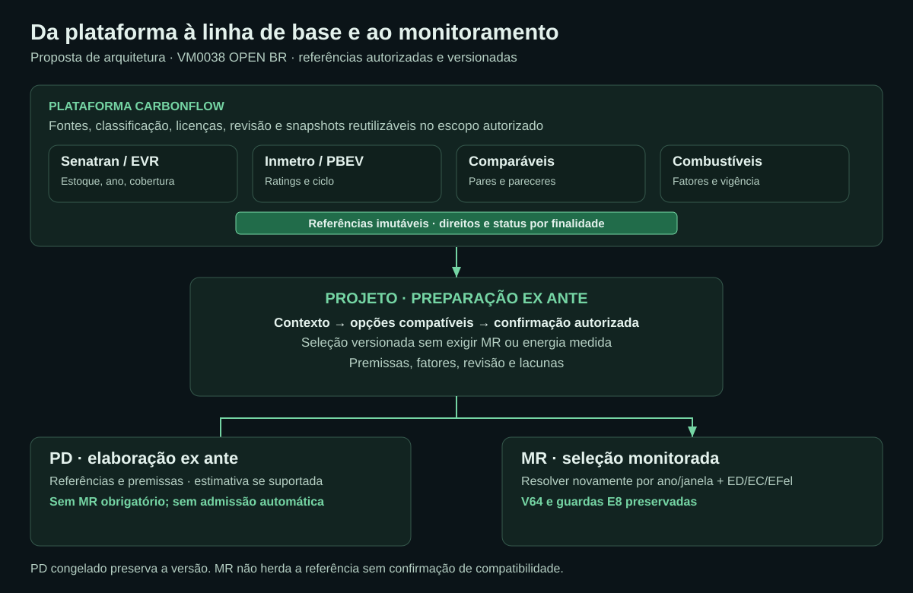
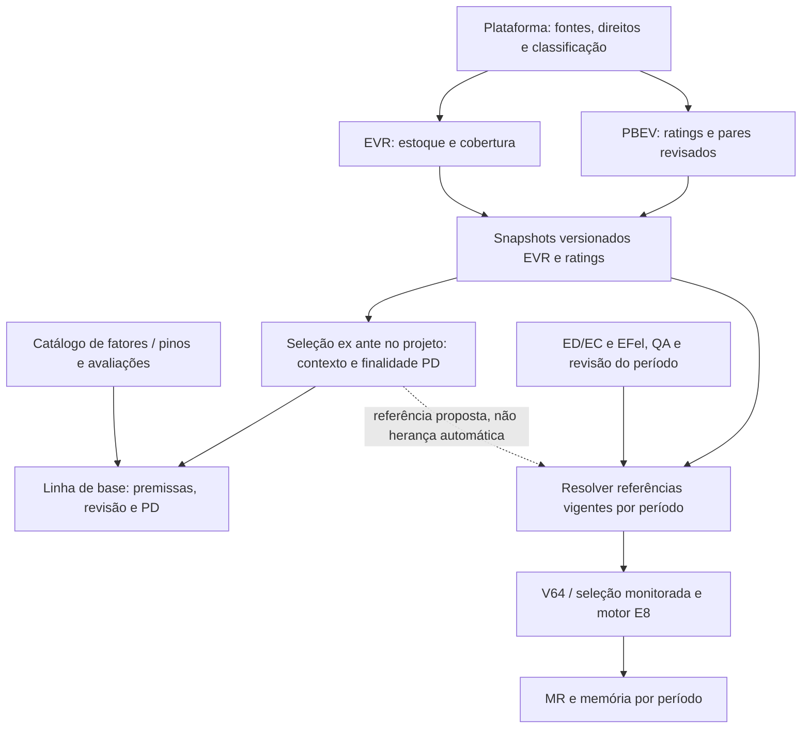
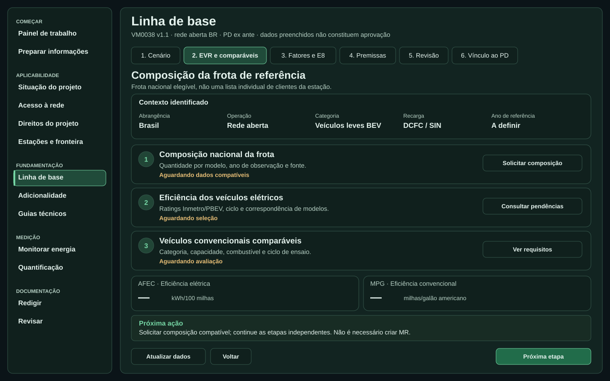
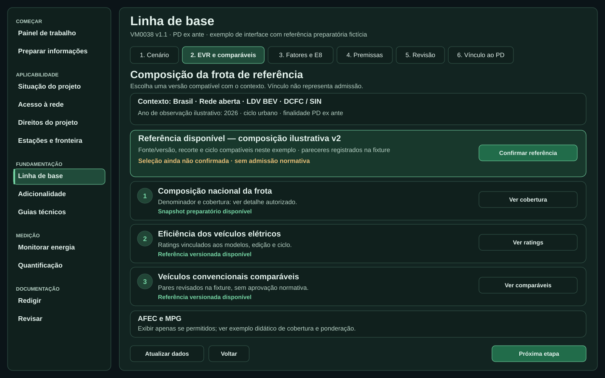
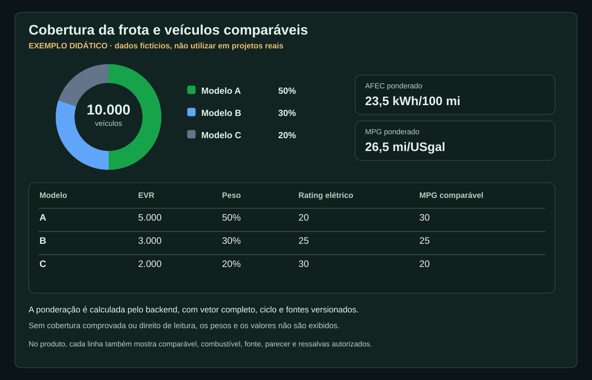

# CF-UX-TECH-001 — Frota EVR, comparáveis e fatores na linha de base ex ante

**Status:** especificação de produto e arquitetura, P0, solicitada pelo responsável em 26/11/2026. **Não implementada por este PR.** Corte de inspeção: `cc25f64b85900fdba6be115bb0f8bf764f0e6d4b`. Nível D17: J03 Preparação técnica (pacote de metodologia/edição + jurisdição + projeto), J04/J05 apenas quando o ato e o plano de monitoramento exigirem; conferir os nomes e incidência na [jornada canônica](../specification/CF-JOURNEY-001.md). O núcleo segue agnóstico: EVR, PBEV, DCFC, AFEC/MPG e EFfuel são requisitos do adaptador OPEN, não universais.

Owners: #40 seleção/decisão da linha de base; #124 experiência e projeção; #94 catálogo/composição EVR; #95 ratings e pares; #96 fatores e IR/Dy; #97 executor e seleção monitorada; #98 energia e períodos; #92/#33 fontes, direitos, provas; #13/#19 requisitos e tarefas; #128 proveniência; #122/#43 vínculo documental; #101/#45 homologação e segurança. Preservar #124 UX-08D.1–.4 já priorizados (catálogo de combustível) e D21/Q13, inclusive guardas. Não abrir outro épico, ledger, cálculo ou catálogo.

## 1. Diagnóstico verificável e problema de negócio

O usuário ainda não cadastrou a frota no ambiente local. Informou que concluiu a revisão interna do catálogo de combustíveis e falta a independente; o banco local não foi inspecionado. A tela atual (Linha de base → 2. EVR e comparáveis) diz “Nenhum período MR consultável. Prepare o monitoramento para vincular uma frota à etapa de cálculo.” e só oferece abrir monitoramento/dossiês, atualizar e avançar. Isso confunde **ausência de fonte de frota**, **ausência de seleção** e **ausência de período operacional**; um novo PD pode preparar a fundamentação sem haver um MR ou energia medida.

Evidência:
- [Contrato UX anterior](CF-UX-TECH-001-BASELINE-ADDITIONALITY-PD-INTEGRATIONS.md): DecisionWorkbenchComponent consulta dossiês MR e as seleções por período; mostra metadados, não edita a seleção.
- [OpenE8FleetSelections](../backend/src/main/java/br/carbonflow/pilot/OpenE8FleetSelections.java): Option/Input incluem period e energyBindingId; options exige vínculo energético vigente; pin valida energia corrente, ano e snapshot de ratings. Leitura em OpenE8FleetSelectionProjectResource sob dossiê. V64 é um handoff operacional, não um cadastro de premissas do PD.
- [PR #132](https://github.com/leonardobrain42/carbonflow/pull/132), [handoff V64](CF-OPEN-008-EVR-RATINGS-PROJECT-HANDOFF.md), [platform-ratings.html](../frontend/src/platform-ratings.html): equipe com MFA/grant publica referência ao projeto/período. Essa dependência continua correta para a seleção monitorada que ela implementa. Não tornar energyBindingId nulo na V64 nem alterar seu contrato para simular PD.
- [EVR](CF-OPEN-005-EVR-STOCK-BR.md): V48 e V108–110, identidade/modelo/aliases, classificação com evidência, fila de candidatos, composição, cobertura e snapshot. Amostra RENAVAM [#211](https://github.com/leonardobrain42/carbonflow/pull/211): 22.849.046 linhas, 136.424.856 registros de veículos no universo analisado, **não** denominador elegível. A classificação/identidade e a reconciliação ainda precisam de dados reais. Ferramentas offline: build_evr_stock_csv, extract_pbev_electric, match_senatran_pbev, build_fleet_model_registrations e reconcile_fleet_catalog; não equivalem a admissão.
- [Ratings](CF-OPEN-006-PBEV-RATINGS.md): V49, unidade/ciclo, comparação técnica e revisão segregada, snapshot e ponderação. [#307](https://github.com/leonardobrain42/carbonflow/pull/307) extraiu 174 linhas elétricas de 2025 e 186 de 2026, não universo de estoque nem importação persistente completa. [#308](https://github.com/leonardobrain42/carbonflow/pull/308) candidatos de alias, não decisão. #94/#95 abertas.
- [Catálogo de combustível](CF-DATA-009-VINCULO-CATALOGO-COMBUSTIVEL.md): V116 aceita CATALOG_REFERENCE, revisão interna permite pino preparatório; a #124 UX-08D.1 corrige interface antiga. D21/Q13, guarda EF_FUEL_WINDOW e IR por conjunto de pinos permanecem conforme implementação/decisões vigentes; V117 registra declaração de transição (rc.92), não remove guardas.
- [PD](CF-TRUST-001-PD-FLEET-CONTEXT.md), #208/#221: leitura de referência operacional sem copiar números licenciados ou aprovar o documento.

**Diagnóstico:** infraestrutura de catálogo/snapshots existente, aquisição/admissão incompletas; falta seleção **ex ante** com contrato próprio de finalidade/contexto, exposição no workbench e UX acionável. Não resolver com mudança de rótulo, dummy M1/MR, dados simulados, nem permissões ampliadas.

## 2. Jornada desejada





O fluxo real é paralelo: direitos, adicionalidade, estações, planos e redação não dependem de uma frota pronta. PD ex ante pode documentar cenário, fontes, premissas e lacunas sem apresentar resultado numérico indevido. Estimativa ex ante (se disponível e permitida pelo motor/pack) usa **entradas planejadas explicitamente**, jamais kWh medido inventado, e permanece distinta de cálculo monitorado, admissão e ato externo. O cálculo monitorado resolve versões efetivamente incidentes e mantém suas guardas V64/E8. Uma mudança de ano ou vigência não atualiza referências congeladas silenciosamente.

### 2.1 Plataforma — preparar uma composição reaproveitável, com autorização
1. Cadastrar fonte/direitos/finalidade e edição (origem, observação, hash, locator); decidir licenças, escopo, território, dados permitidos. #92. Não confundir fonte pública com redistribuição autorizada.
2. Adquirir fonte de estoque; reconciliar universo, ano de observação, propulsão, classe, compatibilidade DCFC e circulação. Distinguir ano de fabricação, ano do projeto, ano civil, vintage e observação. Usar fila de aliases V108–110, decisões e classificação com provas. Desconhecido fica pendente; não promover vendas/registro bruto a circulação ativa.
3. Produzir EVR por modelo e snapshot imutável. Exibir contagem de modelos, denominador, cobertura, total de referência, diferença e lacunas quando autorizados; sem inventar peso, excluir silenciosamente modelo ou impor percentual de cobertura não definido pelo método/política. Respeitar decisão de cobertura existente e requisitos #94.
4. Associar eficiência de cada BEV a edição/ciclo/unidade PBEV e modelo canônico. Propor comparável fóssil, comprovar categoria/capacidade/serviço/ciclo/mercado e combustível, obter avaliação por ator autorizado distinto quando exigido. Sem aprovação por IA ou por similaridade textual. Separar alias, classificação, rating e comparabilidade.
5. Gerar FleetRatingSnapshot ligado à composição EVR, mesma população e ano, denominador e vetor completos; ponderar AFEC e MPG no serviço existente. Revisão, publicação preparatória, admissibilidade e autorização de leitura são eixos distintos.
6. Disponibilizar referências para contextos autorizados (atualmente mesma organização e direitos aplicáveis). **Não** abrir catálogo restrito entre tenants: reaproveitamento interorganizacional depende de licenças, autorização e desenho próprio #92; não copiar dado licenciado em tabela de projeto ou ampliar grants para cumprir UX. Manter rechecagem/revogação/expurgo conforme contratos.

### 2.2 Projeto — preparar e confirmar referências
1. Identificar recorte do projeto e data/intervalo de referência para o ato PD; mostrar método/edição, jurisdição, rede aberta, LDV BEV, DCFC, SIN, ano de observação requerido resolvido pelo pack/decisão. Se faltar data/contexto, apontar a tela dona, não escolher ano atual silenciosamente.
2. Consultar projeção contextual autorizada dos snapshots; distinguir fonte inexistente, fonte disponível porém não publicada/revisada, incompatibilidade, cobertura insuficiente, falta de ratings/pares, acesso restrito, seleção pendente, seleção vigente e obsoleta. Mostrar candidato compatível e justificativa (com versão/ano/ciclo/escopo), sem selecionar valor não autorizado.
3. Usuário com autoridade efetiva confirma referência e motivação; preparador sem autoridade solicita vinculação ao responsável pelo fluxo #26 (ou encaminhamento explícito quando integração ainda indisponível; nunca mostrar solicitação fictícia). Publicação continua com competência, MFA e escopo equivalentes ao handoff atual. Mesmo único candidato exige confirmação. Revisão independente exigida pelos owners não pode ser dispensada para concluir seleção apta.
4. Relacionar combustível dos pares ao catálogo de EFfuel, EFel/IR/Dy quando incidentes; recomendar sem fallback. Não presumir gasolina C ou CO2_ONLY sem contexto metodológico documentado; manter D21, gates de janela, revisões e licenças.
5. Mostrar premissas versionadas, parecer, pendências, prévia do PD e proveniência. A seleção preparatória é utilizável para elaborar a documentação interna quando permitido, não é admissão E8/Verra/VVB. A memória de cálculo e o resultado vêm do executor #97, não de cálculo Angular.
6. Ao iniciar monitoramento, resolver referências para janela efetiva e ano do projeto; se referência ex ante compatível e vigente, oferecer como candidata para confirmação, não herdar automaticamente. Seleção V64 continua exigindo energia/QA, ano e demais guardas. PD congelado preserva as referências originais; relatório posterior aponta versão efetiva e divergência justificada.

## 3. Especificação funcional da tela

### 3.1 Layout e navegação
Preservar sidebar, rota e links existentes do workbench (`?secao=linha-base&etapa=...`); resolver identificadores atuais, não inventar URL pública. Dentro da linha de base, seis etapas estáveis: (1) Cenário, (2) EVR e comparáveis, (3) Fatores e E8, (4) Premissas, (5) Revisão, (6) Vínculo ao PD. O rótulo de etapa 3 pode evoluir para “Fatores e prontidão” com alias de rota. A seção EVR só aparece quando incidente no pacote; não impor em outros métodos. Navegação livre entre tarefas independentes, sem remount de menu; “Próxima etapa” preserva rascunho e não significa aprovação. Cabeçalho com projeto/método/edição, ato, objetivo e stepper. Sem acordes repetidos ou jargão sem ajuda.



**A — Contexto identificado:** país/jurisdição, operação, categoria, recarga e ano de referência (ou “a definir”, CTA para contexto). Mostrar motivo “a frota nacional de referência não é a lista de clientes”. Informação de origem somente leitura; correção leva à ficha canônica. Nenhum MR requerido.

**B — Três blocos de trabalho:**

| Bloco | Conteúdo e estados | Ação principal |
|---|---|---|
| Composição da frota EVR | Fonte/versão, ano, geografia, cobertura, denominador/modelos quando permitido, lacunas, decisão e status | Consultar fontes compatíveis / Solicitar composição / Ver cobertura |
| Eficiência dos BEVs | Edição PBEV, ciclo, associação de modelos, unidades e cobertura; ausência de rating por modelo | Ver ratings e pendências / Solicitar complementação |
| Comparáveis convencionais | Modelo/variante, categoria, capacidade, serviço, ciclo, combustível, justificativa e parecer; incompatibilidades explícitas | Ver pares / Solicitar revisão técnica |
| Resumo derivado | AFEC kWh/100 mi, MPG mi/USgal; origem/versão e escopo; ausente = travessão, restrito = rótulo; não calcular no navegador | Ver memória de ponderação se autorizada |

**C — Escolha contextual:** lista/selector com versões elegíveis; filtros por ano/escopo sem suprimir motivos; descrever incompatibilidade e opção de solicitar fonte. Se várias elegíveis, usuário autorizado decide com justificativa; preview antes de confirmar, sem duplicar snapshots. Exibir estado do vínculo e base de revisão. Alterar seleção cria nova versão; conflito preserva edição e permite recarregar. Revogação oculta campos e remove CTAs incompatíveis imediatamente. Sem números licenciados na UI/API/exportação/cache sem direitos.



**D — Inspeção da cobertura e pares (painel expansível ou subrota, não formulário paralelo):** tabela paginada, ordenação/busca por modelo, filtro de pendências. Colunas: modelo/variante e chave canônica; quantidade EVR/peso; rating elétrico/unidade/ciclo; comparável e combustível; rating fóssil/MPG; motivo/estado de avaliação; fonte e edição/locator autorizado. Totais reconciliados pelo backend, cobertura/missing explicitamente informados. Gráfico de distribuição opcional com tabela acessível equivalente; não mostrar percentuais se denominador não verificado ou acesso não permitido. Projeção de números apenas quando licenças autorizarem; caso contrário, mostrar metadados e status. Exemplo didático abaixo **não é fonte brasileira** e não entra em seeds ou fixtures de produção.



Exemplo exclusivamente didático: 5.000, 3.000, 2.000 veículos com ratings elétricos 20,25,30 kWh/100 mi e comparáveis 30,25,20 mi/USgal. AFEC = 23,5 e MPG = 26,5 conforme ponderação por EVR do serviço existente. O exemplo explica o cálculo, não substitui norma, cobertura ou pares reais; não usar como fallback. 

**E — Rodapé e feedback:** “Atualizar dados”, CTA contextual autorizado, “Voltar”, “Próxima etapa”; preservar foco, scroll e estado de etapa após voltar; feedback de salvamento/solicitação somente após resposta bem-sucedida. “Como entrará no PD” aponta ao bloco e estado, não marca documento pronto. Se revisão independente pendente, distinguir do vínculo preparatório; não reusar status de revisão de combustível como aprovação de frota. Erros de rede não viram ausência.

### 3.2 Estados da projeção (nomes lógicos, mapear enums existentes antes de criar novos)

| Estado lógico | Mensagem | Próxima ação | Efeito |
|---|---|---|---|
| CONTEXT_REQUIRED | Falta contexto de referência | Completar cenário/data | Seleção bloqueada, outras tarefas disponíveis |
| SOURCE_MISSING | Nenhuma fonte elegível cadastrada | Solicitar fonte | Sem números |
| PENDING_SOURCE_REVIEW | Fonte existe, aguardando revisão/direitos | Aguardar equipe técnica | Não oferecer como apta |
| INCOMPATIBLE | Ano/escopo/versão/ciclo incompatível | Revisar contexto ou fonte | Sem fallback |
| COVERAGE_PENDING | Cobertura nacional não demonstrada | Consultar lacunas autorizadas | Sem AFEC/MPG aptos |
| RATINGS_OR_PAIRS_PENDING | Modelos sem rating/par aceito | Solicitar complementação/revisão | Não descartar pesos |
| READY_TO_SELECT | Referência preparatória compatível | Selecionar/confirmar com grant | Não admitir |
| SELECTED_PREPARATORY | Referência selecionada, revisão/admissão pendente quando aplicável | Ver referência/solicitar revisão | PD preparatório; sem liberação normativa |
| STALE | Referência requer rechecagem | Consultar motivo, criar sucessora | Preservar passado, bloquear novo uso quando incidente |
| RESTRICTED | Informação indisponível para esta conta | Solicitar acesso quando permitido | Sem IDs/contagens/valores protegidos |
| UNAVAILABLE | Falha ao consultar | Tentar novamente | Não presumir ausência factual |
| ADMITTED_FOR_CONTEXT | Somente se owner publicar decisão efetiva de admissão | Ver parecer/escopo | Não implica aprovação VVB/Verra ou VCU |

Diferenciar estado de seleção, qualidade/cobertura, revisão, direitos e prontidão. Um estado de lista não deve absorver todos os eixos. Nas telas administrativas de combustível, OWNER_INTERNAL permite resolução/pino nos limites CF-DATA-009; INDEPENDENT permanece separado. A exigência de parecer independente existente para frota/ratings é preservada; não se transfere política de combustível para EVR.

## 4. Contrato de arquitetura e dados (proposta a implementar)

### 4.1 Dois contextos, fontes canônicas
- **EX_ANTE / PD**: projeto/organização/ambiente, método/edição/branch, cenário e revisão, finalidade/ato, data/intervalo de referência e ano de observação resolvido com regra/versão; sem energyBindingId nem MR obrigatório. Serviço owner #40 reutiliza validadores de #94/#95, licenças e autorização atuais. Definir contexto de ano e conflitos antes de persistir; não converter ano de observação em ano relativo do projeto.
- **MONITORED / MR**: V64 e OpenE8FleetSelections intactos, periodCode, energyBindingId e versões ED/EC/EFel, cobertura temporal e gates. #97 controla snapshots de execução. Reusar referência ex ante somente se nova resolução confirmar contexto, direitos e vigência. Se incompatível, motivo e seleção explícita.
- Usar entidade/serviço de seleção de linha de base existente se houver contrato adequado; no corte, o vínculo V64 é monitorado. Fazer inventário antes de escolher armazenamento. Se necessário, migração aditiva para referência ex ante versionada em #40, sem tornar campos V64 opcionais e sem catálogo paralelo. Não alterar migração publicada ou hashes de fixtures.

### 4.2 Referência versionada (campos lógicos, não contrato wire final)
```text
BaselineFleetSelection
  id, projectId, organizationId, environment, version, supersedesRef?
  methodologyId, edition, branch, normativePackageRef
  scenarioRef@version, purpose=PD_EX_ANTE, actContextRef
  referenceInterval, observationYear, resolutionRuleRef@version
  fleetSnapshotRef@version/hash, ratingSnapshotRef@version/hash
  coverageDecisionRef, cycle, reviewRefs, rightsContextRef
  selectionRationale, actorId, selectedAt, canonicalDigest
  selectionState, reviewState, admissionState, invalidationReasons
```
Persistir referências imutáveis, não valores protegidos duplicados. Campos derivados e status vêm de owners na leitura. Hash protege integridade, não autenticidade da fonte nem validação normativa. Dados canônicos permanecem nas V48/V49; manter PK/FK/escopo e concorrência. Publicação não implica cross-tenant. Ações com idempotency key, If-Match, lock/constraint para versão, auditoria, retorno 201/200, 409 contexto inválido, 412 concorrência, 401/403/404 conforme política existente, 422 input inválido. Não retornar dados sensíveis em erros.

### 4.3 API candidata (nomes propostos, verificar contratos existentes)
| Operação | Intenção |
|---|---|
| GET /v1/projects/{project}/technical/baseline/fleet-context | Projeção autorizada de contexto, seleção, lacunas, ações e refs visíveis; sem consulta a APIs staff pelo cliente |
| GET /v1/projects/{project}/technical/baseline/fleet-options | Opções filtradas e explicadas conforme grant/rights; se restrito devolver estado sem metadados protegidos |
| GET /v1/platform/.../baseline-fleet-selections/options | Opções administrativas contextualizadas, sem depender de V63/MR; reaproveitar serviço canônico |
| POST /v1/platform/.../baseline-fleet-selections | Confirmação staff/MFA/escopo, referências + contexto + justificativa, If-Match/Idempotency-Key |
| GET /v1/projects/{project}/technical/baseline/fleet-selections/{id} | Histórico/detalhe exato autorizado, sem substituir versão por latest |
| Fluxo de aquisição #26 existente | Pedido real de dados/vinculação quando capability permitir |

Os nomes são sugestões, não endpoints existentes. Preferir extensão de serviço/recurso já apropriado. Se confirmação por projeto não tiver autorização, manter ação staff; não introduzir POST de colaborador só para cumprir mockup. ProjectWork/RequirementGraph projeta o mesmo item por requisito, finalidade e objeto; sem duplicar tarefas. Cache privado/no-store; segurança backend; paginar listas e mascarar campos conforme direito. Cancelar/ignorar resposta tardia após troca de contexto, saída, revogação. A UI usa motivo em linguagem comum, código estável apenas como referência.

### 4.4 Temporalidade e obsolescência
Snapshot selecionado não se altera; mudanças de edição, triagem/contexto, fonte, cobertura, alias, rating/par, decisão ou direito reavaliam somente dependentes afetados. Alteração de energia/MR não invalida seleção ex ante por si só. Alteração relevante de contexto deve tornar seleção anterior stale para novo uso, não apagar PD congelado. Período monitorado mantém V64; referências históricas continuam recuperáveis se direitos permitem, caso contrário expurgo/redação pelos owners sem restaurar dado proibido. Não redefinir D21/Q13, IR, Dy nem defaults; delegar aos contratos vigentes.

### 4.5 Segurança e papéis
PREP prepara, consulta e solicita conforme grants; PP acompanha e confirma o que sua autoridade permite, não assume staff; OP opera ED/EC, sem acesso automático à fonte restrita; REV avalia somente com competência/independência aplicável; gestor de fontes com MFA e escopo publica referência; administrador não recebe acesso irrestrito por título. Proibir autor/revisor incompatíveis quando owner exige. Testar ausência/revogação de grant, projeto/tenant fora do escopo, licença por operação, replay, acesso por URL direta e histórico. Dados sintéticos só em fixture isolada, nunca fallback no projeto próprio.

## 5. Integração com cálculo e documentação

| Saída | Fonte canônica | Limite |
|---|---|---|
| Cenário e seleção EVR/PBEV do PD | #40, #94/#95 | Ex ante; referência e versão/parecer, lacunas; não copiar dados vedados |
| Fator fóssil e elétrica/IR/Dy | #96 e UX-08D.1–.4 | Referências por finalidade, janela, fronteira e revisão; não deduzir admissão |
| AFEC/MPG ponderados | VehicleRatingService/VehicleRatingsMath | Valores apenas quando válidos e autorizados, nenhuma conta Angular |
| BE estimada | #97, modo ex ante se existente/implementado | Premissas planejadas, claramente estimativa; não exigir MR para fundamentação |
| BE/PE/LE/ER monitorados | E8 + V64 + energia #98 | Entradas medidas e guardas do período; não aliviar condições |
| PD/MR | #122/#43 e #128 | Referência exata/snapshot, proveniência, limites, revisão; preservar artefato congelado |

Mapear BaselineDocumentOutput da #40 ao bloco PD sem gravar narrativa automaticamente. Na leitura atual de OpenPdBaselineNote, preferir referência ex ante para a finalidade PD após o contrato; manter referência histórica monitorada explicitamente rotulada, sem fazer fallback silencioso. Ausência de MR não é pendência impeditiva da fundamentação PD, mas MR/quantificação monitorada conserva suas pendências incidentes. Sem números aptos = nulo, não zero. Nenhuma alteração libera VCU.

## 6. Fatiamento priorizado e dependências

| Ordem | Fatia | Entrega/owner | Dependências e aceite |
|---|---|---|---|
| P0-A | UX-08D.1 | #124: fechar catálogo combustível → pino já priorizado | API existente, teste UI real de CATALOG_REFERENCE |
| P0-B | BL-EX-01 | #40 + #97: contrato e serviço ex ante | #94/#95 snapshots; fixture controlada, zero MR; isolamento e guardas; sem tocar V64 |
| P0-C | BL-EX-02 | #124 + #40: contexto/seleção e estados na etapa 2 | BL-EX-01; empty, seleção, revisão, retorno, deep link; preparar outras tarefas |
| P0-D | BL-DATA-01 | #94/#95/#92: operação de dados real em paralelo | Classificar/conciliar estoque, licenças, importar ratings/pares, avaliar cobertura e revisar; não bloquear desenvolvimento com fixture |
| P0-E | BL-EX-03 | #124 + #13/#19 + #122: diagnóstico por ato, projeção e PD | BL-EX-01/02 + UX-08D.2/.3; eliminar bloqueio MR universal e vincular referência exata |
| P1 | BL-EX-04 | #128/#124: inspeção de cobertura, pesos e pares | Direitos, API paginada, gráfico/tabela acessível e estado restrito |
| P1 | BL-EX-05 | #97/#98: handoff monitorado e rechecagem | Contexto temporal e V64 vigentes; confirmar nova seleção; sem herança automática |
| P0 gate transversal | BL-QA | #101/#45: homologação incremental e E2E | Segurança, dados reais autorizados, UI, regressão PIL-SYN, sem aprovação presumida |

P0-A segue primeiro; P0-B/C podem avançar em paralelo ao trabalho técnico D21/Q13 e dados P0-D. BL-EX-02 é complementação de UX-08D.4, não PR duplicado. UX-08D.2/.3 deve usar os contratos e diagnósticos comuns, não repetir componente específico. Ao finalizar cada PR indicar critério BL-Txx coberto, teste executado, limitações e dependência residual. Sem fechamento artificial de #124/#40/#94/#95/#97.

## 7. Critérios verificáveis (planejados, não testes executados)

| ID | Cenário / aceite | Owner |
|---|---|---|
| BL-T01 | Projeto novo OPEN válido sem MR/ED/EC: contexto ex ante acessível; selecionar snapshot autorizado com fixture válida sem criar dossiê ou energia fictícia; PD recebe ref exata e sem admissão automática | #40/#97/#124 |
| BL-T02 | Sem estoque/catálogo: mensagem correta e ação de aquisição; sem snapshot criado, sem percentuais ou zero; próxima etapa independente acessível | #94/#124 |
| BL-T03 | Estoque candidato, vendas/registro sem prova, cobertura desconhecida/denominador inválido: nunca composição apta; razão e dono explícitos | #94 |
| BL-T04 | Modelos sem rating/alias/par aceito ou ciclo/combustível incompatível: lacuna por modelo sem descarte silencioso; sem AFEC/MPG aptos | #95 |
| BL-T05 | Uma/múltiplas referências, ano, geografia, método e direitos divergentes: resolver somente elegíveis; confirmação/justificativa, sem escolha silenciosa | #40/#124 |
| BL-T06 | PREP sem grant, OP, cross-tenant, licença revogada e staff sem MFA: sem gravação nem campos protegidos; acesso direto negado; autorização de leitura distinta | #40/#92/#45 |
| BL-T07 | Duas confirmações concorrentes e replay: conflito recuperável, histórico imutável, mesma chave não duplica; chave divergente recusada | #40 |
| BL-T08 | Alterar modelo/rating/fonte/contexto/decisão/rights: somente dependentes stale; documento anterior íntegro; expurgo/redação conforme licença | #40/#13/#122 |
| BL-T09 | Criar MR posterior e energia reconciliada: V64 exige entradas e versão vigente, reusa ex ante apenas como candidato compatível; mudança de ano exige nova decisão | #97/#98 |
| BL-T10 | Sem energia medida, PD pode prosseguir com lacunas e sem número falso; MR e cálculo monitorado continuam bloqueados; estimativa rotulada se realmente suportada | #97/#122/#124 |
| BL-T11 | Revisão interna do combustível (caso relatado) resolve fator conforme escopo e data; seleção preparatória não promove INDEPENDENT/ADMITTED; E30/E32 e transição seguem D21 | #96/#124 |
| BL-T12 | Tabela/gráfico de exemplo apenas fixture; backend produz AFEC/MPG conhecidos, e campos numéricos omitidos sem direitos; tabela acessível equivalente, paginação | #95/#128 |
| BL-T13 | Desktop 1440×900, mobile 390×844, teclado, foco/aria-current, sem scroll horizontal da página; tabela scroll interno com cabeçalhos; reload/back sem perder seleção | #124/#45 |
| BL-T14 | Erro 401/403/404/timeout, troca de contexto e resposta atrasada: não exibir dados stale/protegidos; mensagem não confunde rede e fonte ausente | #124/#45 |
| BL-T15 | Revisão/PD congelado e histórico: referência exata sem latest automático; nenhum PDF/documento pronto por preenchimento ou vínculo | #122/#128 |
| BL-T16 | Outro método/ramo: não exigir EVR/DCFC/ratings quando não incidentes; sem fallback OPEN/SIM; regressão PIL-SYN e fluxos monitorados | #124/#97/#101 |
| BL-T17 | Teste humano com preparador e gestor: encontrar contexto, distinguir dados ausentes/sem vínculo/restrição, solicitar ou selecionar, voltar ao PD; registrar evidência e ajustes | #101/#124 |

Testes unitários de regras existentes, Quarkus/PostgreSQL em banco limpo, Angular + Playwright, auditoria de autorização e evidência visual real. Mockups SVG abaixo são especificação visual, não screenshots de execução, nem prova de acessibilidade ou funcionamento. Antes de homologar usar base real autorizada e registrar revisão; não cadastrar ou simular parecer em nome do responsável.

## 8. Operação imediata e limites

No sandbox, admin com competência e MFA pode abrir Fontes → Frota EVR / Eficiências e comparáveis para preparar fontes, modelos, aliases, ratings e pares. Consultar guias #94/#95 e direitos antes de importar. Dados de teste não devem ser persistidos no ambiente de trabalho real. O usuário pode trabalhar em paralelo nas partes independentes. Até BL-EX-01/02, vínculo V64 continua exigindo período e energia; não fabricar MR para desbloquear a tela.

**Decisões de desenho propostas pelo autor deste documento:** separar finalidade PD/MR, manter V64 intacta, usar serviço owner #40 e autorização atual, apresentar seletor contextual e detalhes condicionados a direitos, preservar layout dark/verde. A implementação deve confirmar nomes de API/tabelas, mapeamento de estados e disponibilidade de dados. Nenhuma nova interpretação metodológica, mudança de direitos ou admissão foi aprovada neste PR. O estado do banco local e a revisão independente não foram verificados.

## Estado de implementação
**BL-EX-01 implementado em 26/11/2026 (rc.94)** como backend de staff: [CF-OPEN-008-BASELINE-FLEET-EX-ANTE](CF-OPEN-008-BASELINE-FLEET-EX-ANTE.md). Resolve o ponto de desenho "ano de observação ex ante" pela D22 (política interna reversível). Leitura pelo projeto e tela (BL-EX-02) seguem planejadas.

## Complemento de preparação técnica
Ver [Premissas, adicionalidade, direitos, revisão e PD](CF-UX-TECH-001-PREMISSAS-ADICIONALIDADE-PD.md) para V68/V94, telas de revisão, V100, eventos/direitos e composição documental. PT-06 é BL-EX-03/UX-08D.3, não outra entrega duplicada.

## Ampliação da frente de dados
[BL-DATA-01 — pipeline em massa](CF-OPEN-005-006-PIPELINE-FROTA-NACIONAL.md) detalha A–H, importação, reconciliação, fila existente, aplicação de decisões humanas, snapshots e atualização anual. Não exigir cadastro unitário de modelos nem ampliar admissão. Planejado.
