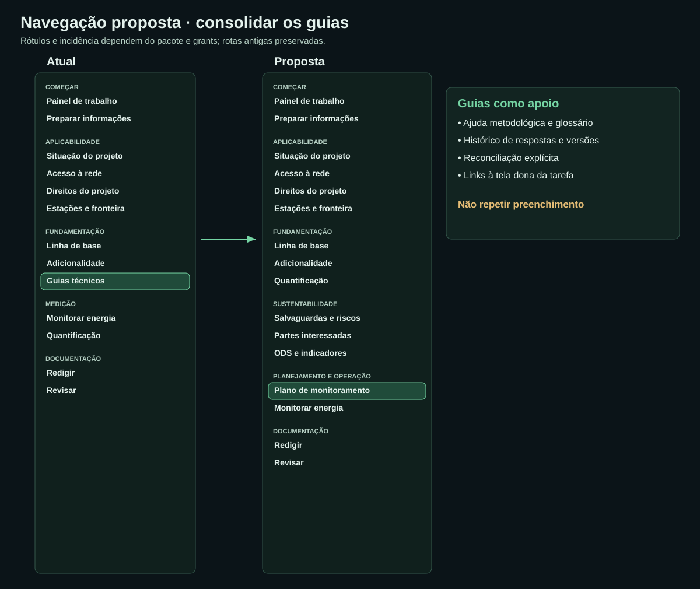
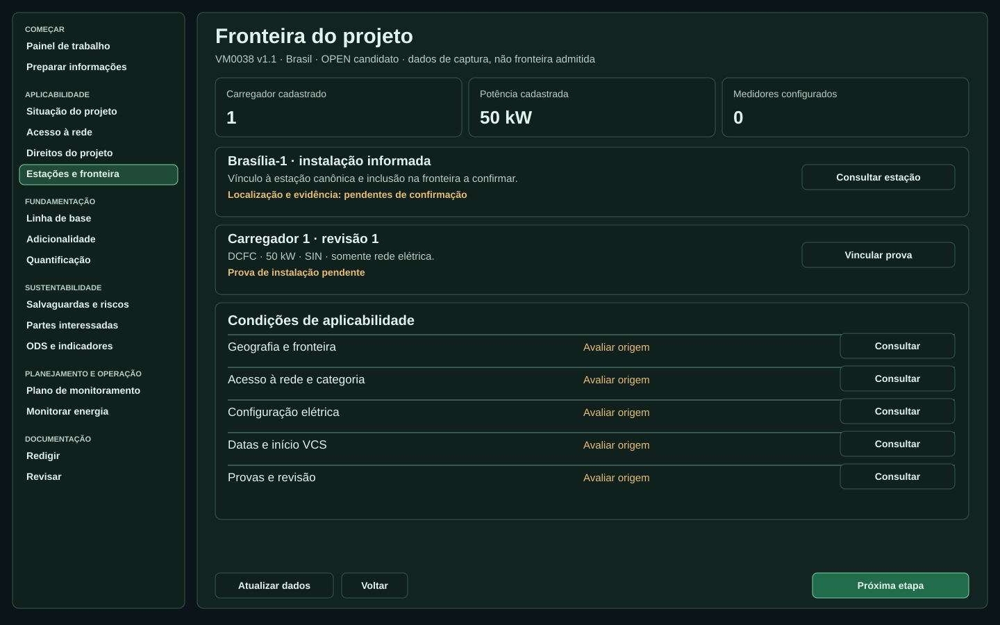
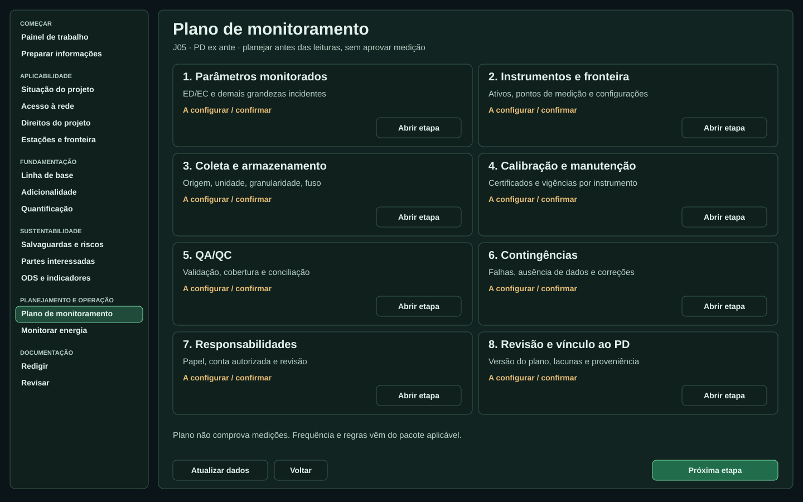
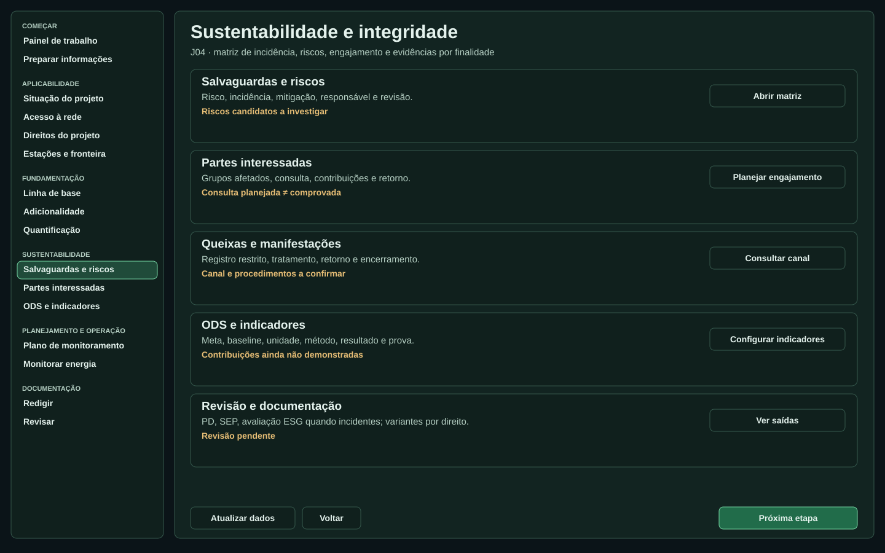
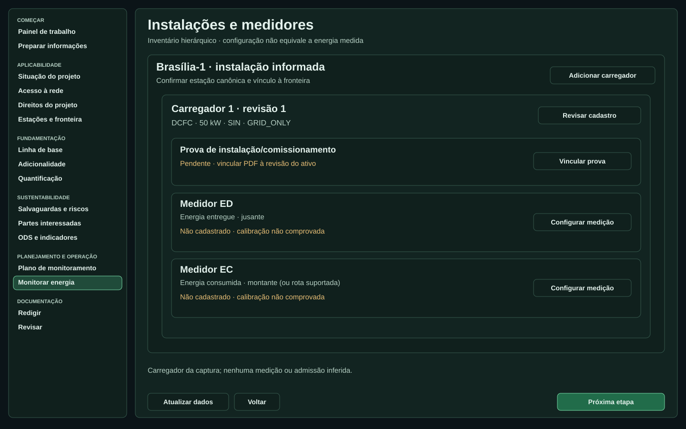
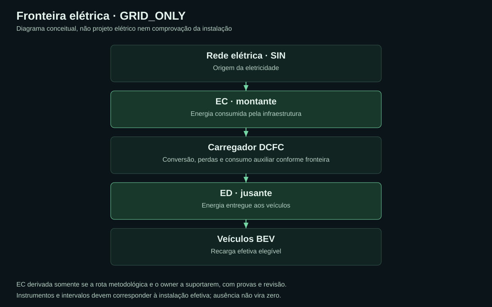
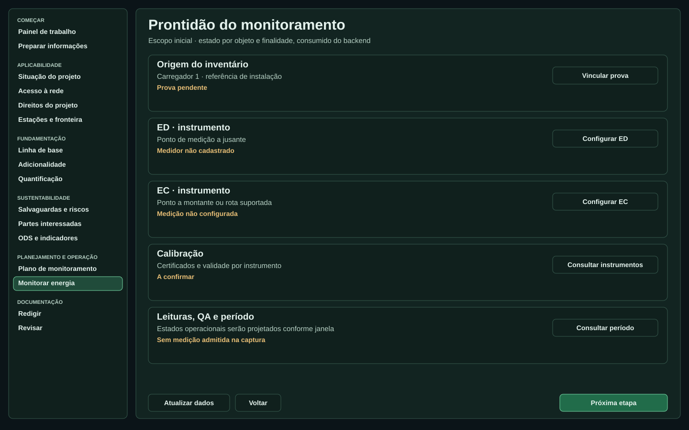
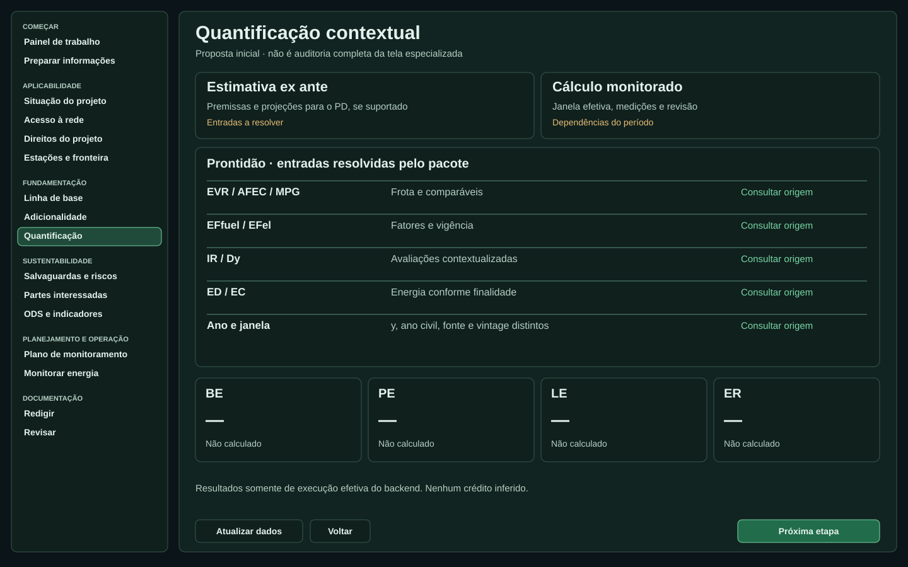
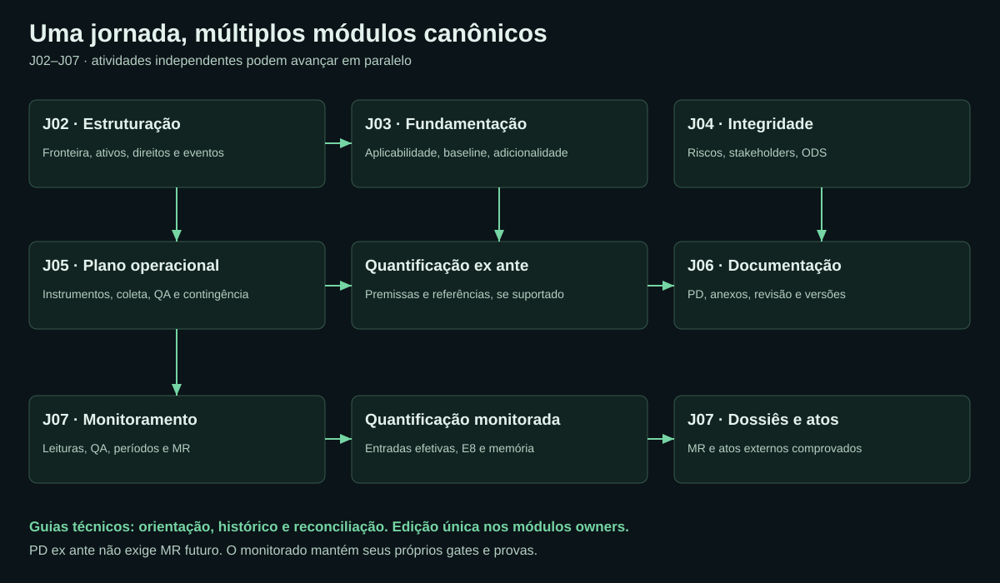

# CF-UX-TECH-001 — Consolidação dos guias, fronteira, sustentabilidade e planejamento operacional

**Status:** especificação de evolução P0 (26/11/2026), não implementada. Complementa [frota ex ante](CF-UX-TECH-001-FROTA-BASELINE-EX-ANTE.md) e [premissas/adicionalidade/PD](CF-UX-TECH-001-PREMISSAS-ADICIONALIDADE-PD.md) no PR #351. Owners #124 e #41/#93/#98/#97/#43/#122 conforme domínio. Marco #124 → #122 PD interno completo; J01–J07 conforme D17/[CF-JOURNEY-001](../specification/CF-JOURNEY-001.md).

**Escopo da auditoria:** dez capturas de Guias técnicos e Monitorar energia > Instalações e medidores, código main cc25f64b85900fdba6be115bb0f8bf764f0e6d4b, #124 e issues owners. Capturas indicam carregador código 1, Brasília-1, DCFC, 50 kW, SIN, GRID_ONLY, revisão 1, zero medidores; não provam inclusão de estação na fronteira, calibração, energia medida nem direito. Não houve acesso ao banco local, execução ou validação normativa independente. A auditoria completa das outras etapas de Monitorar (leituras, ocorrências, QA, dossiês, fator elétrico), da tela especializada Quantificação, Redigir e Revisar foi **explicitamente reservada para próxima análise com novas capturas**. As propostas PT-14/15/16 abaixo são escopo inicial, não diagnóstico integral dessas telas. Não reabrir entregas fechadas #139/#140/#141/#30/#31.

## 1. Evidência e aderência ao marco

| Achado verificável | Evidência | Critério da #124 / ação |
|---|---|---|
| Guias técnicos ainda oferecem seis formulários genéricos, inclusive baseline e additionality também usados nos workbenches | project-guides.html, V68; capturas | UX-RES-02, UX08-T07: consolidar pontos de edição, não afirmar que há duas tabelas |
| Aplicabilidade V68 usa incidence, justification condicional, stationCode, chargerCode condicional, plannedDate e unrestrictedAccess | V68, captura | UX-T02/03/05: relação real de muitos ativos e fatos canônicos |
| Plano atual é seleção ED/EC, frequency e validade declarada | V68 monitoring, captura | J05/#41: plano completo separado de medição |
| Salvaguardas tem consulta prevista, data condicional e contexto livre de risco | V68 safeguards, captura | J04/AGN-07/#41: matriz, engajamento, indicadores, queixas |
| Quantificação guia: início/fim, vintage genérico e multiselect de fontes | V68 quantification, captura | UX08-T09/10, #97: finalidade/recorte e entradas resolvidas |
| Monitorar/inventário: siteCode é input livre, sourceReference textual | open-monitoring.html | UX-T02/03/07: seleção de estação e provas V69 |
| Medidor: chargerCode é seletor existente, ED/EC separados; quatro campos temporais são inputs de texto ISO 8601 | open-monitoring.html, captura | UX-T03/15: formulário assistido, preservar contrato temporal |
| Cards ED/EC têm texto fixo “Pendente de medição admitida”; prontidão prefixada “Não —” | open-monitoring.html | UX08-T01/07/09: projetar estados reais, não liberar cálculo pelo UI |
| project-guides.html alerta calibração por answers()['calibration']/['validUntil'] do guia legado; salvaguardas e quantificação têm avisos estáticos | código | UX-08D: substituir por projeções owners, ausência de evidência ≠ inexistência de consulta |
| PD trace ainda não compõe automaticamente respostas tipadas | capturas | UX-T09, #43/#122: integrar PT-07, não duplicar editor |

Fontes internas: [V68](../backend/src/main/resources/db/migration/V68__typed_guide_definitions_and_answers.sql), [Guias](../frontend/src/project-guides.html), [Monitorar](../frontend/src/open-monitoring.html), [Navegação](CF-UX-TECH-001-MODULE-NAVIGATION.md), [Provas V69](CF-UX-TECH-001-ASSET-EVIDENCE-UX03B.md), [#124](https://github.com/leonardobrain42/carbonflow/issues/124), [#41](https://github.com/leonardobrain42/carbonflow/issues/41), [#98](https://github.com/leonardobrain42/carbonflow/issues/98), [#97](https://github.com/leonardobrain42/carbonflow/issues/97), [#93](https://github.com/leonardobrain42/carbonflow/issues/93). #141 já entrega PDF contextual de SITE/CHARGER com versão, locator, hash, armazenamento criptografado e parecer independente, não admissão normativa. Não duplicar storage.

## 2. PT-09 — navegação e consolidação de Guias técnicos

Manter sidebar estável e rotas legadas (?secao=guias, guia selecionado, deep links de tarefa/PD) acessíveis e autorizadas. Proposta de IA de informação: Começar (painel e informações), Aplicabilidade (situação, acesso à rede, direitos, estações/fronteira), Fundamentação (linha de base, adicionalidade, quantificação), Sustentabilidade e integridade (salvaguardas/riscos, partes interessadas, ODS/indicadores), Planejamento e operação (plano de monitoramento, monitorar energia), Documentação (redigir/revisar). Guias técnicos vira ajuda metodológica e reconciliação/histórico, com links para owner, não mais etapa paralela obrigatória. J04/J05 aparecem conforme pacote, finalidade e grants, não universalizar DCFC ou todos documentos. Não remover caminhos necessários antes de o substituto existir; migração progressiva por guia, com flag/compatibilidade e testes de deep link/checkpoint.

| Guia V68 | Campos | Destino de trabalho único |
|---|---|---|
| applicability | incidence/justification, stationCode/chargerCode, plannedDate, unrestrictedAccess | situação/aplicabilidade #93; inventário #98; cronologia #38/#99; rede #93 |
| baseline | scenario, vehicleClass, referenceYear, efficiencyValue/unit | Cenário/Premissas/EVR #40/#94/#95, PT-01 |
| additionality | route, considered, decision, commitment | Enquadramento/Cronologia #38/#99, PT-02/03 |
| monitoring | energyKinds, readingFrequency, calibrationValidUntil | plano #41, instrumentos #98, PT-11/13 |
| safeguards | consultationPlanned, consultationDate, riskContext | J04 #41, PT-12 |
| quantification | periodStart, periodEnd, vintage, sourceKinds | quantificação #97, PT-15; plano quando hipótese |

Um ponto canônico de edição por fato, permissões equivalentes e estado único; workbench pode reutilizar renderer V68 no contexto. Respostas antigas imutáveis, versão, autor, hash, origem; se equivalência inequívoca, propor ligação confirmada, caso contrário reconciliação explícita; jamais gerar entidade/prova/admissão a partir de texto. “Formulário v2” do guia legado vs “definição v1/revisão 0” tipada devem ser rotulados separadamente, não indicar revisão salva do formulário atual com base no legado. Separar declaração, vínculo, prova, revisão e saída PD. Ajuda curta por campo, histórico em drawer/subrota, botão salvar com motivo se desabilitado, status de rascunho e proteção de alterações não salvas. Não criar novo ledger de tarefas: #13/#19/ProjectWork projeta uma tarefa por requisito+ato+objeto, links validados pelo servidor. UX-T01/08/11/12/13, UX08-T07/08/12.

## 3. PT-10 — aplicabilidade e fronteira multiestações

O guia V68 permite selecionar uma estação e um equipamento, mas não substitui a gestão da fronteira. A UI deve listar todas as instalações e ativos candidatos/selecionados sob autorização, com busca, filtros e cards expansíveis. Reutilizar inventário #98, seleção de fronteira #93 e evidências V69. Se o owner não oferecer associação versionada de múltiplos itens, evoluir de modo aditivo no owner, não criar segunda tabela de estações no guia.

- Estação: identidade canônica, localização/coord. quando fornecida e permitida, situação planejada/instalada/operacional, operador/titular e datas com evidências. Incluir/excluir da fronteira com justificativa, versão e histórico; nunca deletar ativo referenciado por cálculo ou PD congelado. Separar cadastro de inclusão/revisão da fronteira.
- Carregador: código/serial quando aplicável, potência e unidade, tecnologia, conectores e configuração elétrica efetiva, vínculo à estação e prova por versão. Não esconder fatos AC/armazenamento/V2G/geração própria; classificar como fora do ramo/indeterminado quando não suportado e não liberar E8. Não pedir VIN individual em rede aberta.
- Condições: acesso efetivo a BEV compatível vem do módulo Rede; geografia, tecnologia, categoria e alimentação vêm dos fatos/regras #93. Incidência candidata/N/A justificada por critério é declaração, não decisão. Exibir regra/edição, evidência requerida, conclusão/parecer e próxima ação; teste de mercado separado da adicionalidade. Não inferir de propriedade privada ou gratuidade.
- Data prevista, data efetiva operacional, início relevante ao VCS e datas de prova são distintas; remeter à timeline PT-03, sem copiar nem gerar data de início. Ação de vincular/anexar prova via V69 #141/#33 com versão/locator e revisão; não confundir sourceReference textual com arquivo. ACL no backend, isolamento e revogação.

UX-T02/03/04/05/07/10 e UX08-T01/02. Teste com duas estações, vários carregadores, cada ativo com prova própria e atualização seletiva de dependentes; preservar histórico. Sem presumir que o carregador da captura integra fronteira admitida.

## 4. PT-11 — plano de monitoramento ex ante (J05, #41)

O plano não é um MR, nem ingestão de medições #98. Pode existir antes de instrumentos instalados e leituras. Planejar parâmetros incidentes, não exigir um valor real para ED/EC futuro. Derivar requisitos de frequência, unidade e fronteira do pack/rota de cálculo; seleção de frequência não altera a regra. Não inventar frequência universal, norma, prazo ou limite. Expor plano como etapas:

| Etapa | Dados / procedimento |
|---|---|
| Parâmetros | Grandeza, definição, unidade, origem, finalidade, método, frequência/granularidade requerida e planejada, justificativa |
| Instrumentos | Referências canônicas estação/carregador/medidor, ponto na fronteira, configuração prevista vs efetiva, lacunas; EC medida preferida quando incidente, alternativa só com rota suportada e prova |
| Coleta e armazenamento | Sistema origem, formatos, período, fuso, timezone/offset, periodicidade, responsável, retenção conforme política; sem prometer conector inexistente |
| Calibração e manutenção | Instrumento, certificado/prova versionados, validade/agenda de manutenção e substituição; não validade global digitada |
| QA/QC | Regras de unidade, cobertura, duplicatas, lacunas, conciliação ED/EC e fontes, controles, tratamento de exceções; critérios de #98/#97 |
| Contingências | Falha de medição, indisponibilidade, manutenção, comunicação, correção e evidência; ausência não vira zero; substituição só se método/owner permitir |
| Responsabilidades | Papel previsto e colaborador ativo com grant; solicitação operacional #26/#24, competência do revisor |
| Revisão e PD | Plano versionado, justificativa, pendências, referência a regra/ato e saída documental; aprovação interna separada de evidência e execução |

Modelo lógico proposto no owner #41: MonitoringPlanRevision@version (project/context/pack/act, parameterPlans[], instrumentRefs[], procedureRefs[], QA/contingency, plannedRole/assignee, evidenceRefs, reviewRefs). V68/V30-V31 guias iniciais preservados e reconciliados. Validar no servidor, If-Match/idempotência, histórico imutável, referências autorizadas, status planejado/parcial/revisado/stale; não mutar V68. Evitar repetir valores que já vêm de #98. Mudanças de instrumento/rota alteram apenas dependentes relevantes. PD usa versão do plano; MR usa medições, revisão e período efetivos. #98 permanece owner exclusivo de ingestão, QA e instrumentos.

## 5. PT-12 — sustentabilidade e integridade (J04, #41)

O schema safeguards V68 tem apenas consulta prevista/data quando verdadeira e texto de risco. Evoluir para workbench próprio segundo J04; não inferir cumprimento do programa por declaração. Resolver incidência/edição/ato no pack #10/#13/#90 e licenças #92; consulta, consentimento, prazo pré-início e documentos somente quando exigidos. O contrato J04 prevê aprofundar VCS v5 §3.16; não fixar requisito ou número mínimo de ODS neste adendo sem resolução normativa.

### 5.1 Riscos e salvaguardas
Matriz repetível: risco/categoria/grupo/atividade, incidência (sim/não/indeterminada) com justificativa, descrição, probabilidade/severidade quando pertinente, evidência, medida de prevenção/mitigação, indicador/monitoramento, responsável, prazo, ocorrência, ação corretiva, estado/revisão. Exemplos candidatos para recarga: segurança elétrica, acessibilidade, descarte de equipamento e privacidade, não fatos comprovados nem lista obrigatória. N/A exige fundamentação e revisão quando incidente; não assumir baixo risco por atividade climática. CTA revisar risco, vincular evidência ou solicitar ação pelo owner. Preservar histórico.

### 5.2 Stakeholders e engajamento
Grupos afetados, impactos/interesses, canal/representação e critérios de identificação; plano de engajamento, evento planejado vs realizado com datas/canal/participação, material divulgado, contribuições e respostas, compromissos/responsável/prazo, retorno e revisão. Consentimento quando exigido. Reutilizar ConsultationWorkflow e registros existentes quando a finalidade for compatível; não confundir consulta local, consulta pública externa do ciclo J07, recibo, ou divulgação aos motoristas #93. Não presumir obrigação universal, nem fazer recibo sem evento. Prazos oficiais vêm de owner, não do frontend.

### 5.3 Queixas e indicadores
Canal de manifestações, identificador restrito, recebimento, triagem, tratamento, providência, prazo, retorno, encerramento/reabertura e evidência; acesso mínimo, dados pessoais/relatos em espaço restrito, não no PD público. Indicadores/ODS: objetivo/meta, baseline, método/unidade, periodicidade, responsável, resultado comprovado e revisão; ODS 7/11/13 são exemplos candidatos, não contribuições certificadas. Não contar atividade sem prova como impacto. Direitos, dupla reivindicação e instrumentos concorrentes referenciados de #93/#99/#96 sem novo registro paralelo. 

### 5.4 Saídas
Projetar blocos ao PD, SEP, ESG Risk Assessment, ESG Risk Monitoring Report e demais anexos quando incidentes, usando #43/#122 e template vigente, com variantes e redação conforme direitos. Não criar parecer VVB. Dados e relações versionados em #41/owners, documentos #33; autorização por papel e finalidade, especialmente participantes e queixas. Aceite AGN-07, #41; consulta planejada ≠ ocorrida ≠ comprovada; revisão humana e lacuna de norma explícita.

## 6. PT-13 — ativos, instrumentos e provas (inventário de #98)

Preservar quatro subrotas monitorar (inventario, leituras, qa, dossies) e os serviços de #98. Neste adendo apenas a tela de inventário e medidores é auditada. Visual hierárquico estação → carregadores → pontos/medidores ED/EC → documentos, validade e status. Ação contextual “Adicionar carregador nesta estação”, “Configurar medição ED/EC”, “Vincular documento”, “Ver revisões”. Reuso de siteCode e chargerCode; converter input de siteCode em seletor de estações autorizadas (criação no owner). Identidade/código do ativo preservado; se campo legado não resolver, apresentar vínculo pendente para reconciliar, não aceitar novo texto arbitrário como estação comprovada. Não pressupor que todo siteCode atual referencia uma estação persistida. Validar associação e contexto em Quarkus, não apenas filtro Angular.

**Provas:** reusar V69 para SITE/CHARGER e ledger/arquivo de #33/#98; mostrar prova, finalidade, versão, locator, parecer e estado stale; sourceReference textual permanece histórico, não prova. Para MEDIDOR/calibração, verificar contrato de evidências #98 e ampliar associação versionada nele se faltar; não afirmar V69 já suporta METER (suporta SITE|CHARGER). Certificado pode conter vários instrumentos; vínculo exato, identificação/serial, período e revisão; não aprovar por extração de datas.

**Medidor:** código e identidade física, associação/ponto de medição, grandeza ED a jusante ou EC a montante, unidade/método e sistema de origem (seleção canônica se disponível; declaração rotulada caso contrário), certificado, datas de validade/configuração, fuso. Campos de data e hora locais com zona IANA, resumo do offset e UTC enviado em ISO 8601 explícito; backend valida zona/offset, início/fim exclusivo, sobreposição, lacunas, ausência de fim se permitido, intervalos de validade; não supor validade ou timezone desconhecido, resolver horário ambíguo quando incidente. Sugestão do fuso da estação confirmada, não default silencioso. Datas sem hora não viram meia-noite automaticamente sem regra/confirmacão explícita. Não alterar intervalos publicados. Se configuração/certificado não disponíveis, salvar rascunho quando permitido e mostrar pendência real.

**Diagrama:** exemplo GRID_ONLY, SIN → EC (lado da rede) → carregador → ED (lado veículos) → BEVs. Não é projeto elétrico nem comprovação de instalação. Medidor EC compartilhado/alternativa deve demonstrar fronteira, alocação e ausência de dupla contagem conforme owner; não simular medidor físico. #98 prevê rota EC derivada DCFC (§10.2) quando indisponibilidade demonstrada, eficiência e provas revisadas; não habilitar no UI se ainda não suportada. Não calcular EC a partir de ED no Angular. Não confundir faturamento/sessões com medição admitida.

## 7. PT-14 — prontidão dinâmica do monitoramento (escopo inicial)

Substituir literal fixo ED/EC e prefixo “Não —” por projeção canônica #98/#97: configuração, presença de leituras, cobertura/QA, revisão/admissão interna por janela, aptidão para cálculo no ato, pendências. Não usar contagem de medidores como medição. Projeto sem MR pode ter plano pronto para revisão; MR e cálculo monitorado continuam condicionados. Distinguir “sem instrumento”, “configurado sem leituras”, “leituras recebidas”, “em QA/revisão”, “admitido para finalidade” e “rechecagem”, além de indisponível/restrito. Somente usar estados existentes/derivados no servidor; se contrato não suporta projeção positiva, declarar limitação, não criar ready. Cada card/pendência tem objeto exato, motivo, fonte, papel/assignee, ação e link validado; mudança propagada sem duplicar tarefas (#13/#19/UX-08D). Calibração vencida impacta janela afetada, não toda história. Remover avisos fixos dos guias só após novo owner projetar status. Testar estados positivos/negativos e revogação. **Leituras/importação, correções, QA, admissões, dossiês, EFel, VT0011/TOOL07 não auditados integralmente; detalhamento posterior.**

## 8. PT-15 — quantificação contextual (escopo inicial, não auditoria da tela especializada)

Consolidar formulário V68 quantification na tela quantificar e #97: selecionar finalidade (estimativa ex ante, ensaio interno ou monitorado, apenas se modo implementado), contexto e janela. Derivar ano relativo y do calendário e convenção aplicáveis, separar ano civil, observação EVR/ratings, vigência de fator, vintage e M1/M2. Se período cruza ano/transição, dividir ou bloquear conforme owner. Não digitar ano único como substituto da resolução temporal. Lista de entradas é definida pelo pack e resolvedor, não multiselect manual de ED/EC/EFel/EVR/combustível. Mostrar EVR/AFEC/MPG, EFfuel/EFel, IR/Dy e energia conforme finalidade, origem/versão/validade, motivo de bloqueio e link para resolver; D21/Q13 e outras guardas intactas. BE/PE/LE/ER só se run efetivo do backend e autorizado, nulo ≠ zero; não calcular pelo navegador, não usar piloto sintético como dado real, não declarar VCU. Estimativa ex ante, se suportada, usa entradas planejadas explicitamente, não MR fictício. Exibir cálculo monitorado somente com dados efetivos e gates. **Execução E8, memória detalhada, fechamento anual/vintages, comparação/reexecução, revisão e saída PD/MR serão auditadas com as próximas capturas e código.**

## 9. PT-16 — saídas documentais (escopo inicial)

Extensão do PT-07/#43/#122, não novo editor. Mapear fronteira, ativos, avaliação de aplicabilidade, plano ex ante, salvaguardas, stakeholders, ODS e saídas de quantificação a blocos e alegações do template resolvido por pack/ato. Referências imutáveis, documentos/evidência/parecer autorizados, fatos vs planos, lacunas explícitas; dados derivados read-only e narrativa humana editável. Reusar PdTrace e editor, não preencher automaticamente com dados não confirmados nem sobrescrever documento congelado. Histórico e stale seletivo; variantes pública/restrita e privacidade. **A UX de Redigir/Revisar, exportação, revisão de seção e manifesto não foi auditada integralmente neste adendo.** Não declarar PD pronto por guia salvo.

## 10. Arquitetura, sequência e gates

| Fatia | Owner / dependência | Prioridade |
|---|---|---|
| PT-09 | #124/#13/#19/#90, consolidar edição, preservar V68/rotas; junto PT-01–07 | P0 |
| PT-10 | #93/#98/#33/#124; reuso UX-03A/B e PT-03/04 | P0 |
| PT-11 | #41/#98/#24/#33/#97; plano ex ante distinto do MR | P0 |
| PT-12 | #41/#33/#13/#35/#43; J04 condicionado ao pacote | P0 |
| PT-13 | #98/#124/#33; reuso inventário e V69, PT-10 | P0 |
| PT-14 | #98/#97/#13/#19/#124; mesma projeção UX-08D.3/PT-06; detalhamento futuro | P0 |
| PT-15 | #97/#96/#124/#128; BL-EX/UX-08D, detalhamento futuro | P0 |
| PT-16 | #43/#122/#128; extensão PT-07, após contratos owners; detalhamento futuro | P0 |
| PT-QA | #101/#45; cada vertical e homologação; não fechar por mockup | P0 |

Preservar ordem previamente aprovada UX-08D.1, BL-EX-01/02 e PT-01–07; frentes J04/J05 e integração de ativos podem avançar em paralelo quando independentes. P0 é criticidade do marco, não ordem de execução de todas as frentes simultaneamente. Dados reais #94/#95 e revisão independente em paralelo. Contratos novos são lógicos: antes de criar tabela/API, inventariar owner, usar schema/versão/refs e migrar aditivamente se necessário. ACL server-side antes de metadata/contagem; RBAC, grant, escopo, licenças, MFA quando aplicável; no-store, conflito If-Match, idempotência, audit trail, historização e rechecagem por dependência. IA opcional, nunca decide norma/revisão. Não alterar migrações existentes, fixtures PIL-SYN ou guardas do E8. Mobile 390×844 e desktop 1440×900, foco/teclado, leitor de tela, controles de data acessíveis, tabela com alternativa textual, rascunho seguro e deep links.

## 11. Critérios de aceite complementares (planejados)

| ID | Caso verificável |
|---|---|
| PT-T19 | Guias V68 com histórico e revisões permanecem acessíveis; uma edição canônica por fato; deep links antigos e checkpoint retornam ao owner autorizado; não duplicar tarefa |
| PT-T20 | Legado não reconciliado mostra versão/texto original e ação, sem criar IDs/prova/aceitação; distinguir versão do guia e resposta atual |
| PT-T21 | Duas estações, vários carregadores, inclusão/exclusão versionadas da fronteira, provas distintas, mudança seletiva, links para rede/cronologia; não VIN individual OPEN |
| PT-T22 | AC/armazenamento/V2G/geração local/indeterminado registrados como fatos quando permitido, bloqueio explicado no recorte OPEN; outro pack sem imposição DCFC |
| PT-T23 | Plano ex ante sem MR/leituras: parâmetros, frequência e método incidentes, procedimentos, QA, contingência, responsabilidades e saída PD; frequência incompatível sinalizada, sem dados fictícios |
| PT-T24 | Plano e medidores vinculados sem duplicação; revisão/versionamento e rechecagem apenas dependentes, perda de medida não vira zero |
| PT-T25 | J04 risco incidente/N/A fundamentado, mitigação, evidência, responsável, prazo, ocorrência e revisão; ausência não aprova; sugestão não prova |
| PT-T26 | Consulta planejada/ocorrida/comprovada e pública/local distintas; data futura não prova; consentimento/prazo conforme ato; manifestação protegida |
| PT-T27 | ODS indicador/meta/baseline/método/unidade/evidência; sem dado não declarar impacto; variantes PD/SEP/ESG somente quando incidentes |
| PT-T28 | Seletor de estação/ativo valida relação no backend, não aceita cross-project ou ID inexistente como válido; provas V69 SITE/CHARGER, medidor por owner #98 |
| PT-T29 | ED/EC e pontos de medição distinguíveis, datas com fuso/offset e fim exclusivo, certificados/intervalos, vencimento e rechecagem; sem alocação/EC derivada fictícia |
| PT-T30 | Cards de prontidão mudam conforme estados efetivos do owner, sem literal fixo nem promoção por configuração; ausência/restrição/rede distintas; monitoramento futuro não bloqueia universalmente PD |
| PT-T31 | Quantificação recebe finalidade e recorte, entradas resolvidas sem seleção manual de grandezas; ano relativo/civil/observação/vigência/vintage distintos; nulos, sem fallback SIM, gates intactos |
| PT-T32 | Saídas do plano/fronteira/J04 e cálculo são referências versionadas; preview não aprova, congelado preservado, privacidade e ACL; #43/#122 |
| PT-T33 | Regressão V68/V69, fluxos OPEN e PIL-SYN, outro pack, cross-tenant, revogação, concorrência, erro/reload, 390×844/1440×900, teclado/leitor de tela, teste humano PREP/OP/REV |

Os critérios complementam BL-T01–17 e PT-T01–18; não substituem UX-T01–18/UX08-T01–12 e AGN. E2E Quarkus/Postgres + Angular, fixture isolada e dados reais autorizados para homologação. **Nenhum teste executado neste PR documental.**

## 12. Pendências de auditoria e limites

O responsável enviará capturas adicionais de Monitorar, Quantificação, Redigir e Revisar. Não declarar lacunas residuais exaustivas nem aprovação dessas telas. Próxima auditoria deve confrontar telas, APIs, serviço, persistência, issues e estados: (a) importação ED/EC/lotes, ocorrências/correção, QA/conciliação, admissão, EFel/VT0011/TOOL07 e MR; (b) execução, memória, resolução temporal, fechamento, reexecução e resultados; (c) outline/template, editor, revisão, claims/provas, manifesto, exportação e freeze. Atualizar PT-14/15/16 sem duplicar entrega. As figuras são mockups SVG originais, não screenshots funcionais; nomes de campos/estados novos são sugestões, não APIs já disponíveis. Sem alteração de código, dado, decisão, norma, licença ou merge neste adendo.

## Atualização das pendências de auditoria
[PT-17–26](CF-UX-TECH-001-MONITORAMENTO-QUANTIFICACAO-REVISAO.md) consolida a análise subsequente de oito capturas legíveis e código (QA visual ilegível), detalhando PT-13–16. Autoria avançada do PD (PT-24) explicitamente reservada a próximo adendo; não confundir esta análise documental com homologação funcional.
