# CF-UX-TECH-001 — Monitoramento, quantificação e revisão documental

**Status:** especificação P0 planejada, 26/11/2026, não implementada. Adendo ao PR #351 e ao marco #124/#122. Complementa [frota ex ante](CF-UX-TECH-001-FROTA-BASELINE-EX-ANTE.md), [premissas/adicionalidade](CF-UX-TECH-001-PREMISSAS-ADICIONALIDADE-PD.md) e [guias/J04/J05](CF-UX-TECH-001-GUIAS-FRONTEIRA-J04-J05.md). Corte da main cc25f64b85900fdba6be115bb0f8bf764f0e6d4b; contratos lidos na branch documental b84ab0cf8af8c1af2804dc32347975eab05fbbf3.

**Decisão de escopo do responsável:** primeiro consolidar a auditoria anterior das jornadas Monitorar, Quantificar, Redigir (visão geral), Revisar e exportação. Reservar a especificação aprofundada de **Redigir PD, editor híbrido e máxima oferta de insumos técnicos** para a atualização seguinte, após conclusão desta atualização documental. PT-24 fica como ponto de extensão, não é retirado do marco nem implementado aqui. Não alterar a prioridade/escopo de #43/#122 já acordados. Esta separação é de entregas de especificação, não uma exigência de terminar toda a operação MR para começar a autoria PD.

**Evidência e limite:** oito capturas legíveis; a nona (presumivelmente QA) tem 1×1 pixel, portanto QA foi analisada pelo código e contratos, não por imagem. Capturas mostram um carregador, zero medidores, onze pendências de pré-cálculo, ausência de período vinculado e prévia documental 4 da revisão técnica 5 frente ao rascunho revisão 6. São estados observados da interface, não inspeção do banco nem homologação. Não executar testes de produto, não promover estados e não encerrar issues por este adendo.

## 1. Diagnóstico ancorado no código e nos owners

| Superfície | Estrutura existente | Lacuna de integração |
|---|---|---|
| Instalações e medidores | V52, inventário e versões, ED/EC, fuso, calibração | PT-13: seleção de site e prova canônica, controles de data e topologia |
| Leituras | V53 CSV cifrado, candidatos/quarentena, revisão V54 | Importação assistida, filtros, resultados de validação, correções rastreáveis |
| Ocorrências | V56 ledger imutável e parecer independente | Seletor de objeto, intervalo local, impacto e evidência contextual |
| QA | V54 snapshot INTERNAL_QA_ONLY, V55 prova, admissão de lote por snapshot | Workbench por janela/ativo, revisão e ações dirigidas |
| Dossiês | V57 vínculo MR versionado, V58 parecer metodológico, V59 pacote horário | Período como contexto de trabalho; distinguir plano, QA, MR e estado externo |
| Fator elétrico/caderno | candidatos EFel e abordagens VT0011/TOOL07; pacotes vinculados | roteiro por rota, dependências, referência e vigência; sem nova regra Angular |
| Quantificação | preflight, seleção temporal, ensaio por período, consulta anual | lista repetida, fallback M1, separar ex ante/monitorado, memória e histórico |
| Redigir | PdSections, PdTrace, narrativa e leituras de proveniência, prévia JSON | visão por documento/template, composição #43; especificação aprofundada PT-24 reservada |
| Revisar | PdReviews, ações de versão, preview legado com PENs | fila por seção/achado, próximo passo, rechecagem seletiva |
| Exportação | contratos #43/#122, saídas iniciais/legadas | pacote DOCX/PDF por template e manifesto; não confundir JSON ou SIM com PD completo |

Referências internas:
- [Ingestão](CF-OPEN-009-MEASUREMENT-CSV-INGESTION.md), [eventos](CF-OPEN-009-OPERATIONAL-EVENTS.md), [QA](CF-OPEN-009-INDEPENDENT-REVIEW-PERIOD-QA.md), [admissão de lotes](CF-OPEN-009-PERIOD-BATCH-ADMISSION.md), [provas](CF-OPEN-009-PERIOD-DOCUMENTARY-READINESS.md).
- [MR/PD stale](CF-OPEN-009-MR-PD-STALE-DEPENDENCIES.md), [parecer metodológico](CF-OPEN-009-INTERNAL-METHOD-REVIEW.md), [energia candidata](CF-OPEN-008-HOURLY-ENERGY-CANDIDATES.md).
- [EFel](CF-OPEN-007-HOURLY-EFEL-SOURCE-CANDIDATES.md), [matriz VT0011/TOOL07](CF-DATA-008-MATRIZ-VT0011-TOOL07.md), [Case 2](CF-OPEN-007-VT0011-CASE2-WORKBOOK.md), [precheck OM A1](CF-OPEN-007-TOOL07-SIMPLE-OM-A1-PRECHECK.md).
- [preflight](CF-OPEN-008-DYNAMIC-E8-PREFLIGHT.md), [runs](CF-OPEN-008-E8-PROJECT-RUN.md), [consulta anual](CF-OPEN-008-ANNUAL-CONSOLIDATION.md), [seleção por período](CF-OPEN-008-PERIOD-INPUT-SELECTION.md). Documentos históricos não substituem as guardas mais recentes do executor, inclusive D21/Q13.
- [Monitorar](../frontend/src/open-monitoring.html), [quantificar](../frontend/src/open-calculation-readiness.ts), [PD](../frontend/src/pd-sections.html), [revisões](../frontend/src/pd-reviews.ts), [workbench](../frontend/src/project-technical.html).
- Issues [#124](https://github.com/leonardobrain42/carbonflow/issues/124), [#98](https://github.com/leonardobrain42/carbonflow/issues/98), [#97](https://github.com/leonardobrain42/carbonflow/issues/97), [#43](https://github.com/leonardobrain42/carbonflow/issues/43), [#122](https://github.com/leonardobrain42/carbonflow/issues/122), [#128](https://github.com/leonardobrain42/carbonflow/issues/128).

## 2. Jornada integrada e finalidade

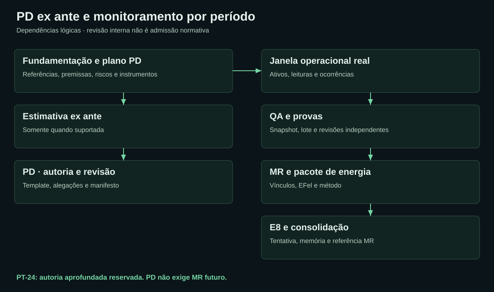

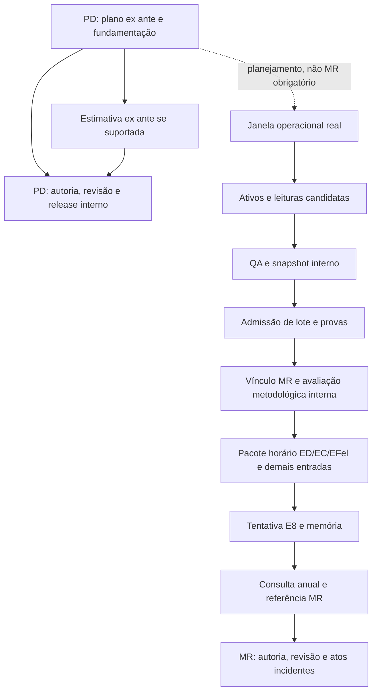

O diagrama é de dependências lógicas, não uma ordem rígida de atos externos; cada gate conserva a ordem, segregação e aplicabilidade do serviço owner. Planejamento PD pode ocorrer antes de qualquer medição; o MR exige dados reais e referências aplicáveis. Não generalizar as equações OPEN para outros packs. PT-13/14/15/16 permanecem, agora detalhados por PT-17–26. ProjectWork/#13/#19 expõe tarefa única por requisito+ato+objeto. Monitorar conserva rotas inventario/leituras/qa/dossies, com contexto de período compartilhado onde pertinente e acesso por grant. A UI sempre distingue plano, candidato, revisão interna, admissão para propósito específico, admissão normativa e ato externo; não promover canRunE8/usableForE8/canIssueVcu.

## 3. PT-17 — importação assistida de leituras e gestão de lotes (#98/#124)

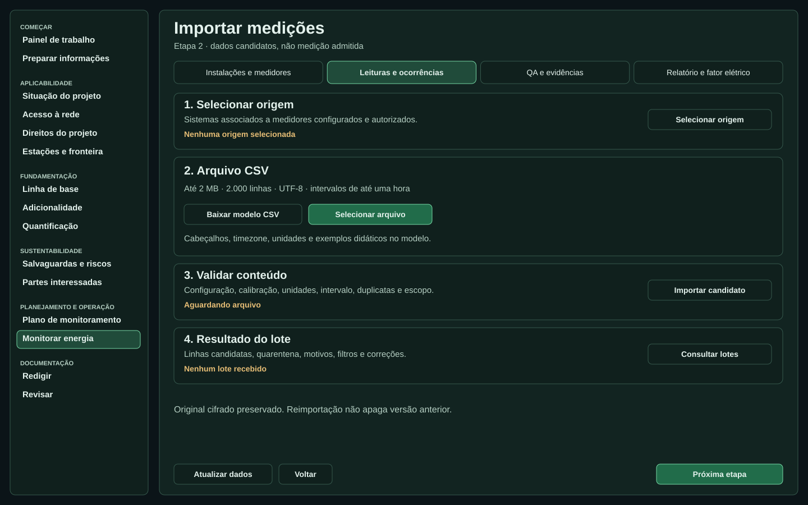

1. Selecionar origem autorizada vinculada a configuração de medidor; listar grandezas, medidores, intervalo e limitações. Sem configuração, ação para PT-13; não digitar ID inexistente como fonte válida. Validar no servidor escopo, origem e vigência.
2. Modelo CSV baixável com cabeçalho exato `meterCode,sequence,kind,start,endExclusive,zone,quantity,unit`, exemplo claramente didático e instruções UTF-8, ISO 8601 com offset, Wh/kWh/MWh, máximo 1 hora por leitura; contrato atual até 2 MB/2.000 linhas. Não incluir PII de motoristas. Download do modelo não cria leitura. Pré-checagem local apenas orientativa; autoridade de validação é V53.
3. Upload via serviço existente com idempotência; preservar original cifrado, nome/hash/autor/instante e resultado por linha. Mostrar sucesso somente após resposta; erros de transporte não significam lote ausente. Nenhuma conversão silenciosa no browser. Prévia de cabeçalhos/linhas limitada e autorizada; arquivos muito grandes recebem instrução de particionamento.
4. Lista paginada de lotes, por origem, janela, ativo, estado e versão; contagem de linhas candidatas, quarentena e erros conforme resposta. Detalhe por linha: índice original, intervalo, grandeza, unidade original/normalizada quando retornada, motivo, estado de parecer e ação. Não representar candidato como energia admitida.
5. Correção: preservar lote/linha anteriores, orientar novo arquivo corrigido e referência à causa/versão conforme contrato do owner; não apagar, editar ou neutralizar duplicata automaticamente. Quarentena não pode receber ACCEPTED_FOR_QA pela UI/API; não criar caminho de bypass. Correção/reimportação deve respeitar dedup e revisão vigente; se faltar contrato de substituição, especificar migração aditiva no owner antes da UX.

Escala: manter limites vigentes até estudo de capacidade e autorização; medir bytes, linhas/hora, medidores, duração, tempo de importação, paginação e concorrência. Suportar múltiplos lotes no mesmo contexto sem perder rastreabilidade; ingestão em massa/conectores comerciais é evolução posterior (benchmark #101/#49), não prometer API ou processamento assíncrono existente.

## 4. PT-18 — ocorrências operacionais e correções (#98/#124)

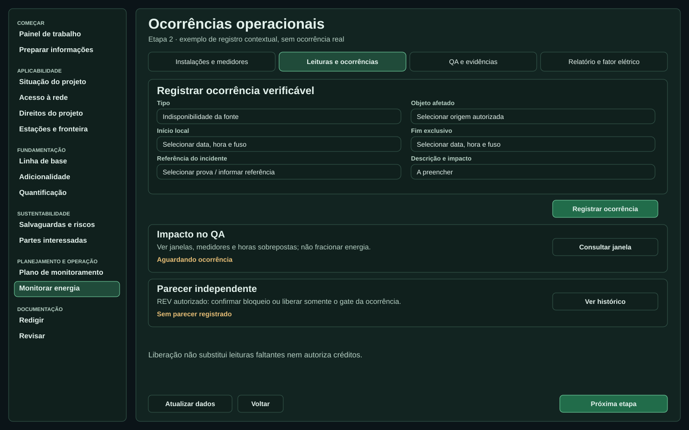

V56 tipos SOURCE_OUTAGE (origem), METER_MAINTENANCE/CLOCK_DRIFT (medidor), DATA_GAP (origem/medidor/carregador). Seletor de tipo filtra objeto permitido pelo owner, com validação servidor. Período local com offset explícito e fim exclusivo, limite vigente 31 dias por ocorrência; exibir UTC/horas afetadas e fuso do ativo; nunca inventar resolução de data ambígua. Referência verificável, descrição, evidência/locator autorizados, autor e impacto na janela. Histórico imutável, comandos e revisões versionados. OP/PREP autorizado registra, REV independente com MONITORING registra CONFIRMED_BLOCKING ou CLEARED_FOR_INTERNAL_QA com motivo/prova conforme V56; não confundir liberação de gate com reparação de leitura. Sobreposição parcial bloqueia hora integral segundo contrato; não fracionar kWh. Exibir quais snapshots/QA exigem rechecagem e ação de correção no owner. Repetição idempotente e conflito preservam rascunho.

## 5. PT-19 — QA, evidências e revisão independente (#98/#33/#35)

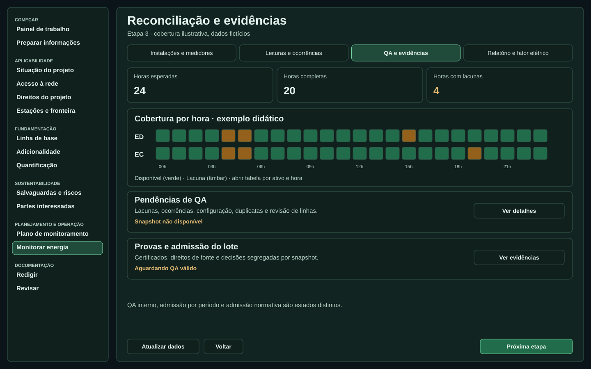

### 5.1 Reconciliação
Escolher janela explícita e consultar GET period-qa; V54 exige janelas UTC horárias inteiras de 1 a 744 horas, ED/EC separados, configuração e certificado vigentes, sem lacunas, duplicatas ou sobreposição, revisões por linha, eventos e topologia incidentes. Não somar janelas incompletas como total apto. Se contrato mais novo admitir rota EC derivada, respeitar suas guardas; não simular dois instrumentos nem flexibilizar a regra V54 pelo UI.

Dashboard exibe horas esperadas/completas, cobertura por ativo/grandeza, lacunas, duplicatas, ocorrências e certificados, com drill-down por hora e tabela textual acessível. Célula tem estado retornado pelo servidor, intervalo, instrumento, linha/ref de origem quando autorizado; ausência não vira zero. Exemplo SVG usa 24 horas, 4 incompletas (lacunas ED 04/05/15, EC 04/05/19), puramente fictício. Para períodos maiores que o limite, particionar segundo contrato e calendário de cálculo; não fundir snapshots por conveniência. Filtros paginados, histórico e diferença entre preview corrente e snapshot congelado.

### 5.2 Cadeia de decisões
| Ação | Condição/efeito existente que a UX deve preservar |
|---|---|
| Parecer de linha V54 | REV com MONITORING; não autor do lote; ACCEPTED_FOR_QA ou REJECTED; quarentena inelegível |
| Congelar QA V54 | REV autorizado, preview sem bloqueios; snapshot INTERNAL_QA_ONLY, usableForE8=false |
| Admitir lote para snapshot | REV distinto de remetente, revisor das linhas congeladas e criador do snapshot; ADMITTED_FOR_PERIOD/REJECTED; versão exata; ainda não E8 |
| Prova documental V55 | PDF METER_CALIBRATION por medidor e SOURCE_RIGHTS por origem; vínculo ao snapshot, até limite vigente; conferência documental independente de remetente/criador; DOCUMENT_CHECKED_INTERNAL/REJECTED |
| Vincular MR V57 | Snapshot corrente coerente, pode haver provas pendentes; revisão do dossiê versionada; não é MR verificado |
| Conferência metodológica V58 | REV competente/segregado do autor MR, criador QA e remetentes das linhas/provas; seis critérios no contrato; CHECKED_INTERNAL ou RETURNED; não admissão definitiva |
| Preparar pacote V59 | MR/parecer/QA e provas exatos vigentes, cadeia imutável; NOT_ADMITTED, usableForE8=false |

Os passos de prova e admissão podem ter ordem/paralelismo conforme owners. Não criar ação genérica “aprovar tudo”; não confundir papéis nem usar DRAFT_OWNER como REV implícito. Ações vêm da API (grants, versão, contexto), justificativa e locator da prova, com If-Match/idempotência conforme contrato. Uma revisão em massa somente se owner suportar atomicidade, validação individual e justificativa; não é requisito para caminho manual. Comparar versões e stale por dependência, preservar histórico. V55 verifica estrutura mínima PDF, não autenticidade. Ver V58 para critérios BOUNDARY_DCFC_SIN, METER_CALIBRATION, SOURCE_RIGHTS, HOURLY_ED_EC, CLOCK_GAPS_MAINTENANCE e DOUBLE_CLAIMING; mostrar regra e fato, ressalva e parecer, sem impor a outros métodos.

## 6. PT-20 — períodos e dossiês MR (#98/#42/#124)

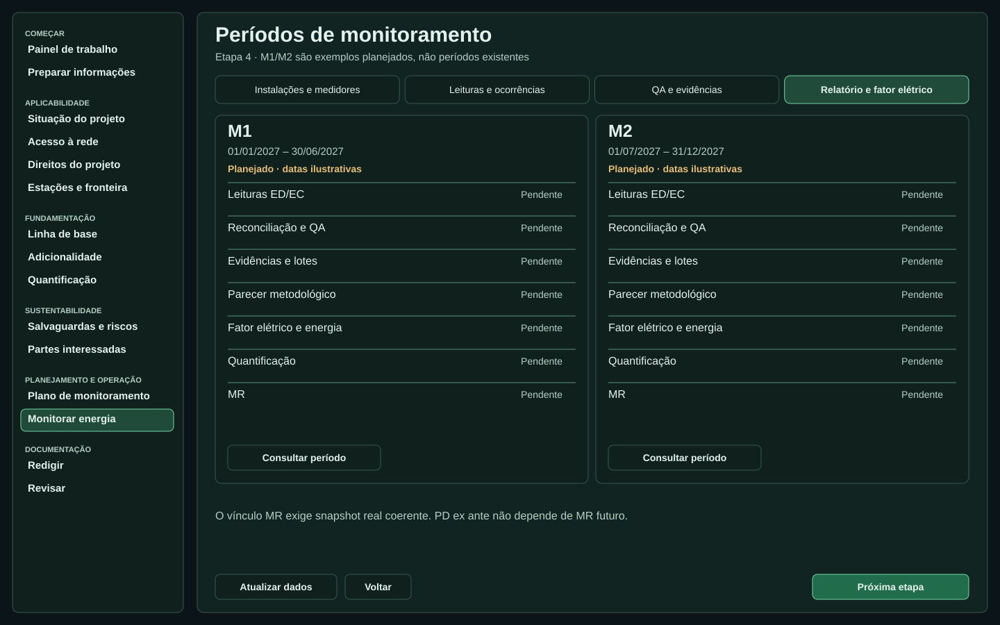

Hoje o vínculo V57 parte de um código textual (M1 na captura) e um snapshot QA. Proposta: selecionar contexto real de período no workbench, com planejamento, início/fim exclusivo, fuso, estado, ações, dossiê vigente e versões. Reusar registro de período do owner #42/#98 se existente/adequado; se não, contrato aditivo para janela planejada explicitamente distinta de snapshot/dossiê operacional. Não gravar V57 com snapshot fictício nem preencher M1 automaticamente. Código definido pelo projeto; quantidade e duração não fixas. Validar limites de QA e do ano do projeto/ano-fonte; sobreposição/lacunas conforme finalidade; sem forçar janela semestral.
- Lista com linhas ou cards de período, situação planejada/coleta/QA/provas/revisão/pacote/cálculo/documento (estados lógicos projetados, não novo enum global); mostrar ações futuras desabilitadas com motivo, sem ocultar a jornada toda quando pré-condição ausente.
- V57 recebe versão exata do snapshot e justificativa; histórico imutável. Rechecagem após alteração relevante de evento, parecer, instrumento, fonte ou prova; V57/V58/V59 preservam guards. Mostrar atualização proposta e comparar cadeia; nunca atualizar histórico automaticamente.
- M1/M2 no mockup são exemplos; nenhum período foi criado. MR e atos externos #42 dependem de registro comprovado. PD ex ante não precisa de período efetivo nem MR; se uma seção PD realmente usar referência monitorada, conservar dependência e stale específicos.

## 7. PT-21 — EFel, VT0011, TOOL07 e caderno (#96/#98/#97/#124)

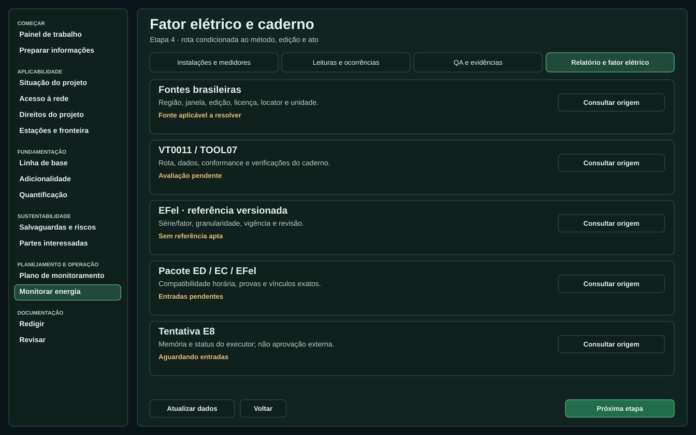

Projetar fluxo: fontes brasileiras oficiais autorizadas → seleção da abordagem aplicável à metodologia/edição/ato/região e intervalo → insumos e verificações do caderno (VT0011/TOOL07 quando incidentes) → candidato/versão da série ou fator compatível → decisão/revisão e referência contextual → pacote horário ED/EC/EFel → tentativa de cálculo. Mostrar qual etapa depende de dados/parecer e a ação para owner. Não transformar qualquer média MCTI em OM/CM admitida, não presumir opção A1 ou Case 2; matriz de conformance e PENs incidentes permanecem. Identificar fonte, edição, data de observação/publicação, licença, locator, granularidade, unidade original/convertida, região/SIN, cobertura temporal, regra, versão/hash, valores somente autorizados. Indicar série horária vs anual quando rota permitir e não fazer fallback de granularidade. EC e EFel precisam de compatibilidade temporal; ausência, duplicata ou lacuna bloqueia conforme owner. O caderno mostra insumos, validações e cálculos de ferramenta efetivamente produzidos; se incompleto, indicar pendência sem fabricar valores. Revisão interna de fator fóssil relatada pelo usuário não é revisão elétrica. Reutilizar candidatos, cadernos e vínculos existentes; não duplicar parser, TOOL07, VT0011, cálculo ou armazenamento. Preservar PEN-003 e demais decisões aplicáveis até resolução pelo owner.

## 8. PT-22 — execução e memória de quantificação (#97/#128/#124)

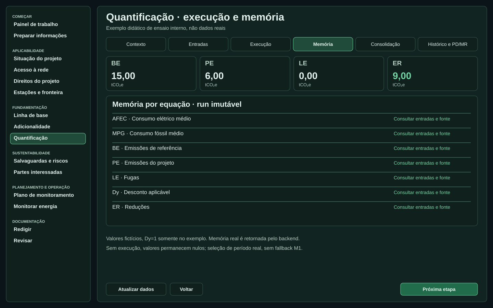

Seis áreas estáveis: Contexto e período, Entradas, Execução, Memória, Consolidação, Histórico/PD-MR. Em telas estreitas, navegação equivalente. Unificar as 11 pendências da captura em tarefas únicas por finalidade, com requisito, objeto, causa, prova, revisão, responsável e CTA. Detalhes das equações referenciam essas tarefas, sem duplicar lista. Regra/edição, direitos, EVR/ratings, EFfuel, IR, Dy, EFel, ED/EC e MR aparecem quando incidentes; não retirar bloqueios reais para melhorar a UX. Ex ante usa plano/hipóteses rotulados e referências BL-EX/PT-01; expor estimativa somente quando executor suportar, não copiar ensaio monitorado. 

**Fallback confirmado:** open-calculation-readiness.ts inicializa runPeriod='M1' e consulta periods[0]??'M1', inclusive ramo de usuário com cálculo mas sem monitoramento. Corrigir por contexto autorizado do owner, não simplesmente remover permissão de cálculo para resolver fallback. Estado sem período = vazio, sem GET/POST para M1 inventado; oferecer consulta/seleção de período real ao ator com VIEW_OPEN_E8_RUN, inclusive quando não tem acesso ao conteúdo bruto de monitoramento. Não vazar metadata de período/tenant fora de escopo. Usar resolução de calendário atual: y por aniversários no calendário São Paulo e ano-fonte UTC conforme contrato, início confirmado e janelas compatíveis; não pedir ano único ou incrementar y a cada MR. D21/Q13 e políticas de IR/Dy vigentes prevalecem sobre documentação histórica. Não fazer fallback scalar legado, zero ou 1 por conveniência.

GET/POST /technical/open-monitoring/dossiers/{period}/e8-runs: tentativa imutável, seleção energyBindingId/fleetSelectionId e contexto temporal no servidor, idempotência e If-Match. Distinguir BLOCKED sem resultados, REVIEWED_INTERNAL ensaio, STALE de referência histórica, execução normativa futura quando realmente suportada. canRunE8=false no preflight não implica que não haja memória de ensaio; não alterar status para acomodar UI. Seção de execução mostra permissão real, entrada/versão, momento, resultado e próxima ação. Sem execução, números nulos. Não criar run automaticamente ao navegar.

Memória por AFEC, MPG, BE, PE, LE, Dy, ER conforme equações efetivamente usadas, ED/EC, EFel horário e demais parâmetros. Fonte, versão, ciclo, fronteira, unidade, transformação, ponderação, precisão, valores intermediários, fórmula/regra e ressalvas retornados pelo backend. Drill-down de PE horário paginado por ativo/intervalo; mostrar total quando owner retorna. Valores de mockup 15/6/0/9 tCO2e são fictícios, com Dy=1 apenas para ilustração; não representam regra geral, dado de projeto, seed ou crédito. Não recalcular no Angular. Pino geral não equivale à seleção da janela; mostrar referência resolvida e avaliação estruturada quando aplicável, sem expor números licenciados.

## 9. PT-23 — histórico, comparação e consolidação (#97/#128)

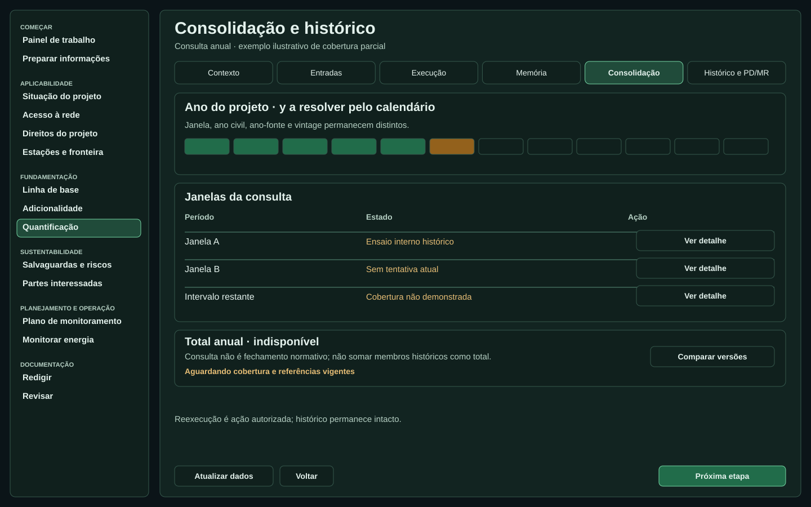

Consulta GET /technical/open-calculation-years/{year} existente, não é publicação anual persistida. Mostra uma tentativa mais recente por período e janelas reais de dossiê, inclusive sem tentativa, cobertura, lacunas, sobreposições, referências vigentes, total ou nulo e motivos por intervalo. Exibir y, calendário e limite exclusivo, ano civil, ano-fonte, vintage quando resolvido pelo owner; não transformar ano do projeto em vintage. Respeitar regras atuais de compatibilidade de IR, frota/ratings e EFfuel e transição D21; não implementar a política histórica como norma imutável nem relaxar divergências. Total exige cobertura e guardas vigentes; números históricos visíveis se autorizados, não somados como total atual. 
Histórico paginado de tentativas com seleção de dois runs imutáveis, diff de entradas, fonte, janela, regra, revisão, engine, precisão e resultados; distinguir reexecução técnica de mera alteração editorial. Se mesma chave retorna tentativa original, indicar corretamente; nova tentativa somente por ação autorizada, sem editar passado. Se comparação anual persistida/freeze for necessária, owner #97/#43 especifica manifesto e versão por finalidade; não tratar hash da consulta como fechamento normativo. Vincular run exato a PD/MR e dependências, preservar histórico; #128 lineage e acesso autorizado.

## 10. Redigir — central documental e reserva PT-24 (#43/#122)

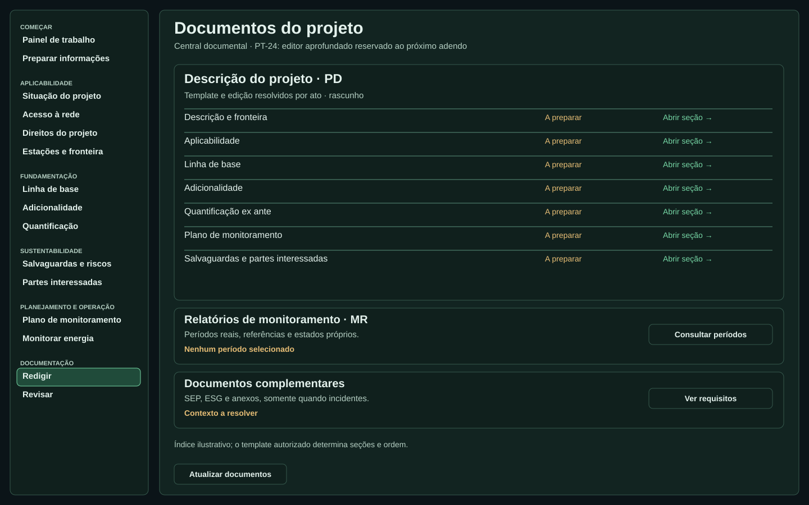

Proposta de visão geral: PD ex ante, MRs por período real e documentos complementares incidentes (SEP, ESG, anexos), template/edição/ato resolvidos, status por seção, última versão e atualidade. Roteiro atual/JSON é prévia preparatória, não documento. Mostrar motivo para regenerar prévia de revisão 5 quando contexto corrente é 6; diferenciar prévia, revisão técnica e versão da seção. Abrir seção existente sem duplicar editor; destacar dependências reais e direitos. Reusar #43/#122 DocumentContext/DocumentSourceRef/DocumentBlock/ClaimSupport/SectionSnapshot/DocumentReleaseManifest; mapeamento condicionado ao template, sem fixar índices globais. Preservar PT-07/PT-16 e PD-A–F, editor manual #36 e revisão #37. 
**PT-24 — RESERVADO PARA ADENDO DE AUTORIA:** editor híbrido, fundamentação por seção, biblioteca contextual, inserção de insumos/figuras e assistência opcional serão detalhados em próxima atualização documental por solicitação do responsável. Neste adendo somente fronteira do contrato: referências versionadas dos módulos owners, blocos derivados somente leitura, narrativa humana, suporte por alegação, origem/versão/licença, stale, revisão e export. Não adicionar especificação visual detalhada do editor, subfatias PT-24A–J, comandos IA ou novo armazenamento nesta entrega. Próximo adendo deve estender este contrato e #43/#128/#100/#122, sem reabrir #36/#37 nem tornar IA gate de release. P0 de autoria manual permanece.

## 11. PT-25 — revisão e resolução de achados (#35/#37/#43/#124)

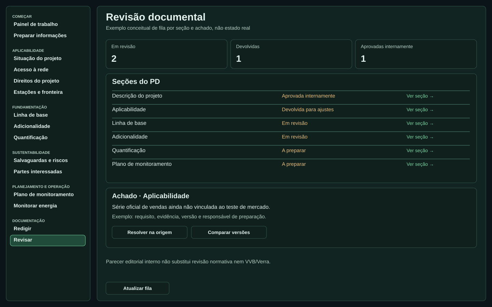

Reutilizar PdReviews e ações SUBMITTED, RETURNED, APPROVED_INTERNAL, FROZEN_INTERNAL, REOPENED; mostrar apenas ações retornadas pelo backend, versão corrente, competência, justificativa, histórico, If-Match; autor não aprova própria seção. Visão por documento/ato/template e por seção/versão: a preparar, em revisão, devolvida, aprovada internamente, congelada, reaberta, desatualizada; não inferir aprovação por contador. Selecionar seção/achado abre fato, regra, evidência/locator e parecer do owner, diff e impacto, ação resolver e retornar. Achado ancorado em sectionVersion, claim/block/requisito, sourceRef e motivo; se contrato ainda não suporta ancoragem, extensão aditiva #43/#35, sem segundo ledger. PREP corrige na origem ou narrativa conforme natureza, REV reavalia nova versão. 
PENs históricos são referências de governança, não fila de ação universal do projeto; projetar causa concreta e incidência por ato, mostrar código no detalhe e não ocultar pendência técnica real. Não exigir MR futuro para todo PD, nem liberar revisão de bloco dependente de dado ausente. Pareceres técnicos dos owners e revisão editorial são independentes; VVB/Verra atos externos #42 não equivalem à aprovação interna. Sem prova de revisão válida, bloqueios persistem. Reabertura e novo release preservam congelados.

## 12. PT-26 — congelamento, exportação e manifesto (#43/#122/#128)

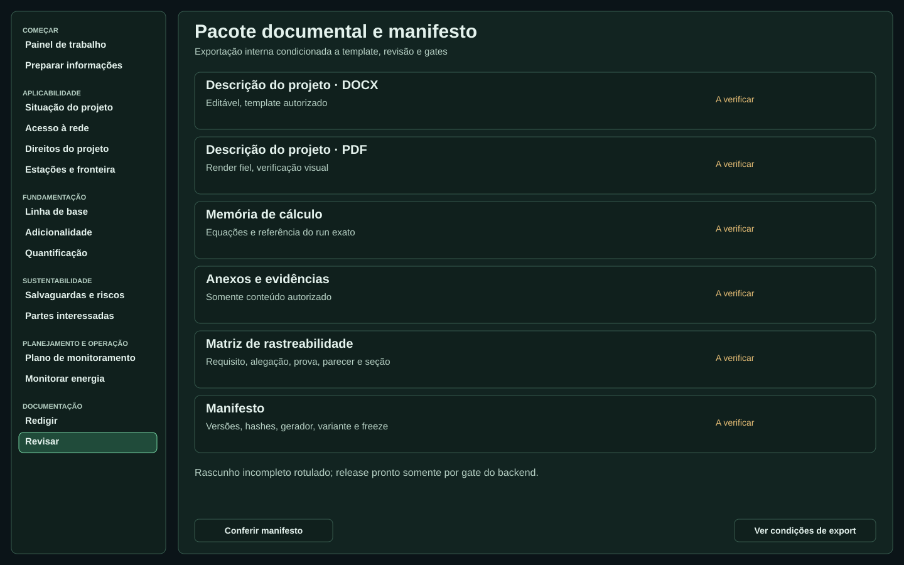

Contrato já previsto PD-E/F e #122: DOCX editável com template autorizado, PDF fiel, memória de cálculo legível e export de dados quando autorizado, anexos/evidências permitidos, matriz de rastreabilidade e manifesto de release. Não prometer render oficial sem template/licença. Preview incompleta somente rotulada, sem aparentar release pronto. Template e mapping resolvidos por ato/edição; usar ordered SectionSnapshot e input/output refs exatas. Freeze interno condicionado a gates, autorizações, revisão, atualidade e suficiência de provas; atomicidade, versão/hashes, data, gerador, variantes reservada/pública, política de anexos e redaction. Reusar DocumentReleaseManifest; SHA não é assinatura jurídica. Redaction cobre conteúdo, XML DOCX, PDF, metadados, nome/URL, índices e manifesto; revogação afeta leitura/export conforme licença, sem reescrever histórico. Verificar QA de render (tabelas longas, quebra, sumário, notas, unidade, cifras, referências, anexos e idioma), consistência com snapshots e manifest. Reabrir cria versão nova; arquivo já liberado não sofre atualização silenciosa. Não declarar emissão, submissão ou VVB concluída. Sem IA é possível concluir percurso quando todos os insumos admissíveis existirem. A autoria aprofundada PT-24 será especificada depois; os gates documentais atuais não são reduzidos.

## 13. Sequência, dependências e segurança

| Fatia | Owner e dependência | Prioridade |
|---|---|---|
| PT-17 | #98/#124, V53 e PT-13 | P0 |
| PT-18 | #98/#124, V56, ativos PT-13 | P0 |
| PT-19 | #98/#33/#35/#124, V54/V55, PT-17/18 | P0 |
| PT-20 | #98/#42/#124, contexto de período e V57; base antes da UX PT-19/22 quando necessário | P0 |
| PT-21 | #96/#98/#97/#124, fonte/rota/caderno, pacote de energia | P0 |
| PT-22 | #97/#128/#124, PT-15/BL-EX, seleção e executor | P0 |
| PT-23 | #97/#128, runs PT-22, consulta anual vigente | P0 |
| PT-24 | #43/#122, PT-07/16; **especificação aprofundada reservada** | P0 manual, IA opcional #100 |
| PT-25 | #35/#37/#43/#124, reuso PdReviews; ancoragem depende PT-24 | P0 |
| PT-26 | #43/#122/#128, composição/revisão/manifesto | P0 |
| PT-QA | #101/#45, validação incremental de cada vertical | P0 |

Preservar UX-08D.1, BL-EX-01/02, PT-01–16 e dados/revisão em paralelo. Períodos operacionais não são pré-condição de toda autoria ex ante. PT-14 = projeção PT-06/UX-08D.3; PT-17–21 detalham PT-13/14; PT-22/23 detalham PT-15; PT-24–26 detalham PT-07/16, sem novo épico, motor, storage, fila ou editor. Em cada PR, mapear critérios e contratos, não fechar marco com mockups.

Backend Quarkus/PostgreSQL e Angular: autorização ACL-first, escopo/tenant, grants, competência, licença por operação, MFA quando incidente, no-store, paginação, idempotência, ETag/If-Match, versionamento append-only, auditoria e revogação. APIs propostas são extensões lógicas a validar, não contratos existentes inventados. Erro/timeout/restrição ≠ ausência. Desktop 1440×900, mobile 390×844, teclado, foco, estados textuais e alternativas acessíveis a gráficos, preservação de rascunho e retorno, sem ações fantasma. Migrações aditivas; não mudar migrações publicadas, não contaminar projeto real com fixture PIL-SYN. Testes com base real autorizada e revisão competente permanecem gate.

## 14. Critérios de aceite adicionais (planejados, não executados)

| ID | Cenário verificável |
|---|---|
| PT-T34 | Origem e medidor selecionados com ACL; modelo CSV exato e instruções, limites 2 MB/2.000, idempotência, upload original preservado |
| PT-T35 | Candidatos, quarentena, erros por linha, duplicata e correção por versão; sem aceitação automática, reimportação não apaga histórico |
| PT-T36 | Ocorrência tipo/objeto compatível, timezone/offset, fim exclusivo, limite e sobreposição parcial; liberação REV não repõe energia |
| PT-T37 | QA por ativo/hora ED/EC, janela 1–744 horas conforme V54, lacunas/duplicatas/vigência, gráfico e tabela equivalentes; não congelar QA bloqueado |
| PT-T38 | V54/V55/V56/admissão de lote/V58 segregação de atores, versão e prova exatas; negar autoavaliação, quarentena, cross-tenant e ação sem grant |
| PT-T39 | Snapshot e MR tornam-se stale apenas quando dependências relevantes mudam; novo vínculo preserva histórico e gates; sem fake MR |
| PT-T40 | Período planejado vs efetivo, seleção autorizada, sem default M1 inclusive ator somente CALCULATION; janela/ano e códigos não presumidos |
| PT-T41 | Caderno EFel por rota/edição/região/fonte/granularidade, licença, cobertura e unidade; ausência não vira média genérica, ferramenta incompleta não produz fator apto |
| PT-T42 | Pacote ED/EC/EFel e seleção por janela conforme owner; V59 NOT_ADMITTED e guardas D21/Q13, nenhuma promoção normativa pela UI |
| PT-T43 | Contexto ex ante/monitorado distingue entradas; preflight único e acionável; run bloqueado nulo, ensaio interno rotulado, sem execução fictícia no navegador |
| PT-T44 | Memória do run exato, equações/intermediários/horas/unidades/precisão e proveniência autorizadas; gráfico/tabela sem recomputar resultado |
| PT-T45 | Reexecução por ação autorizada, replay e concorrência; comparar runs, referências, versão e efeito; sem editar passado |
| PT-T46 | Consulta anual inclui janelas sem run, cobertura/lacuna/sobreposição, vigência e consistência; total nulo se bloqueado; y/ano civil/ano-fonte/vintage distintos |
| PT-T47 | Central documental resolve template e ato, PD sem MR futuro universal, MR por janela real, versões da prévia e seção distintas; links ao editor existente |
| PT-T48 | PdReviews mantém transições e competência, achado concreto com origem e versão, devolução/diff/retorno; revisão técnica e editorial separadas |
| PT-T49 | Freeze e export DOCX/PDF/manifesto por seção/run pinado, variantes e anexos autorizados, revisão de render; rascunho rotulado e histórico imutável |
| PT-T50 | Isolamento, licença/revogação, erros/reload, deep link, concorrência, mobile/desktop/teclado, teste PREP/OP/REV, outro método e regressão PIL-SYN |
| PT-T51 | PT-24 continua extensão explícita do contrato #43/#122; sem duplicar editor, dados ou ledger; próximo adendo de autoria pode enriquecer insumos mantendo os mesmos refs e gates, modo manual preservado |

Complementam BL-T01–17 e PT-T01–33, UX-T e UX08-T. O último é verificação de integração da especificação; não equivale a teste da autoria avançada, que terá critérios próprios. Não afirmar aprovação de QA visual: print ilegível, testes interativos ainda necessários. Mockups SVG são propostas, exemplos fictícios, não telas executadas. Nenhuma alteração de código, banco, normas, direitos ou decisões reais. Não fazer merge por esta atualização.
