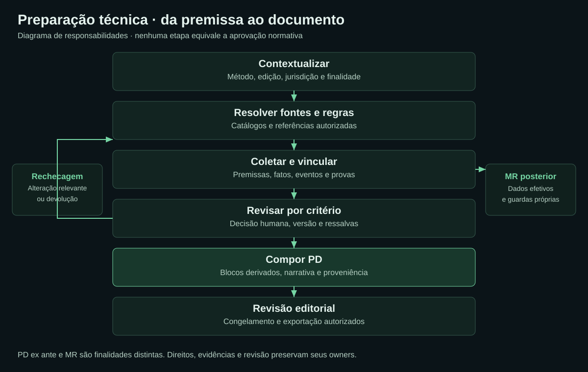
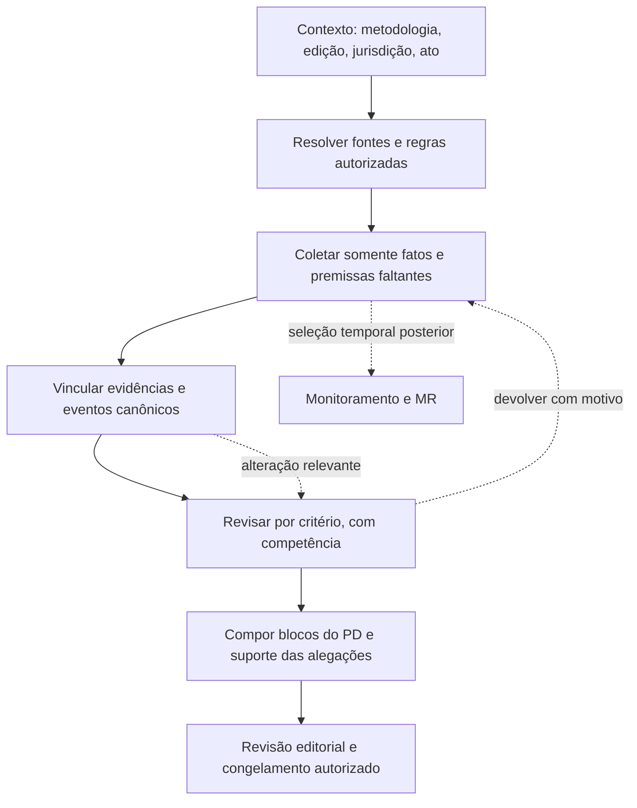
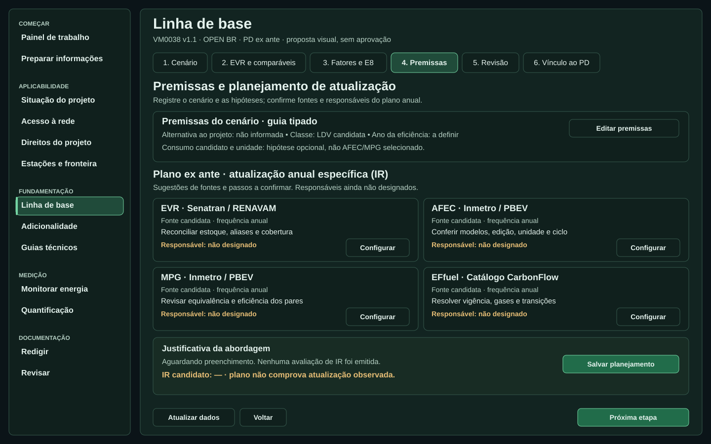
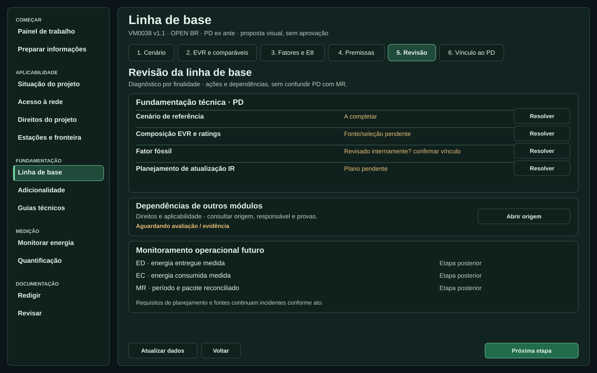
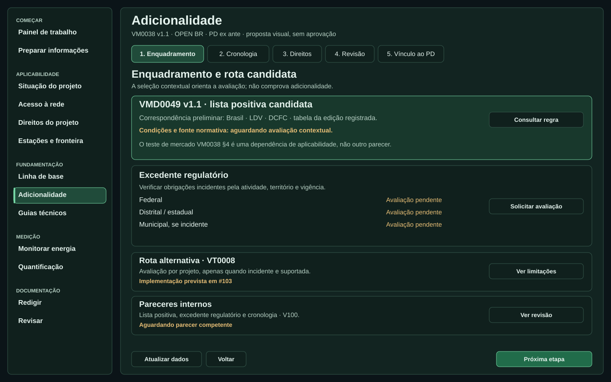
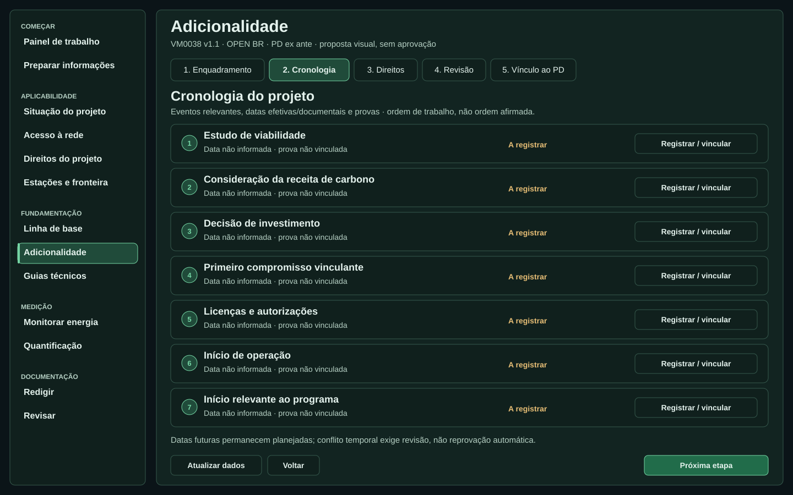
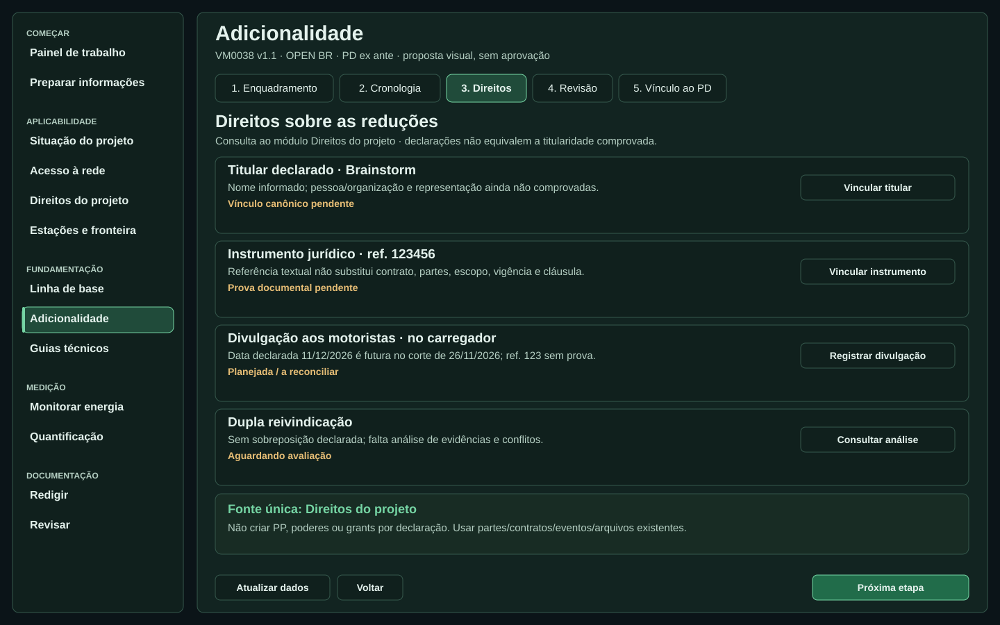
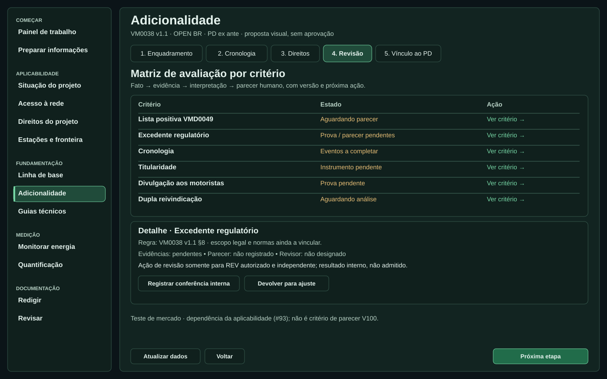
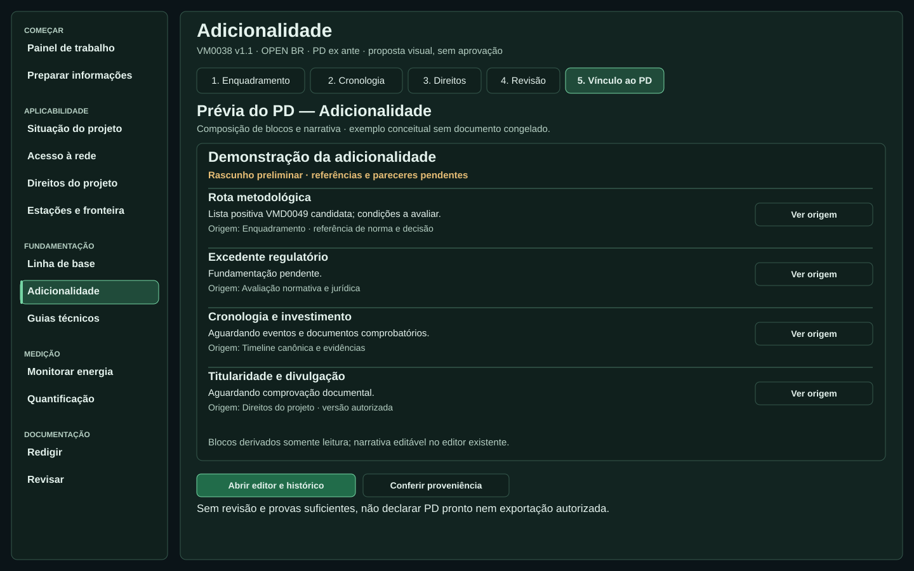

# CF-UX-TECH-001 — Premissas, adicionalidade, direitos, revisão e composição do PD

**Status:** proposta de especificação funcional/visual e arquitetura P0, 26/11/2026; não implementada. Complementa [frota e seleção ex ante](CF-UX-TECH-001-FROTA-BASELINE-EX-ANTE.md) no PR #351. Corte do código main cc25f64b85900fdba6be115bb0f8bf764f0e6d4b. D17/J03, J02 para fatos de direitos e cronologia, documentação conforme [jornada canônica](../specification/CF-JOURNEY-001.md). Recorte inicial VM0038 v1.1 OPEN BR LDV BEV DCFC SIN GRID_ONLY. Não impor requisitos desse pacote a outras metodologias.

**Base da análise:** sete capturas anteriores de Linha de base (Premissas/Revisão) e Adicionalidade (Enquadramento/Cronologia/Direitos/Revisão/Vínculo ao PD), código e contratos. O anexo adicional de Premissas recebido tem 1×1 pixel e é ilegível; não presumir seu conteúdo. A inspeção do código confirma a presença do guia tipado abaixo do plano IR; seus campos são especificados aqui com base em V68. Se o anexo pretendia mostrar outra coisa, reconciliar quando houver captura legível. Não houve execução local ou inspeção do banco do responsável. A revisão interna de combustíveis foi informada pelo responsável, não comprovada neste PR.

## 1. Diagnóstico e fronteiras de responsabilidade

| Tela | Comportamento observado/contrato atual | Lacuna e owner |
|---|---|---|
| BL Premissas | DecisionWorkbench renderiza OpenIrExAntePlan e TypedGuide; V94 contém quatro triplas de texto e justificativa; V68 guia baseline com scenario, vehicleClass, referenceYear, efficiencyValue, efficiencyUnit | Referência contextual, responsável com grant, procedimento estruturado, conciliação de premissas; #40/#96/#124 |
| BL Revisão | c.gates inteiro da prontidão de cálculo em accordion; guia vN e campos faltantes | finalidade PD vs MR, links para ação, estados de fontes/revisão; #13/#19/#40/#97/#124 |
| ADD Enquadramento | declaração OPEN, VMD0049/REGULATORY_SURPLUS, rota no guia, três pareceres projetados | seleção contextual da rota e evidência normativa; estado real do parecer; #93/#99/#38/#124 |
| ADD Cronologia | 3 datas consideradas/decisão/compromisso + guia tipado integral; comparação informativa | eventos e documentos canônicos, temporalidade e reconciliação, não repetir rota; #38/#99/#33/#124 |
| ADD Direitos | consulta declaração OpenApplicability; botão editar declaração; registro canônico separado já existe em OpenProjectRights (V72–74) | vincular partes/contratos/eventos/arquivos canônicos, versão e validade; #24/#93/#99/#124 |
| ADD Revisão | findings em accordion, informação de que parecer será produzido em outro workbench | V100 POST parecer já existe, UI não consome review; falta dependência exata de provas e ação por critério; #99/#38/#35/#124 |
| ADD Vínculo PD | PdTrace mostra referência de guia/versão, respostas tipadas ainda não incorporadas ao PD; editor separado | composição tipada, claim→prova, prévia/versão, controle editorial e direitos; #43/#122/#128 |

**Reuso obrigatório:** [UX implementada](CF-UX-TECH-001-BASELINE-ADDITIONALITY-PD-INTEGRATIONS.md), [V94 plano IR](CF-OPEN-007-IR-EX-ANTE-PLAN.md), [Q04/D13](CF-OPEN-007-IR-FIRST-YEAR-EX-ANTE.md), [V100 parecer](CF-OPEN-010-ADDITIONALITY-REVIEW.md), [V64 frota](CF-OPEN-008-EVR-RATINGS-PROJECT-HANDOFF.md), [D21/EFfuel](CF-DATA-009-VINCULO-CATALOGO-COMBUSTIVEL.md). Código: [DecisionWorkbench](../frontend/src/decision-workbench.html), [plano IR](../frontend/src/open-ir-ex-ante-plan.html), [V68](../backend/src/main/resources/db/migration/V68__typed_guide_definitions_and_answers.sql), [OpenProjectRightsResource](../backend/src/main/java/br/carbonflow/pilot/OpenProjectRightsResource.java), [OpenAdditionality](../backend/src/main/java/br/carbonflow/pilot/OpenAdditionality.java), [PdTrace](../frontend/src/pd-trace.html). Os owners de cálculo, norma, direitos, evidência e documento permanecem canônicos. Não criar outro motor, ledger, catálogo ou editor.

## 2. Modelo de interação comum

Preservar sidebar e rotas de DecisionWorkbench. Linha de base: Cenário, EVR e comparáveis, Fatores e E8 (pode rotular Fatores e prontidão sem quebrar link), Premissas, Revisão, Vínculo ao PD. Adicionalidade: Enquadramento, Cronologia, Direitos, Revisão, Vínculo ao PD. Etapas estáveis, voltar/avançar sem mudar aprovação, foco e rascunho preservados. Outros métodos recebem campos/etapas conforme pack, sem EVR/VMD0049 universal. Cada área mostra finalidade, status contextual em português, origem, próxima ação, responsável previsto vs identidade/grant, e saída documental. Códigos internos em detalhes, não como rótulo primário. Aviso de não admissão curto, sem repetição excessiva.

Separar eixos: incidência, completude, disponibilidade, vínculo, suficiência de prova, revisão interna, admissão metodológica, atualidade e estado editorial. Filtro por finalidade PD_EX_ANTE vs MR_MONITORED/QUANTIFICATION; medições futuras não bloqueiam elaboração ex ante, mas plano de monitoramento e premissas exigíveis pelo ato continuam necessários. Sem número apto = nulo/travessão, não zero; sem acesso ≠ ausência; indisponível ≠ dado inexistente. Todos estados e ações calculados pelo backend; ProjectWork e projeção #13/#19 deduplicam requisito+ato+objeto. Autorização antes de metadata/contagem; privacidade por tenant, licença e finalidade.

## 3. Linha de base — Premissas: dois trabalhos distintos na mesma etapa

### 3.1 Premissas do cenário — guia tipado V68

A seção abaixo do plano IR não é o mesmo formulário. O schema baseline v1 tem:
| Campo existente | Tratamento proposto | Fonte de verdade/validação |
|---|---|---|
| scenario — Alternativa ao projeto (descrição) | Descrever cenário contrafactual/serviço e justificar; prévia da informação já registrada em Cenário; ação Editar cenário abre o mesmo owner | #40, guia tipado e cenário versionado; manter narrativa humana, evitar duplicar descrição |
| vehicleClass — LDV / A confirmar | Mostrar classe resolvida pelo contexto quando confirmada; se hipótese, confirmar ou corrigir na tela dona; estado A confirmar explícito | #93/#40, sem impor a todos os métodos |
| referenceYear — Ano do dado de eficiência, condicionado a LDV | Derivar da referência de ratings selecionada, quando existente; antes dela, ano candidato rotulado; não confundir fabricação, observação, fonte e ano do projeto | #94/#95 e BL-EX-01; compatibilidade temporal no servidor |
| efficiencyValue — Consumo candidato (decimal 0,001 a 10.000 no schema atual) | Retirar do caminho principal de seleção real. Se necessário para estudo preliminar, manter em seção opcional “Hipótese de eficiência”, com tipo, fonte/justificativa, finalidade e ressalva; não confundir com AFEC/MPG | Guia V68 preserva versões; hipótese não vira entrada E8 |
| efficiencyUnit — kWh/100km ou km/L; obrigatória se valor fornecido | Selecionar conforme tipo de hipótese; não permitir unidade incompatível nem converter no Angular; valores reais só pelo owner de ratings | #95 VehicleRatingsMath e regras do schema; hipótese continua candidata |

Os campos acima são os **existentes em V68**; a proposta não afirma que a imagem de 1×1 os mostrava. Verificar schema vigente retornado pela API antes de implementar. Preservar respostas anteriores, sem mutar V68; nova versão do schema por migração aditiva se necessária, adapter de legado e revisão explícita quando não houver vínculo inequívoco. Não salvar classes/anos derivados como segunda verdade; resposta tipada pode referenciar entidade/version ou manter hipótese quando seleção ausente. Cenário e premissa declarada não concluem baseline.

### 3.2 Planejamento ex ante de atualização (IR) — V94

Já existe GET/POST /v1/projects/{project}/technical/open-ir-ex-ante-plan, independente de MR, versionado, If-Match e Idempotency-Key. ParameterPlan(source,responsible,procedure), quatro conjuntos evr,afec,mpg,fuel, rationale. Contexto SCOPE_PENDING ou OPEN_CANDIDATE; fora do recorte bloqueia escrita. Não substituir por pino escalar, nem exigir fonte admitida para simplesmente planejar.

**Objetivo da nova UI:** ajudar a preparar o plano anual da abordagem específica por projeto, recuperar referências escolhidas nas etapas EVR/fatores, oferecer sugestões e registrar o que será feito. Não gerar decisão normativa. A política interna D13/Q04 exige rota anual específica, contexto e parecer independente, vínculo do plano vigente para a estimativa ex ante do ano 1; não preencher IR=1 pelo simples planejamento. D21/Q13 e prova de atualização observada nos anos posteriores preservadas. Um resultado candidato 1 só aparece se serviço owner o retornar e explicar o estado; nenhuma fórmula no Angular. No primeiro ano, IR não influencia a Eq.1 com expoente zero; isso não elimina as guardas. Ver D13 e regras atuais.

| Parâmetro | Fonte recomendada candidata, não garantida | Procedimento assistido proposto, confirmável |
|---|---|---|
| EVR | Senatran/RENAVAM e complementos autorizados; snapshot selecionado quando houver | Obter estoque da observação aplicável; reconciliar aliases/classificação, cobertura e denominador; revisar e publicar versão |
| AFEC | Rating PBEV para BEVs elegíveis e snapshot de ratings | Conferir edição, ciclo, unidade, correspondência dos modelos e cobertura; recalcular no owner |
| MPG | Rating PBEV dos comparáveis fósseis e pares revisados | Atualizar pares e evidências de equivalência, combustível, ciclo e eficiência; revisão competente |
| EFfuel | Catálogo de combustível CarbonFlow, fontes brasileiras aplicáveis | Verificar escopo/gases, composição, vigência e transições; resolver referências por janela conforme D21, revisar |

UI: cards compactos, parâmetro, origem sugerida e situação (planejada/selecionada/pendente), frequência anual da rota candidata, papel previsto, conta selecionável apenas se colaborador ativo e com autorização; opção “Ainda não designado” salva rascunho quando suportado, não cria grant. Editar procedimento por checklist de passos tipados propostos e justificativa livre; fonte alternativa por referência candidata ou texto explicitamente não resolvido, sem fingir publicação. Exibir versão/ano, avisos e link à seleção canônica. CTA “Salvar planejamento” usa endpoint existente enquanto contrato for textual; não serializar IDs em texto fingindo integridade. Evolução contratual abaixo antes de expor seletores persistentes. O usuário não precisa repetir manualmente fontes já vinculadas; confirmar sugestões, indicar lacuna ou justificar alternativa. Histórico imutável e plano anterior não sobrescrito.

### 3.3 Evolução de contrato, sem apagar V94
Proposta lógica: PlanRevision@version com contextRef, cada ParameterPlan com sourceRef? (catálogo/licença/seleção), sourceCandidateText?; plannedRole, assigneeRef? validado; procedureSteps[] com ruleRef/ação/periodicidade/owner; rationale; state; originalTextV94 preservado. Não criar ledger paralelo: evoluir owner OpenIrExAntePlans e schema aditivo/versionado; validar referências, competência e acesso em Quarkus. Rascunho incompleto é legítimo; não confundir com plano apto ao parecer V93/V94/V97. Se regras atuais exigem todos os textos para registrar V94, manter esse gate até evolução e preservar rascunho editável sem chamar de plano registrado. Adapter legado não inventa IDs ou aprovação. Vínculo do plano e parecer continua explícito; mudança de snapshot/fonte/contexto exige reconciliação pelo owner, sem invalidar histórico. Não presumir que atualização planejada ocorreu. Atraso de atualização é pendência interna, não prazo Verra inventado.

## 4. Linha de base — Revisão

Agrupar projeção canônica em Fundamentação técnica PD (cenário, EVR/ratings, fatores incidentes, plano/IR), Dependências de outros módulos (direitos, regra e aplicabilidade) e Monitoramento/quantificação posterior (ED/EC medido, pacote elétrico por janela, MR). Requisitos como EFel, Dy e plano de monitoramento podem ser incidentes ex ante **conforme finalidade**, não deslocar todos para futuro por conveniência; separar premissa/fonte planejada de evidência medida. Não esconder bloqueios de cálculo monitorado. Estado atual de cada item, motivo, versão/evidência visível, papel/assignee válido, CTA que navega ou solicita pelo fluxo #26, prazo somente se definido pelo owner, efeito no PD. Mostrar ações possíveis primeiro, tarefas externas em acompanhamento, e status “fora do recorte” quando indicado. A leitura de c.gates não é prova de conclusão. Usar projeção #13/#19/#124, sem inventar lista universal. Ver BL-EX-03/#351, UX-08D.3; integrar na mesma fatia quando sobreposição.

## 5. Adicionalidade — Enquadramento e rota

### 5.1 Rota candidata
Resolver no backend metodologia/edição, ato, jurisdição, categoria e tecnologia. Para o ramo inicial, #99 registra VMD0049 v1.1 Tabela 1 Brasil LDV DCFC como hipótese positiva (0,7% de 2024 é dado da tabela, **não** substitui o teste de mercado VM0038 §4). Exibir referência normativa, versão, localização da tabela, match candidato e condições faltantes, sem declarar adicionalidade. Rota selecionada/justificada no owner #38/#99 e não no campo livre separado. O enum route existente pode permanecer como declaração de hipótese histórica/adaptador; nenhuma aprovação por seleção. Rota alternativa por projeto VT0008/#103 só aparece quando incidente e suportada; se não implementada, NEEDS_REVIEW/OUT_OF_MVP, não aprovação nem reprovação genérica.

### 5.2 Excedente regulatório
Bloco distinto, com escopo legal derivado da localização e atividade; fontes federal, distrital/estadual, municipal apenas se incidente (DF não presumir município); obrigação aplicável, artigo/edição/vigência, interpretação, exceções e documentos. Catálogo normativo #10/#92 administra fontes e direitos; #99 avalia incidência; PREP propõe fatos/evidências, REV competente registra parecer, eventual parecer jurídico por autoridade apropriada. A automação pode pesquisar/candidatar, não decidir. Sem norma consultável: pendência concreta; sem obrigação demonstrada: não presumir excedente. Separar do teste de mercado #93; mostrar dependência resumida e deep link apenas, não outro parecer de adicionalidade.

### 5.3 Ações e estado
“Consultar rota e regra”, “Completar contexto”, “Vincular norma/evidência” ou “Solicitar avaliação técnica/jurídica” conforme grant e owner; usar #26 quando disponível. Mostrar estado do parecer real V100 (pendente, conferido internamente, devolvido, obsoleto) e histórico autorizado; tradução de PENDING_NORMATIVE_REVIEW; referência de código em detalhes. Não exibir como botão ativo sem implementação.

## 6. Adicionalidade — Cronologia

A tela não deve ser mera lista das três datas do guia. O contrato deve orquestrar eventos canônicos versionados, aproveitando OpenProjectRights/V73 onde os tipos existentes forem adequados; #38/#99 é owner do significado metodológico e cronologia; #33 é owner do documento/prova. OpenProjectRights.EventInput atual tem kind, eventOn e documentRef; não presume data documental, prova aceita, tipo adicional ou registro de ato. Inventariar tipos antes de estender; migração aditiva/versão, sem segundo calendário.

| Evento candidato (incidência pelo pack/ato) | Exemplo de prova, não obrigatoriedade universal |
|---|---|
| Viabilidade | estudo técnico/econômico |
| Primeira consideração da receita de carbono | registro contemporâneo, ata, estudo ou decisão |
| Decisão de investimento | deliberação/ato orçamentário |
| Primeiro compromisso vinculante | contrato, pedido, outro compromisso demonstrável |
| Licenças/autorizações | ato emitido pela autoridade, quando aplicável |
| Início de operação | registros de operação, documentos |
| Início relevante do programa | determinação conforme norma/ato, não sinônimo de início operacional |

Campos: stable eventId, kind, plannedDate? / actualEffectiveDate?, documentDate?, status PLANNED/DECLARED/OCCURRED/PENDING_EVIDENCE/REVIEWED (nomes lógicos), source/evidenceRef@version e locator, ator/organização, justificativa, confidencialidade e parecer. Não usar data futura como prova de ocorrência; quando futuro é plano legítimo. Permitir datas desconhecidas e rascunho. Data de declaração ≠ data documental ≠ data efetiva. Alteração cria versão, revisão verifica relações e sequência, alertas de inconsistência com motivo, sem veredito automático. Exibir eventos ordenados pelas datas efetivas conhecidas e seção separados sem data/planejados, não impor ordem fixa de ocorrência. A lista de passos pode ser ordem de trabalho, não cronologia afirmada. Compromisso anterior à consideração gera achado, não reprovação. V68 considered/decision/commitment antigos preservados e confrontados com os eventos; se divergência, solicitar reconciliação, sem converter automaticamente texto em prova. Não repetir o enum route nessa etapa; consultar o mesmo valor no Enquadramento. Ação por evento: registrar, anexar/vincular documento autorizado, pedir evidência, ver histórico e solicitar revisão. Fluxo de arquivos e permissões #33/#93; sem upload paralelo.

## 7. Adicionalidade — Direitos

A seção Direitos do projeto é a fonte canônica. A tela adicionalidade deve resumir os mesmos registros/estado e abrir a ação contextual, sem exigir uma segunda declaração. V72–74 e OpenProjectRightsResource já possuem partes, contratos, eventos e upload PDF para CONTRATO/DISCLOSURE; PartyInput(kind,displayName), ContractInput(partyCode,label), EventInput(kind,eventOn,documentRef). São registros iniciais, não prova de identidade/representação, nem contrato admitido. Evoluir #24/#93/#99 conforme abaixo, sem prometer que todos os campos já existem.

- **Titular:** seletor de pessoa/organização/parte autorizada com referência versionada, papel jurídico e relação com estações/atividade, fundamento; nome livre histórico “Brainstorm” é declaração, não PP, grant ou organização validada. Distinguir titular da redução, proponente, operador e representante; link a comprovação de poderes #24.
- **Instrumento:** partes, tipo, data de assinatura e vigência, escopo de redução/ativos/beneficiários, finalidade e cláusula/locator, arquivos autorizados, revisão e ressalvas. Referência “123456” sem arquivo ou vínculo é declaração. Reutilizar saveContract e upload onde adequado, evoluir schema para metadados faltantes. Não exigir contrato específico quando outro fundamento admitido for aplicável; owner define prova.
- **Divulgação aos usuários:** canal(s) e público, versão do termo, vigência/escopo e evidência efetiva (arquivo/locator), data prevista vs realizada. Na captura 11/12/2026 era futura em 26/11/2026; deve ser “planejada” ou divergência a reconciliar, nunca prova de publicação. “No carregador” e ref “123” não comprovam divulgação. Uma referência textual não substitui o documento.
- **Dupla reivindicação:** declaração, análise de conflitos/contratos/programas/escopo, evidências e parecer. “Sem sobreposição declarada” não comprova ausência. Não confundir com Dy, que tem regras próprias #96.
- **Ações:** visualizar vínculo, registrar/vincular parte e contrato, anexar prova, registrar divulgação planejada/realizada, solicitar prova/revisão, retornar ao mesmo passo. Autorização backend; sem exposição de nomes/arquivos ou contadores protegidos; não ampliar grants para facilitar UI. Direitos e cronologia usam refs de versão, alterações impactam requisitos e PD sem reescrever versão anterior.

## 8. Adicionalidade — Revisão por critério

**Entrega mais imediatamente implementável:** V100 e OpenAdditionalityResource já suportam GET .../technical/open-additionality e POST .../{criterion}/reviews para POSITIVE_LIST, REGULATORY_SURPLUS, CHRONOLOGY. Corpo outcome CHECKED_INTERNAL|RETURNED, rationale, evidenceReference; If-Match e Idempotency-Key. O contrato admite somente colaborador REV com ADDITIONALITY e REVIEW_OPEN_ADDITIONALITY; owner/autores da última declaração/guia não revisam; sem permissão, não exibir formulário nem tentar POST. A revisão é **interna e não admitida**; não é parecer jurídico ou externo automaticamente.

Matriz: critério/condição, origem/regra/edição/ato, fato, evidência e locator, responsável com grant (ou papel previsto), estado e decisão vigente. Lista positiva, excedente, cronologia usam V100; direitos/divulgação/duplo pleito consomem estados dos respectivos owners, não inventar códigos V100 nem registrar em critério errado. Aplicabilidade de mercado #93 como dependência externa. Selecionar critério revela fatos, provas, histórico e, se autorizado, ação “Registrar conferência interna” ou “Devolver para ajuste” com justificativa e referência. Não usar “aprovar adicionalidade”. Falta prova/competência gera motivo/solicitação, sem conclusão. Exibir versão e stale; salvar feedback e recarregar projeção apenas após sucesso. 409/412 conflito preserva justificativa e pede reconsulta.

**Lacuna de arquitetura:** V100 calcula contextSha atualmente só com versões da declaração OPEN e guia. Mudanças fora deles (contrato, arquivo/divulgação, evento, norma, licenças) podem não marcar parecer stale. Evoluir de forma aditiva o contexto por critério para referenciar exatamente regra/edição/ato, fato/evento, documento/prova, avaliação e versão, dependências incidentes; histórico V100 não reescrito; legado fica com escopo limitado e rechecagem quando relevante, não declarar cobertura retroativa. evidenceReference textual existente não vira prova por si só; referência estruturada ao ledger #33 quando disponível. Preservar independência, histórico e autorização. Reutilizar #35/#13/#19 e owner #99; o PR #277 já propaga estados de dois pareceres ao diagnóstico, falta cronologia e dependências dirigidas. Não relaxar flags concludesAdditionality/usableForE8.

## 9. Vínculo ao PD — composição estruturada

Hoje PdTrace é uma leitura de proveniência e link ao editor. A composição deve seguir #43/#122, não criar editor novo. Para cada seção, consumir BaselineDocumentOutput/AdditionalityDocumentOutput dos owners, mapear conforme método/edição/ato e template autorizado, sem fixar números de seção presumidos.

| Bloco lógico de adicionalidade | Fonte/estado |
|---|---|
| Rota candidata e justificativa | #99/#38, decisão e versão |
| Excedente regulatório | avaliação e parecer com refs autorizadas |
| Cronologia | eventos, datas e provas versionados |
| Direitos e divulgação | #93/#24, somente conteúdo permitido e relevante ao template |
| Ressalvas/pendências | projeção por critério e ato |
| Narrativa humana | editor #43, versão, autor, alegações vinculadas |

Linha de base segue os mesmos princípios: cenário, EVR/ratings ex ante, fatores, plano IR, estimativa se suportada, parecer e referências. Não transcrever campos antigos como conclusão, não gravar narrativa automaticamente ao consultar. Preview mostra blocos derivados read-only, conteúdo editorial editável no editor existente e estado de prova/parecer, com link a origem e retorno. Dados ausentes aparecem como lacuna, não texto inventado. Rascunho pode ser composto com avisos; só congelar/exportar conforme gate do owner, template e finalidade. Variante pública não contém evidências privadas/valores sem direitos; referências e manifestos congelados, redigir/expurgar segundo política, nunca reconstruir conteúdo proibido. Mudança relevante marca claims/blocos stale, preserva versão anterior e pede reconciliação/diff. Sem MR futuro não bloquear fundamento ex ante; MR usa dados efetivos. PDF/DOCX e manifesto são #122/#43; esta especificação não entrega exportação funcional. Aprovação editorial interna ≠ VVB/Verra.

## 10. Interfaces e segurança — contrato de implementação

Reutilizar GET/POST V94; endpoints OpenProjectRights (GET e PUT parties/contracts/events, upload PDF), GET/POST V100 e GET pd-sections. Não expor APIs administrativas restritas a clientes comuns. Novos DTOs/rotas são sugestões: resolver escopo pelo servidor, validar refs e capability, evitar APIs duplicadas. Projeção contextual de tarefa/requisito inclui requirementId, purpose/act, state/reason, objectRef@version, evidenceRefs autorizadas, ownerRole, assigneeId? validado, nextAction/destination validado, reviewRef, sourceRefs e affectedOutputs; contrato #124 UX-08/ProjectWork. Sem dados privados mesmo em contagens/erros/cache; private no-store. Cancelar resposta tardia após troca de projeto/etapa, grant revogado, erro ou desmontagem. Versionamento otimista, idempotência, auditoria, migração aditiva e preservação de legado. IA opcional somente para sugestões rastreáveis, nunca aprova critérios nem inventa fontes. Desktop 1440×900, mobile 390×844, teclado, foco visível, labels, estado não dependente de cor, leitores de tela, tabelas com scroll interno e alternativa acessível ao diagrama; CTA e mensagem de erro associados ao campo. Não declarar WCAG comprovada até teste.

## 11. Ordem de implementação, sem duplicar PRs

P0-A UX-08D.1 e BL-EX-01/02 do PR #351 mantêm prioridade e dependências. O novo trabalho pode avançar em paralelo onde não dependa da seleção ex ante ou base nacional. Integrar com D21/Q13 e #94/#95 dados reais; não bloquear testes com fixture isolada, não confundir fixture e admissão.

| Fatia | Owner e entrega | Prioridade/dependência |
|---|---|---|
| PT-01 | #96/#40/#124 — premissas tipadas e plano IR assistido, reconciliar V68/V94 | P0, após/ao lado BL-EX-01/02, começar reuso de contexto |
| PT-02 | #99/#38/#124 — rota candidata e excedente contextual, estado real V100 | P0, paralelo, depende de regras/licenças incidentes para conclusão |
| PT-03 | #38/#99/#33/#124 — timeline canônica, data prevista/efetiva/documental, prova e reconciliação | P0, paralelo |
| PT-04 | #93/#24/#99/#124 — direitos canônicos V72–74, vínculo e divulgação | P0, paralelo |
| PT-05 | #99/#35/#124/#13 — UI pareceres V100, extensão contexto e matriz | P0, primeira vertical de UI V100 pode começar já; dependências PT-02/03/04 para contexto completo |
| PT-06 | #124/#13/#19/#97 — diagnóstico por finalidade e ações de revisão baseline/adicionalidade | P0, **mesma entrega BL-EX-03/UX-08D.3**, não outra projeção |
| PT-07 | #43/#122/#128 — blocos/claims e prévia PD versionada | P0, depois contratos de saída; iterar por seção, sem duplicar editor |
| PT-QA | #101/#45 — integração, acessibilidade, autorização, dados reais e teste humano | P0 gate de cada fatia |
| PT-08 | #103/#100 — rota VT0008 quando necessária e IA assistiva | P1, não bloquear rota positiva suportada, explicitar fora do escopo |

## 12. Critérios de aceite planejados (não executados)

| ID | Cenário verificável |
|---|---|
| PT-T01 | Novo projeto sem MR, fonte/ratings ausentes: premissas e plano ex ante editáveis conforme grant; lacunas honestas, sem IR automático, sem dummy MR |
| PT-T02 | V68: scenario/class/referenceYear/efficiencyValue/unit preservados; hipótese tipada distinta do rating selecionado, compatibilidade de unidade, sem promoção E8 |
| PT-T03 | V94: quatro parâmetros, recomendações a partir de referências autorizadas; confirmação, fonte candidata não admitida, assignee legítimo vs papel previsto, procedimento e justificativa |
| PT-T04 | Plano incompleto/fora de recorte/sem grants, conflito, replay e stale: gates mantidos, histórico e rascunho preservados, sem conceder papel |
| PT-T05 | D13/Q04 e D21: plano não produz IR=1 nem prova atualização; avaliação independente/ano e referências efetivas seguem guardas; não mascarar transição |
| PT-T06 | Revisão baseline: agrupar finalidade e incidência; ED/EC futuro não bloqueia fundamentação PD; cálculo monitorado mantém gate; EFel/Dy conforme ato |
| PT-T07 | VMD0049 Brasil LDV/DCFC candidato, referência autorizada, sem concluir; teste de mercado separado; outro ramo ou VT0008 não suportado explicado |
| PT-T08 | Excedente regulatório: norma/território/ato, fonte ausente e parecer competente; não presumir inexistência de obrigação; UI não conclui |
| PT-T09 | Timeline: planejado/ocorrido/desconhecido, data efetiva vs documental, prova; compromisso anterior gera finding sem veredito; legado reconciliado |
| PT-T10 | Direitos: parte/contrato/versão/locator/arquivo reais; nomes/refs digitados não concedem PP, poderes ou prova; sem duplicar módulo |
| PT-T11 | Divulgação futura (11/12/2026 em corte 26/11/2026) fica planejada; publicação real exige prova e escopo; duplo pleito declarado não comprova ausência |
| PT-T12 | REV autorizado registra V100 CHECKED_INTERNAL/RETURNED e UI mostra estado e versão; owner/autor/OP/cross-tenant recusados; não concluir adicionalidade |
| PT-T13 | Replays, concorrência, mudança de guia, regra, contrato, evento ou prova relevante invalidam critérios dependentes; histórico intacto, nenhuma rechecagem global artificial |
| PT-T14 | Matriz por critério mostra fatos, prova, decisão, motivo, próximo passo; mercado como dependência #93; mesma tarefa na visão geral e tela dona |
| PT-T15 | Prévia PD usa refs exatas de cenário, premissa, evento, direitos e parecer; texto/números ausentes não inventados; sem atualização silenciosa de documento congelado |
| PT-T16 | Variantes pública/privada, licença revogada, grants ausentes, links diretos, atraso de resposta e erros: sem vazamento; não exibir sucesso de ação não realizada |
| PT-T17 | Mobile/desktop, teclado, foco, retorno, recarga, rascunho e validação de campo; teste humano PREP e REV localiza ação e origem sem interpretar código interno |
| PT-T18 | Regressão PIL-SYN, V64/MR, E8 e outros métodos; nenhum fallback, regra, número ou requisito OPEN universal; build e integração banco limpo |

## 13. Limites e decisões de desenho

O PR documenta e prioriza, não altera a implementação, banco, parecer, metodologia, direitos ou guardas. Figuras são mockups vetoriais originais inspirados nas telas capturadas, não execução real, e não comprovam usabilidade/acessibilidade; dados de exemplo são fictícios/declarações não verificadas. Nomes de campos novos, estados e DTOs são lógicos; implementação deve reconciliar contratos e decisões existentes antes de migrar. Fonte e procedimento sugeridos não são obrigações normativas nem aprovados. A última imagem não pôde ser interpretada por ter 1×1 pixel; a descrição adicional de Premissas foi obtida diretamente do schema V68 e do template Angular. Não presumir condição que não aparece na fonte. Nenhum teste de produto executado nesta entrega documental.

## Complemento transversal
[PT-09–16: Guias, fronteira, sustentabilidade e plano operacional](CF-UX-TECH-001-GUIAS-FRONTEIRA-J04-J05.md) estende o roteiro; PT-14 integra PT-06, PT-16 estende PT-07. Auditoria completa de Monitorar/Quantificar/Redigir/Revisar reservada para próximas capturas.
