# CF-UX-TECH-001 — Redigir PD: ambiente de autoria técnica fundamentada

**Status:** especificação funcional, visual e arquitetural planejada, 26/11/2026. Fecha a reserva documental PT-24 do PR #351, não a implementação nem o marco de release. Owner exclusivo #43, marco #122, UX transversal #124, transparência #128, assistente opcional #100. Complementa PT-07/PT-16 e PT-25/26 (revisão/release), sem duplicar editor ou compositor.

**Decisão do responsável:** oferecer ao preparador o máximo de insumos que o CarbonFlow já produz, diretamente no editor, para fundamentar a redação. Retoma a proposta aprovada em conversa: três painéis, biblioteca contextual de insumos, normas, provas e IA; gráficos/tabelas/mapas/diagramas inseríveis; suporte por alegação; verificação de consistência e simulação de questionamentos. O PD deve materializar o trabalho de desenvolvimento do projeto, não recomeçar em uma página em branco. Manual completo independente de IA. Máximo de insumos significa máxima utilidade **dentro da autorização, incidência, finalidade e licença**, nunca acesso indiscriminado.

**Base de inspeção:** main cc25f64b85900fdba6be115bb0f8bf764f0e6d4b conforme base do PR e branch documental f4b6d9bef665496e330ee3c9ac79a6e9e193f1a9; issues #43, #122, #128, #100, #124, #35, #37; PdSections, PdReviews, PdTrace e documentos CF-TRUST abaixo. Capturas anteriores Redigir (roteiro JSON, seleção de seção, narrativa) e proposta visual discutida. Não houve execução local, inspeção de dados privados, homologação visual ou nova avaliação normativa. Figuras originais são mockups, não telas implementadas.

## 1. Estado atual e reuso obrigatório

| Capacidade | Estado constatado na base inspecionada | Evolução |
|---|---|---|
| Editor manual de seção | PdSections.Input(guideVersion,narrative), PUT por id com If-Match, texto não vazio até 12.000 caracteres; versões e hash | Evoluir por contratos #43 PD-A/C; manter caminho legado e recuperar rascunho sem quebrar revisões antigas |
| Outline | Seções associadas a guias; roteiro JSON de dossiê | Resolver template/edição/ato e mapeamento versionado; não usar guias como outline final global |
| Memória por run exato | GET pd-sections?period=...&run=...; sem parâmetros pode consultar último run; seleção por URL é leitura | Biblioteca consulta ID exato; pinagem de suporte exige comando e versão, sem fallback ao último |
| Memória na seção | Mostra BE/PE/LE/ER efetivamente registrados e até 24 parcelas PE; verifica projeto/período/versão/hash | Reusar e ampliar paginação/artefatos somente autorizados; não recalcular |
| Parâmetros | Detalhe pinos EFfuel/IR/Dy autorizado; fator licenciado não exibe número | Consumir seleção efetiva e decisões estruturadas vigentes; não tratar pino escalar legado como avaliação aplicável |
| Frota | Detalhe de metadados da seleção, ano/ciclo, sem modelos, pesos, AFEC/MPG ou hashes protegidos | Disponibilizar números/figuras apenas após owner e licença permitirem a operação; não inferir conteúdo de campos extras |
| Energia/ano | Painéis contextuais e consulta anual em PdSections | Distinguir consulta histórica, período pinado e consolidação não persistida |
| PdTrace | Proveniência e link à seção | Ligar origem→bloco/claim→documento com referência estável |
| PdReviews | Histórico e SUBMITTED/RETURNED/APPROVED_INTERNAL/FROZEN_INTERNAL/REOPENED, competência e motivos | Reusar PT-25, comentários/achados ancorados e invalidação dirigida |
| Exportação | Artefato inicial por seção e prévia JSON; contratos E8-007 e PD-E/F | PT-26, DOCX/PDF/manifesto por template e release, não confundir preview com pacote oficial |

Referências: [PdSections.java](../backend/src/main/java/br/carbonflow/pilot/PdSections.java), [PdSectionsResource](../backend/src/main/java/br/carbonflow/pilot/PdSectionsResource.java), [pd-sections.ts](../frontend/src/pd-sections.ts), [pd-sections.html](../frontend/src/pd-sections.html), [pd-trace.html](../frontend/src/pd-trace.html), [pd-reviews.ts](../frontend/src/pd-reviews.ts), [run exato](CF-TRUST-001-PD-EXACT-RUN.md), [memória contextual](CF-TRUST-001-PD-MEMORY-CONTEXT.md), [frota](CF-TRUST-001-PD-FLEET-CONTEXT.md), [parâmetro](CF-TRUST-001-PD-PARAMETER-DETAIL.md), [energia](CF-TRUST-001-PD-ENERGY-CONTEXT.md), [consolidação](CF-TRUST-001-PD-ANNUAL-CONTEXT.md), [proveniência](CF-TRUST-001-PD-QUANTIFICATION-PROVENANCE.md). Contratos superiores: [#43 PD-A–F](https://github.com/leonardobrain42/carbonflow/issues/43), [#122](https://github.com/leonardobrain42/carbonflow/issues/122), [#128](https://github.com/leonardobrain42/carbonflow/issues/128), [#100](https://github.com/leonardobrain42/carbonflow/issues/100). Não reimplementar #36/#37 nem ampliar grants através da biblioteca.

## 2. Experiência de autoria — PT-24A

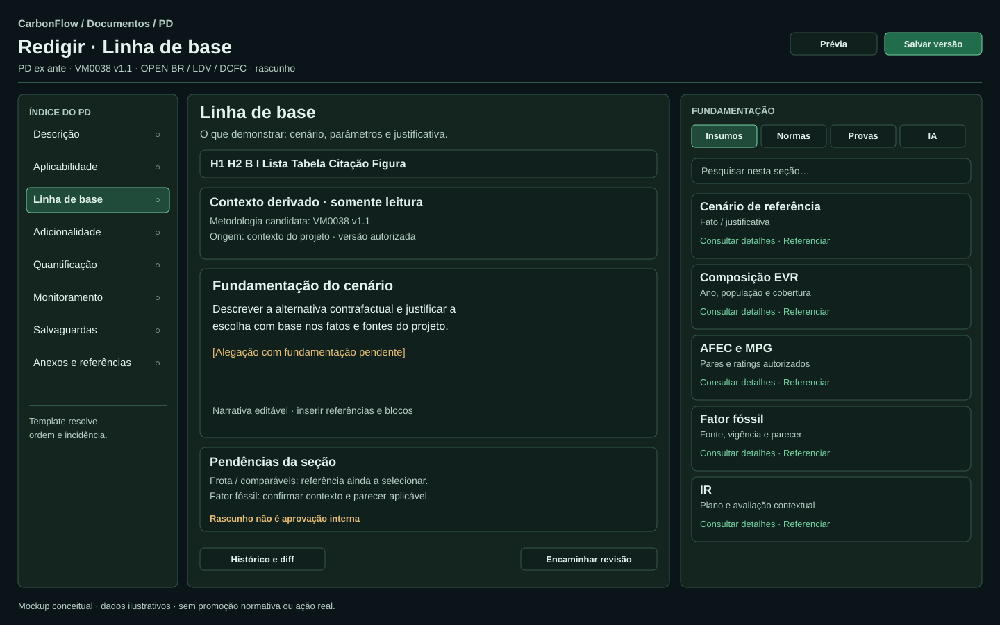

### 2.1 Entrada e contexto

A central documental PT-16/17–26 seleciona documento PD, ou MR por período real quando suportado, template/edição/ato/idioma/variante e versão. Resolver contexto no backend por DocumentContext; versão histórica não é recontextualizada silenciosamente. Mostrar método/edição, finalidade ex ante/medida, revisão, estado de atualidade, direitos e modo leitura/edição. Se template/regime estiver indeterminado ou restrito, permitir orientação/rascunho preparatório conforme contrato sem fingir índice oficial; explicar ação. PD não exige MR futuro universal. MR e afirmações de medição dependem de período real.

### 2.2 Painéis estáveis

| Área | Conteúdo | Interação |
|---|---|---|
| Esquerda — índice | Seções/subseções ordenadas do template resolvido, estados ortogonais, contagem de achados autorizados | Abrir seção, busca no índice, colapsar grupos, ir a pendência, retornar à mesma posição |
| Centro — editor | Objetivo, bloco derivado, narrativa editável, tabelas/figuras, notas, referências, marcadores de suporte | Inserir/reordenar texto e blocos permitidos, editar narrativa, salvar, ver prévia/diff, consultar claim, solicitar revisão |
| Direita — fundamentação | Abas Insumos, Normas, Provas, IA; busca, filtros, resultados contextuais; estados e ações | Consultar origem, referenciar, inserir bloco, ver cálculo, pedir dado, fixar referência e avaliar lacuna |

Em desktop 1440×900, referência de desenho: índice 225 px, centro flexível ~600 px, biblioteca ~400 px, painéis ajustáveis/colapsáveis sem mudar navegação principal. Barra superior com documento/versão, indicador de salvamento, contexto e ações Salvar versão, Prévia, Revisar. Modo foco amplia texto mantendo acesso a biblioteca e retorno; sem clonar editor em outra página. Em tablet índice em drawer, biblioteca acoplável; em 390×844 alternância acessível Índice/Redação/Fundamentação, restaura seção/seleção/rascunho. Sem scroll horizontal global. Toolbar oferece títulos, parágrafos, listas, ênfase, citações, tabelas editáveis apenas para narrativa e referências; não permitir HTML arbitrário, execução de scripts, alteração de células derivadas, inserção de imagens externas não autorizadas. Rich text estruturado sanitizado, colar texto de Word sem macros, referências/âncoras preservadas; se evolução exige novo formato, manter adaptação de texto legado. Não prometer editor WYSIWYG pixel-perfeito do Word.

Cada seção apresenta em linguagem simples: o que precisa demonstrar; requisitos e condições de incidência; o que já existe e o que falta; evidências/decisões; blocos que entrarão no documento e próximas ações. Mostrar detalhes técnicos progressivamente, não repetir avisos genéricos ou códigos PEN. Modo de leitura mostra conteúdo autorizado sem affordances de escrita. Salvar rascunho explicitamente ou autosalvar com lock/If-Match conforme PD-C; sem perda de trabalho em conflito, recarga, troca de seção ou falha de rede. Navegação preserva contexto do projeto/ato/template e retorno; aviso quando edição não salva. Não chamar “salvo” antes do backend confirmar. Estado editorial separado de técnico: RASCUNHO_PREPARATORIO, TEXT_SAVED, PENDING_EVIDENCE, IN_REVIEW, APPROVED_INTERNAL, FROZEN_INTERNAL, STALE, EXPORTABLE_INTERNAL são rótulos/projeções conforme #43, não enum global novo. Rascunho pode existir com pendências, mas não passar gates de release por mero preenchimento.

## 3. Resolvedor de contexto e biblioteca — PT-24B/C

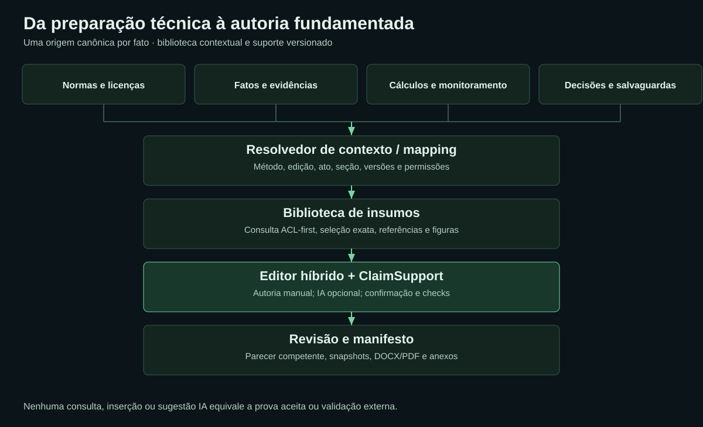

O resolvedor usa mapeamento PD-A e contratos de saída dos módulos já previstos. Recebe documentContext, sectionId, versão histórica ou draft, finalidade, audience e escopo do ator; resolve requisitos incidentes, fatos e inputs canônicos versionados, decisões, links, status e ações permitidas. Busca não é cópia de todo banco nem novo repositório: adapters read-only no owner, consulta paginada e ACL-first. Buscar em toda a informação autorizada do projeto, com prioridade na seção; permitir expandir para outros módulos mediante filtro e motivo. Não apresentar só inputs diretamente usados no cálculo: decisões descartadas/alternativas, critérios de comparação, limitações, evidências, métodos, procedimentos, relatórios técnicos, checagens e resultados intermediários são insumos relevantes se pertinentes e autorizados.

### 3.1 Catálogo de insumos e ações

| Grupo | Conteúdo que a biblioteca deve projetar, quando existente | Owners |
|---|---|---|
| Normativo | metodologia, edição, requisito, regra, equação, ferramenta, condição, vigência, referência/locator, decisões de aplicabilidade | #10/#92/#13/#90 |
| Científico/técnico | referências bibliográficas, estudos já cadastrados ou aprovados, cadernos de análise e justificativas metodológicas; distinguir fonte primária/secundária | #92/#33/#40/#99; pesquisa adicional como candidata |
| Regulatório | legislação federal/local incidente, artigo/edição/vigência, licenças, obrigação, interpretação e parecer | #10/#92/#99/#33 |
| Dados públicos | EVR/Senatran/RENAVAM, PBEV/Inmetro, fatores brasileiros ANP/MCTI/ONS e demais fontes avaliadas; cobertura, data, unidade, licença e transformação | #94/#95/#96/#92 |
| Projeto | contexto, atividade, organização, estações, carregadores, fronteira, localização, eventos, atores e configuração | #16/#24/#93/#98 |
| Linha de base | cenário, comparáveis, estoque/ratings, ponderação, AFEC/MPG, EFfuel, plano/avaliação IR, escolhas e restrições | #40/#94/#95/#96 |
| Adicionalidade | rota, VMD0049, excedente regulatório, cronologia, direitos, decisões e limitações; teste de mercado como dependência de aplicabilidade | #38/#99/#93 |
| Quantificação | run, timing, entradas, equações, etapas/intermediários, BE/PE/LE/ER, Dy, EFel, PE horário, consulta anual e ressalvas | #97/#128/#96 |
| Monitoramento | plano, instrumentos, pontos ED/EC, configuração, certificados, procedimentos, QA/QC, eventos, períodos e revisões | #41/#98 |
| Sustentabilidade | riscos, mitigação, consulta, participação, queixas restritas, indicadores, ODS e evidências | #41/#33 |
| Jurídico | partes, representação, instrumento, vigência, titularidade, divulgação, dupla reivindicação, provas e juízos | #24/#93/#99 |
| Revisão | pareceres por critério, competência, decisão/versão, devoluções, achados, incompatibilidades, ressalvas | #35/#37/#46/#99 |
| Artefatos | tabelas, gráficos, mapas, diagramas, anexos, registros de fontes, memória e manifesto parcial quando autorizados | #43/#128 e owners |

Para cada cartão de insumo: título humano, tipo, por que é relevante para esta seção, origem/owner, identidade exata e versão/hash quando permitido, referência bibliográfica/locator, data/ano/vigência, unidade/escopo, natureza declarada/planejada/candidata/medida/revisada, estado técnico, estado de prova, decisão/ressalva, atualidade e direitos por operação. Ações possíveis: Consultar detalhes; Abrir origem; Referenciar no texto; Inserir bloco; Inserir tabela/figura; Vincular a alegação; Solicitar dado/prova (#26); Comparar versões; Ver restrições. Ações só aparecem ou são habilitadas conforme capability explícita do backend; não mostrar metadata proibida nem motivo que revele existência de objeto restrito. Quando informação está legitimamente ausente, apresentar lacuna, origem e ação; quando acesso negado, resposta opaca. Não transformar candidato em fato comprovado pela inclusão.

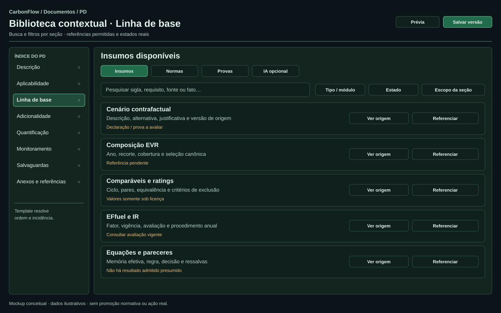

Abas: **Insumos** com filtros por tipo, módulo, finalidade, estado e período; **Normas** com requisitos, condições, edição/locator, interpretação humana e link permitido; **Provas** com documentos, evidências, revisões e lacunas; **IA** opcional, respeitando PT-24I/J. Busca por sigla e termo humano, seleção/foco, paginação, histórico recente permitido, resultados agrupados por relevância (diretamente relacionados, contexto, alternativas/limitações), filtro “já referenciado”, “desatualizado” e “falta prova”. Não usar semelhança textual para inferir admissibilidade. Normas protegidas sem licença para exibição: só metadata/resumo próprio autorizado, sem trecho integral ou acesso indireto. Referência a estudo externo novo deve ser candidato em aquisição, não fonte existente/admitida. Mostrar unidades e definições com glossário #23.

## 4. Matriz contextual seção → insumos → produto documental

Os rótulos abaixo são blocos lógicos, não números fixos de seção oficial. PD-A resolve mapping por metodologia/edição/ato/template e condição. Cada bloco contém fontes, natureza, estado, ações e ausência. Uma fonte pode servir a várias seções, com a mesma ref e diferentes claims; sem duplicação de cadastro.

| Bloco lógico do PD | Insumos prioritários e contextualização | Inserções possíveis |
|---|---|---|
| Descrição/escopo | objetivo, atividade, PP/OP/titular, datas, local, tecnologia, situação do projeto e atos | descrição derivada, ficha, mapa/figura, tabela de ativos, cronologia |
| Limites, direitos e acesso | fronteira por versão, estações, carregadores, configuração, contratos, titularidade, representação, divulgação, exclusividade | tabela de ativos e limites, referências jurídicas, topologia, ressalvas |
| Aplicabilidade | pack/regra e edição, condições, respostas, incidência, teste de mercado com séries e denominadores, prova de acesso e fronteira | matriz requisito→fato→prova→decisão, séries autorizadas, pendências |
| Linha de base | cenário contrafactual e justificativa, EVR/população/denominador/ano/cobertura, pares e ciclo, ratings, AFEC/MPG, EFfuel, IR, equações, parecer e alternativas | composição de frota, tabela comparáveis, memória de cálculo, fontes, limitações |
| Adicionalidade | rota e regra, lista positiva, excedente regulatório, cronologia, investimento, direitos e pareceres; mercado não substitui adicionalidade | timeline, tabela de critérios, referências/justificativas, ressalvas |
| Quantificação ex ante | propósito, janela, ano relativo, dados planejados e hipótese explícita, entradas/metodologia, cálculo do backend se suportado, incertezas e revisão | parâmetros, equações, estimativa, tabela de cenários apenas quando cálculo existir |
| Plano de monitoramento | grandezas, instrumentos previstos/efetivos, frequência, método, fonte, calibração, QA, contingência, papéis, evidências | tabela de parâmetros, topologia ED/EC, fluxos QA e plano versionado |
| Salvaguardas e stakeholders | riscos, incidência, mitigação, plano/realização de consultas, respostas, ODS, indicadores, parecer e restrições | matriz de riscos, indicadores, resumo de engajamento permitido |
| Anexos/referências | documentos e locators, memórias, fontes, anexos exigidos, licenças, limitações, revisão | índice de evidências, notas, bibliografia, anexos suplementares |
| MR (evolução por período) | período real, snapshots QA, evidências, avaliações, energia, EFel, run exato, cobertura e eventos | tabelas de medição/QA, memória, resultados, período/vintage e ressalvas |

Nunca inserir resultado ou fator licenciado apenas porque está em endpoint. Exemplo: painel de frota atual só autoriza metadados em determinado contexto; nesse caso gráfico de pesos não é disponível, ainda que exista um cálculo. Não reconstruir EVR a partir de vendas, PBEV de estoque, OM/CM de média genérica, nem AFEC/MPG por engenharia reversa. Não confundir referência 0,7% da VMD0049 com séries do teste de mercado; usar requisitos, ano, fonte e parecer exatos. O sistema deve explicar a relevância e limitação, não inventar conclusão normativa.

## 5. Inserção, referências e visualizações — PT-24D/E

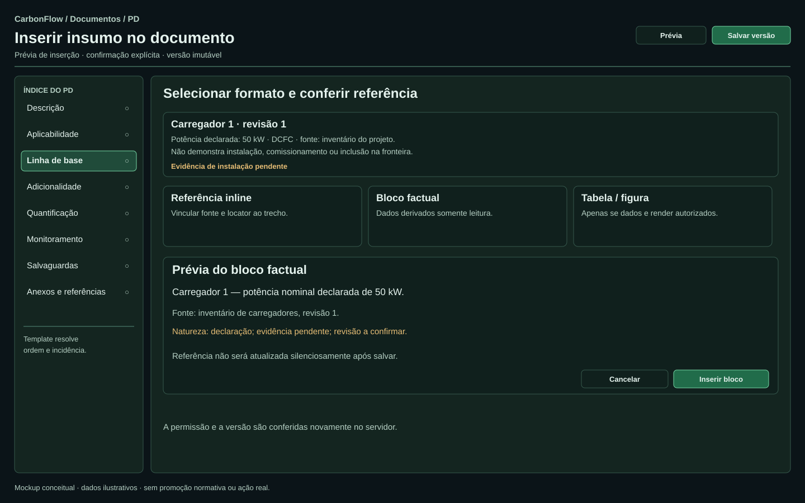

### 5.1 Fluxo de inserção determinístico
1. Selecionar insumo, abrir detalhes e confirmar finalidade/versão.
2. Escolher formato permitido: referência inline/nota; bloco factual read-only; tabela; figura; trecho próprio de narrativa com suporte; link interno ou referência bibliográfica. Se fonte restrita, oferecer apenas operações autorizadas. Não copiar trecho protegido para clipboard/editor/export sem autorização.
3. Prévia no local de inserção: conteúdo, título/legenda, fonte e locator, unidade, período, estado e natureza, licença/variante, impacto no documento. Exibir ressalva junto ao conteúdo, não em texto escondido.
4. Confirmação explícita do preparador: comando valida ref/versão/licença/grant/contexto no servidor, pinagem e mudança de versão editorial em operação consistente. Uma mera consulta não cria claim ou pin. Se mudou enquanto a prévia aberta, devolver conflito e comparar, sem substituir silenciosamente.
5. Renderizar bloco e referência vinculados ao snapshot imutável; alterar/remover/ordenar blocos permitidos é edição de composição, não alteração de origem. Ação “Atualizar referência” gera nova versão após diff e revisão requerida. Alterar dado canônico abre tela owner e volta ao editor.

**Referência no texto:** marca/nota ligada a claimId/DocumentSourceRef, título legível, autor/instituição, edição/data e locator conforme informação permitida; numeração/bibliografia resolvida pelo compositor, não IDs brutos. Suporte múltiplo (regra + fato + prova + parecer) e restrições em cada referência. Links seguros, sem tokens, expiração ou caminhos privados no PD público; acesso ao original via autorização atual. Se ausência, marca “fundamentação pendente”, não citação imaginada. Inserir narrativa baseada em fonte não autoriza reproduzir material protegido; texto próprio, citações dentro do direito de uso.

### 5.2 Tabelas, gráficos, mapas e diagramas
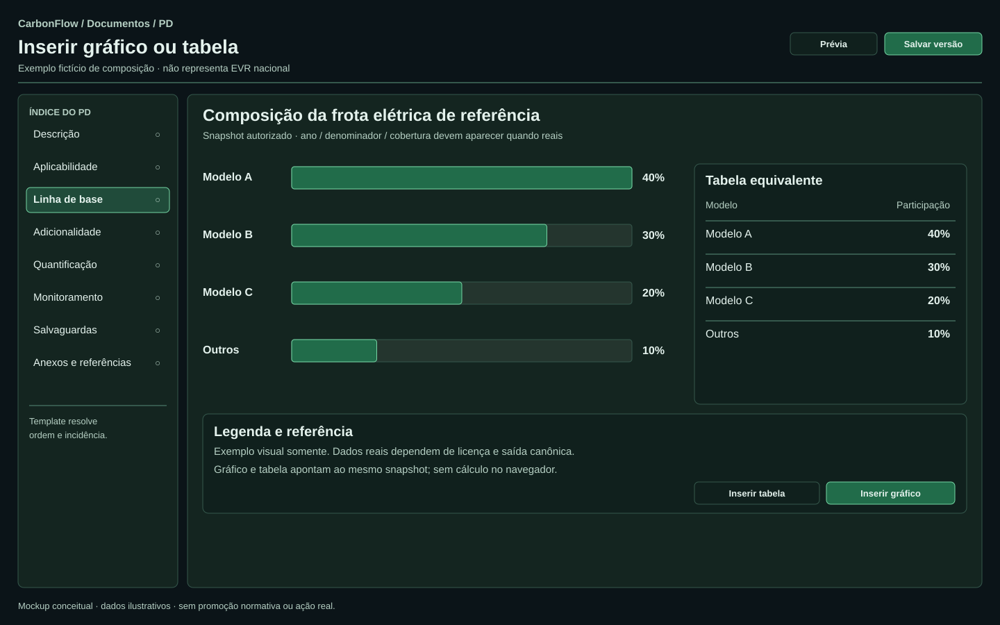

| Visualização | Fonte canônica e controles |
|---|---|
| Composição EVR | snapshot da população e pesos autorizados, ano/recorte, denominador, cobertura, categoria residual, unidade; tabela acessível equivalente |
| Comparáveis | pares/ratings e critérios versionados; valores/unidades/ciclos e exclusões apenas licenciados |
| Fatores EFfuel/EFel | série ou valores autorizados, unidade, vigência, região e granularidade; lacunas sem interpolação/fallback |
| Quantificação | BE/PE/LE/ER do run exato e natureza (ex ante/ensaio/medido), precisão e ressalva; não deduzir números |
| Cobertura QA | horas/ativo e estado da janela, ausência distinta de zero; sem dados identificáveis de motoristas |
| Mapa da fronteira | geometria/coord. do inventário permitido, versão, legenda, privacidade e licença de mapa-base; sem inferir posição |
| Diagrama elétrico | configuração e pontos ED/EC canônicos, rotas de medição; distinguir desenho conceitual de as-built comprovado |
| Timeline | eventos previstos/efetivos/documentais, datas e provas autorizadas, sem inferir início VCS |
| ESG/riscos/indicadores | avaliações, metas e resultados comprovados vs planejados; privacidade de grupos e queixas |

Proposta de extensão FIGURE/DERIVED_TABLE de DocumentBlock: presentationSpec (tipo, título, legenda, unidade, eixos, ordenação, altText/tabela acessível, referência a dataset/output versionado e renderer version, autorização por audience). Não materializar segundo dataset ou cálculo; transformar visualmente dados **já retornados** conforme política do owner. Agregação/ponderação nova que altere significado pertence ao serviço canônico, não ao Angular/compositor. Tabela/figura compartilham referência e filtro; números rotulados com fonte, precisão e propósito. Export usa artefato gerado/renderizado com manifest, resolução e estilos legíveis, versão do renderer, hash, localização de inserção. Editar legenda e descrição acessível não altera dados; sem editar barra/peso/valor. Evitar imagens de gráficos sem valores alternativos; linhas pontilhadas/estados textuais além de cor. Preview de exemplo 40/30/20/10% é fictício, não EVR do Brasil, não seed ou resultado de projeto. Se licença só metadata, ocultar gráfico numérico e explicar ação de resolução sem fazer download ou reconstrução. Não usar screenshot como prova original.

## 6. Fundamentação por alegação (ClaimSupport) — PT-24F

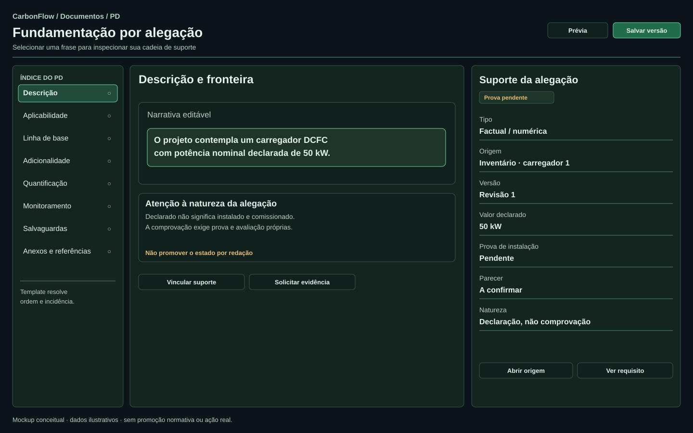

Uma frase ou bloco importante precisa poder ser auditado até a origem. ClaimSupport do #122, não novo fact ledger. Tipos NUMERIC, FACTUAL, NORMATIVE, INTERPRETATIVE (lógicos). Ancorar em blockId/claimId estáveis + narrativeVersion + span (identidade de nó/trecho, offsets e hash/quote permitido); quando editar texto, preservar suporte somente se correspondência inequívoca e sem alterar significado, senão marca NEEDS_HUMAN_REVIEW/UNSUPPORTED e pede reconciliação. Não usar posição textual como única identidade; múltiplas alegações no parágrafo e alegação apoiada por diversas fontes. Bloco derivado carrega refs e estado do owner, mas inserção não prova a interpretação da narrativa. Claim interpretativa requer parecer competente exato; número precisa corresponder à unidade/precisão e snapshot E8; regra exige edição/ato/locator; fato exige natureza e suficiência de prova.

| Status de suporte (contrato #122) | UX e consequência |
|---|---|
| SUPPORTED | Suporte suficiente para finalidade interna, conforme checks e julgamento exigido; não aprovação externa |
| UNSUPPORTED | Prova/regra/ref faltante; abrir achado e ação, bloquear gate se crítico |
| CONFLICT | Divergência factual, numérica, temporal ou entre fontes; explicar diferença e resolver no owner |
| STALE | Referência mudou ou versão/validade não atende contexto; histórico preservado, rechecagem dirigida |
| NEEDS_HUMAN_REVIEW | Interpretação, prova insuficientemente avaliada ou alteração de texto; REV competente decide |

Além do status de suporte, exibir natureza da informação, estado da fonte (disponível/licenciada/admitida), estado editorial e revisão; não reduzir todos a “verde”. Preparador pode selecionar trecho e Vincular suporte, consultar origem, registrar justificativa, indicar lacuna ou pedir avaliação; REV pode ver suporte, comparar versões, devolver com achado, decidir conforme competência. IA não marca SUPPORTED. Checker determinístico valida igualdade numérica e tipos; não declara suficiência de prova qualitativa sem regra/parecer. Sem referência autorizada, não afirmar veracidade. Número divergente de run bloqueia aprovação conforme #43, não corrigir automaticamente.

**Exemplo baseado na captura anterior:** “O projeto contempla um carregador DCFC com potência nominal declarada de 50 kW.” Origem carregador 1 revisão 1, fato declarado; prova de instalação pendente. Se narrativa disser “instalado e comissionado”, esse novo claim exige evidência de ocorrência/instalação, não basta potência cadastrada. Distinguir a própria declaração apoiada pelo registro da alegação de comprovação técnica. Não inferir inclusão na fronteira. Exemplo de suporte do texto: factsRef (inventário), evidenceRef (quando autorizado), ruleRef (quando incidente), reviewRef (quando decisão requerida), natureza, locator, estado/motivo. Revisão preserva evidência histórica e não concede direito ou grant.

## 7. Consistência entre seções e rechecagem — PT-24G/H

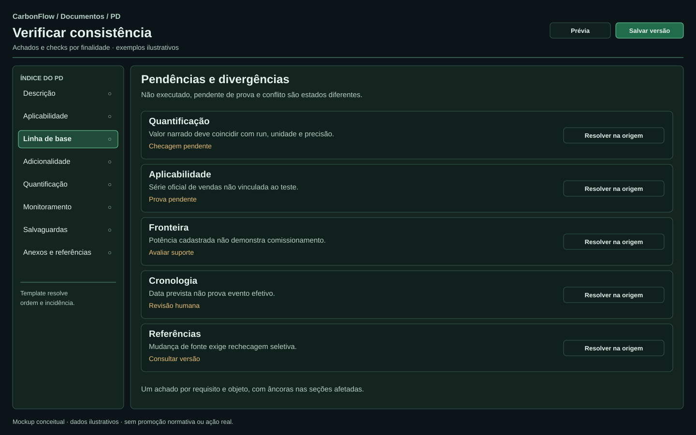

Reusar #35/#46/#13/#19; não criar verificador paralelo nem usar LLM como regra decisória. Checklist por contexto/claim e severidade resolvida pelo owner:
- valor BE/PE/LE/ER e unidade/precisão vs run pinado; estimativa ≠ medição ≠ ensaio interno ≠ crédito;
- quantidade/potência e fronteira vs inventário; estação fora do projeto ou versão; direitos e PP vs parte/representação comprovadas;
- datas efetivas/documentais/previstas e início de crédito, ato/edição/ano relativo/fonte/vintage, sem confundir calendário;
- regra e edição aplicáveis, critérios de incidência, licença/locator e inconsistências de narrativa sobre aplicabilidade/adicionalidade;
- EFfuel/EFel/IR/Dy e seleção por período/avaliação, frota/ratings/ciclo; ED e EC distintas;
- plano de monitoramento vs instrumentos e rota, sem exigir medição futura universal no PD;
- afirmação de consulta, risco mitigado, contribuição ODS vs evidência e parecer; privacidade;
- referências obsoletas, prova removida/restrita, ausência de suporte, contradicão entre claims, template desconhecido.
 
Checks determinísticos com valores estruturados retornam requisito, objetos/claims, expected/actual **se autorizado**, motivo, severidade, efeito sobre gate e próximo passo. Comparações textuais ambíguas geram candidato a achado/revisão humana, não reprovação automatizada inventada. Distinguir “não executado” de “sem achado”. Uma tarefa no ProjectWork por requisito+ato+objeto; o editor agrega âncoras afetadas. Não esconder pendência de outro owner nem duplicar em filas. Parecer PT-25 vincula versão/claim/block, motivo, competência; editor mostra comentário e ação de resolver/retornar. Contagem não é score de conformidade; não usar percentuais de confiança arbitrários.

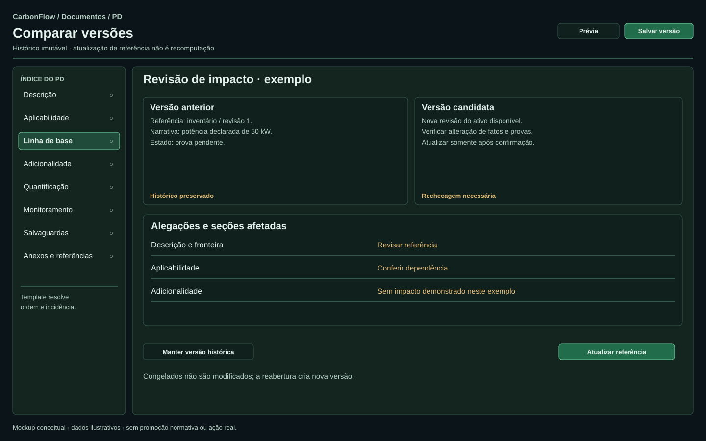

Alteração de fato, fonte, regra, licença, snapshot E8 ou parecer em owner marca dependências específicas. Mostrar versões anterior/atual, o que mudou (narrativa, bloco, fonte, natureza, status, cálculo, requisito) e quais alegações/seções precisam rechecagem. Se atualização afeta só seção dependente, preservar estado das independentes conforme #46. Sem substituir versão congelada nem pinar “última” automaticamente. “Atualizar referência” confirma diff, reexecuta checks e exige revisão humana quando aplicável; preservar histórico e identidade do autor. Se fonte revogada, conteúdo sensível não reaparece em diff/histórico. Retorno da revisão e comparação inclusive em mobile. Distinguir diff editorial de recomputação E8; nova execução só no owner. Comentários PREP/REV ancorados, resposta/resolução, não apagar histórico. Revisão e freeze respeitam ações reais de PdReviews; congelado somente leitura, reabertura cria nova versão/release conforme PT-25/26.

## 8. Assistente de autoria opcional — PT-24I/J

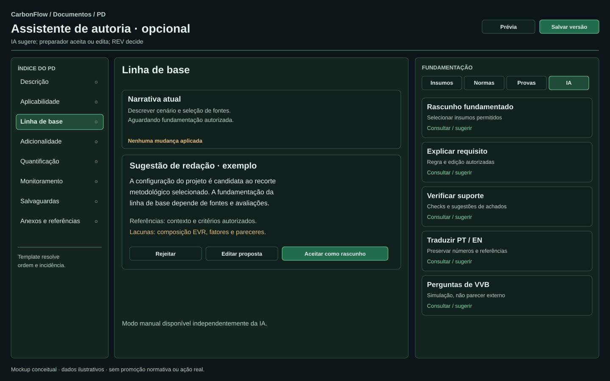

A IA auxilia a redação com as informações que o projeto realmente possui. A fatia manual PT-24A–H é P0 e suficiente para marco #122; as capacidades IA de autoria são P1 neste fatiamento, **não alterar a prioridade P0 da issue transversal #100** nem depender de IA para completar PD. Reusar AssistedJourneyOrchestrator e AI Gateway #100; operar somente com permissão explícita de cada fonte, organização e finalidade. Abas manuais funcionam com IA desligada, offline, quota ou licença negada.

| Operação | Comportamento |
|---|---|
| Elaborar rascunho fundamentado | Selecionar seção e insumos permitidos; proposta narrativa + referências exatas por claim + lacunas; sem inventar fatos |
| Explicar requisito | Regra/edição/locator e condição de incidência, linguagem técnica e simples; abstenção sem fonte autorizada |
| Encontrar fundamentação | Busca ACL-first entre fontes/dados/decisões existentes; sugerir aquisição como candidato, não fabricar URL ou publicação |
| Verificar suporte | Indicar alegações possivelmente sem prova ou incompatíveis; chamar checker determinístico autorizado; opinião humana necessária |
| Verificar consistência | Apontar possíveis contradições; comparar com fatos e runs por refs; não decidir aplicabilidade |
| Identificar lacunas | Sugerir perguntas/dados/solicitação pelo fluxo #26; confirmação antes de persistir |
| Traduzir tecnicamente | Rascunho PT/EN preserva valores, referências, siglas e natureza; não alterar versão original ou substituir revisão de idioma |
| Simular perguntas de VVB | Perguntas hipotéticas por critério e prova faltante, não parecer real, não representar VVB/Verra nem afirmar que exigirá pergunta |

Fluxo: selecionar seção/escopo e intenção permitida; listar conjunto de fontes elegíveis, excluir fontes restritas; usuário confirma uso/consentimento quando necessário; executar retrieval e inferência somente se INDEX_SEARCH/RAG_RETRIEVE/MODEL_INFERENCE/SHOW_EXCERPTS e outras permissões incidentes forem válidas; validar retorno estruturado; mostrar sugestão em painel separado, citações clicáveis, incertezas e diff; aceitar/editar/rejeitar explicitamente. Aceitar cria versão humana por #43, com provenance de sugestão e checks/claims; jamais autoaprovar, alterar fatos, cálculo, grants, regras ou release. Não enviar dados pessoais/financeiros, material de terceiros ou conteúdo protegido ao modelo sem base e autorização. Prompt injection de anexos é dado não confiável, sem tools de escrita, acesso externo não autorizado ou fuga de contexto. Whitelist de intents, tool calls read-only por padrão, server-side ACL, schemas estritos, limites de tokens/custo, timeout, retry idempotente, circuit breaker, consentimento e auditoria minimizada. Sem fonte suficiente → “não há fundamentação disponível”, lacunas e rota manual. Tradução e simulação são propostas adicionais a integrar no gateway por whitelisted intent e testes; não alegar já implementadas.

DraftSuggestion conforme #100: sectionId/templateVersion, documentContext/ref de rascunho, promptTemplateVersion/modelVersion, sourceRefs autorizadas, citedFactIds, calculation snapshot ref, proposedNarrative, claims candidatos, uncertainty/gaps, generatedAt, actor, status SUGGESTED_ONLY e hash quando permitido. Histórico de aceitação/edição/rejeição; não persistir prompts privados ou payloads sensíveis desnecessários. Checar licença novamente no momento de mostrar/aceitar e exportar. Evals #47/#101: factualidade e citações, números E8, prompt injection, cross-tenant, revogação, abstenção, IA OFF, custo/latência e qualidade de tradução; limiares e go/no-go definidos em #100/#47 antes de release, sem inventar score. Simulação VVB não vira consulta formal, aprovação ou autoridade.

## 9. Arquitetura, contratos e APIs (PT-24A–H)

### 9.1 Fluxo e propriedade
Adapters dos owners → resolvedor DocumentContext/mapping → biblioteca read-only → comandos de composição e ClaimSupport #43 → checks #35/#46 + ProjectWork #13/#19 → SectionSnapshot e PdReviews → PT-26 E8-007/DocumentReleaseManifest. IA #100 consome apenas projeção autorizada, opcional. A origem canônica permanece em Quarkus/PostgreSQL nos módulos existentes; Angular renderiza, navega e edita narrativa, não calcula ou determina admissão. Não criar data lake/document store paralelo, DAG paralelo ou segundo editor.

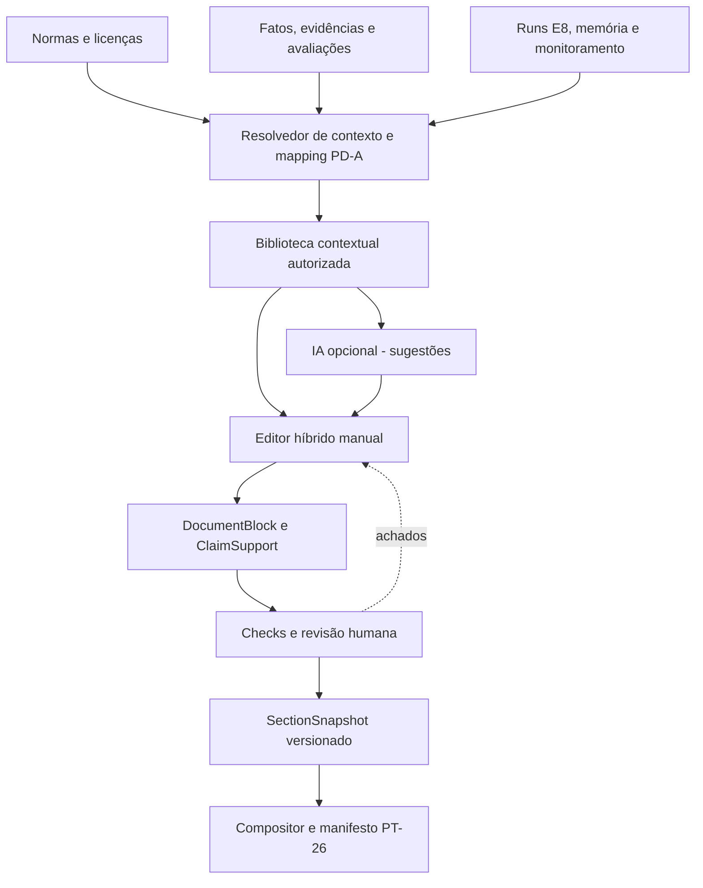

### 9.2 Contratos de #122 (extensões lógicas, não renomear APIs existentes)

| Contrato | Campos / comportamento essencial |
|---|---|
| DocumentContext | organizationId, projectId, environment, methodology+edition, regime/normPack+digest, actType PD/MR, actDates, templateId+edition+digest, language, visibility; ACL server-side |
| DocumentSourceRef | canonicalOwner, objectId, immutableVersion/snapshotId, SHA256 quando autorizado, provenance/locator, temporalVintage, units, technicalAdmission, sourceLicense/permittedOperations, confidentiality, escopo |
| DocumentBlock | stable blockId, sectionId, tipo EDITABLE_TEXT/FACT/RULE/DERIVED_TABLE/PARAMETER/EVIDENCE/FIGURE/WARNING, sourceRefs, typedValue, displayFormat, status RESOLVED/PENDING/STALE/N_A/BLOCKED, presentationVersion; derived read-only |
| ClaimSupport | claimId, narrativeVersion, anchoredSpan/blockId, type, source/rule/review refs e locators, requisito, status, reviewerEvent/motivo |
| SectionSnapshot | sectionId, mappingVersion, narrativeVersion, ordered block refs, source digests, editorial/technical status/freshness, reviewer/competence/decision, dependencies e razões |
| DocumentReleaseManifest | releaseId, actType, variant, normPack/template hashes, seções/ordem/versões, cálculo/evidence refs, attachments policy/hashes, generator/renderer versions, rendering options, freeze actor/time, output hashes |
| ContextualInputView (projeção proposta) | ref permitido, kind, relevância/requirement, natureza, status técnicos/evidência/atualidade distintos, preview permitido, actions/capabilities, missingReason quando seguro, originLink |
| InsertionPreview (proposta) | documentContext, section/draftVersion, source ref exato, tipo de bloco, preview/format, locators, allowedOperations, ressalvas, impact e token/hash de contexto para concorrência |
| ConsistencyFinding (projeção) | requirement, refs de claim/block/version, check id/version, state/severity, motivo, diferença autorizada, action/owner, reviewRef, affected sections |
| DraftSuggestion | contrato #100, ver §8; suggestion não é versão aprovada |

Preservar nomenclatura dos contratos existentes; últimas quatro projeções são sugestões de DTO/queries, evitar persistência duplicada. Mapeamento versionado: method/edition/act/template → section order/conditional requirements → output adapters → block and render policy → confidentiality/competence. Identidade de fonte/versão validada em cada comando, sem confiar em IDs enviados pelo cliente. Referências não precisam copiar bytes de fonte. Reuse do endpoint atual GET/PUT /v1/projects/{project}/technical/pd-sections, consulta exata period+run, GET versões/download e /technical/pd-reviews. O PUT legado salva narrativa com guideVersion e limite 12.000, não suporta blocos/claims; evoluir de modo aditivo/versionado, adapter e migração por versão, preservar hash original. Não misturar novas estruturas em texto/JSON escapado para fingir integridade.

**Superfícies lógicas propostas, nomes finais definidos na implementação PD-A/C/D:** leitura de contexto/outline, consulta paginada de insumos por section/type/estado/termo, detalhe autorizado de ref, preview de inserção, comando de inserir/remover/reordenar blocos permitidos, salvar narrativa+claims e refs, consulta lineage e diff, checks/findings, handoff à revisão, preview/export por manifest. Inventariar APIs existentes primeiro; não implementar todos como novos endpoints se reuso for suficiente. Mutação com If-Match/Idempotency-Key conforme contrato, transação consistente e auditoria, 409/412 conflito com rascunho preservado, 404 opaco sem grant, 400 validação. Idempotência de inserção evita referência duplicada; uma ref pode sustentar claims distintos. Sem escrita ao abrir painel, sem alteração de owner via editor. No-store e cancelamento de respostas tardias (troca de projeto/versão/seção/painel/ACL), evitar cache cliente de valores protegidos. Paginação e lazy load, índice autorizado, medir latência/carga #49, não carregar todos os datasets brutos.

### 9.3 Migração e segurança
Reusar #36/#37, PdSections/PdReviews e #33 storage. Migrações aditivas, versões legadas continuam consultáveis, nenhum backfill assume claim suportado; reconciliar narrativa/texto e refs quando possível, caso contrário pedir revisão. Não gerar novo hash para versão histórica. Rich text sanitização de entrada/saída, sem macros/HTML/script, path traversal, hyperlinks inseguros ou metadados proibidos. Controle de grants por operação (ler metadata, ler dado, consultar, copiar, inserir, renderizar, exportar, inferência), ACL-first em query, busca, ranking, contagem, prévia, diff, erro e manifest. Licença é resolvida pelo owner #92, não inferida de visibilidade UI. Não incluir PII/queixas/contratos sensíveis em documento público, caches, logs, nomes de arquivos, URLs ou modelo. Revogação revalida fontes e remove detalhes proibidos imediatamente; história não reescrita. Estado stale e ausência legítima são distintos de restrição. Testar tenant, actor, environment e propósito. Sem bypass de autorização para facilitar UX.

## 10. Handoff de revisão e exportação

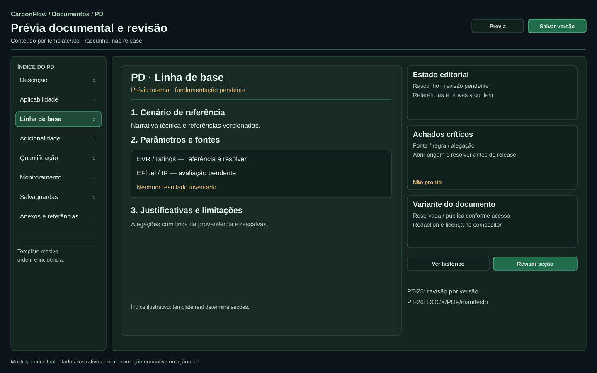

A prévia mostra índice e seções no template resolvido, blocos e narrativa em ordem, referências legíveis, tabelas/figuras, lacunas, avisos de natureza e revisão, com seletor de variante pública/reservada somente autorizado. Não confundir preview de rascunho (watermark/aviso) com release pronto; sem dados de teste no projeto real. Revisão PT-25 recebe SectionSnapshot, referências e claims exatos, achados e diff; REV independente e competente decide. Ações de aprovação/freeze só retornadas pelo backend. Mudança após parecer exige rechecagem conforme #46; autor não aprova versão própria. 
PT-26 produz DOCX editável e PDF fiel, referências, anexos/memória quando permitidos, matriz e manifesto congelado. Não alterar template oficial indevidamente; material suplementar fora do formulário quando requerido. Gerar arquivos a partir de ordered blocks e snapshots, não consultar latest durante export. Verificar composição, arredondamento do E8, referências, paginação, cabeçalhos, sumário, legendas, anexos, acessibilidade e redaction em conteúdo/metadados/hyperlinks/manifesto. ClaimSupport e versão de fonte fazem parte da rastreabilidade; manifesto registra hash de insumos/outputs e versões de geradores, sem publicar segredo ou hash restrito. Hash não é assinatura jurídica. Reabertura cria release novo. PD interno completo ≠ validação VVB ≠ registro Verra ≠ VCU.

## 11. Fatiamento executável e dependências

| Fatia | Entrega / owner | Prioridade | Dependência |
|---|---|---|---|
| PT-24A | Shell três painéis, outline e editor manual versionado #43/#124 | P0 | PD-A/C; #36 |
| PT-24B | Resolvedor contextual, adapters de saída e projeção por seção #43 | P0 | PD-A/B; PT-07/16 e owners |
| PT-24C | Biblioteca, busca, normas, provas, glossário e ações #43/#92/#128 | P0 | B; #23/#26/#33 |
| PT-24D | Inserção versionada de fatos, tabelas, referências #43 | P0 | B/C; PD-B/C |
| PT-24E | Figuras/mapas/diagramas e artefatos derivados #43/#128 | P0 | D; saída autorizada owners |
| PT-24F | ClaimSupport e verificação por alegação #43/#35 | P0 | PD-D, A/B; integrado a D |
| PT-24G | Consistência entre seções, findings e ação owner #35/#46/#43 | P0 | F e outputs canônicos |
| PT-24H | Diff, impacto, histórico e comentários #43/#37/#46 | P0 | A/F/G; PT-25 |
| PT-24I | Sugestões fundamentadas e tradução #100/#43 | P1 da autoria | C/F, direitos, AI Gateway/evals |
| PT-24J | Perguntas técnicas simuladas #100/#35 | P1 da autoria | I, critérios e evals |
| PT-QA | Contrato, API, persistência, browser, segurança, render e teste humano #101/#45/#49 | P0 | por vertical |

Ordem recomendada: PD-A + B (contratos/adapters de primeira seção) em paralelo com shell A; primeira vertical **linha de base ou aplicabilidade** com fonte e prova autorizadas, D/F integrados; C e E ampliam tipos; G/H conectam checks, diff e revisão; generalizar às demais seções por mapping, não codificar formulário OPEN universal. PT-25/26 evoluem em paralelo usando contratos estáveis. IA por último/independente do release. Não suspender UX-08D.1 ou BL-EX e demais dependências de dados reais; trabalhar com fixtures TEST_ONLY e contratos sem promover uso normativo. Escolha definitiva da primeira vertical conforme dados e licenças disponíveis; linha de base é candidata prioritária por esforço já investido, não escolha de fonte real aprovada. P0 não significa iniciar todas as fatias simultaneamente. Não criar issue duplicada: #43 owner, #122 release, #124 UX, #128 transparência, #100 assistente. PT-24 não redefine PT-25/26. Fechar por aceite verificável, não por mockup.

## 12. Critérios de aceite adicionais (planejados)

| ID | Cenário verificável |
|---|---|
| PT-T52 | Outline ordenado por template/edição/ato, template desconhecido sem falso índice oficial, versão antiga preservada |
| PT-T53 | Três painéis desktop, modo foco, mobile 390×844, teclado/foco/leitor de tela, retorno e contexto estáveis; estado não depende só de cor |
| PT-T54 | Editor manual funciona sem IA, sem LLM/corpus; salva narrativa com versão/If-Match, conflito e falha preservam rascunho |
| PT-T55 | Insumos por seção com relevância/requisito, filtros e busca autorizados; fontes de outros módulos apenas dentro do escopo, paginação/dedup |
| PT-T56 | Biblioteca diferencia fato, hipótese, candidato, medição, ensaio, decisão e ausência; nenhum status promovido por consulta/inserção |
| PT-T57 | Norma, edição, locator, incidência e licença; sem SHOW_EXCERPTS não exibir trecho, metadata só se autorizada |
| PT-T58 | Seleção exata de memória/pino/frota/energia por ID/versão/período; nenhuma troca silenciosa pelo latest; stale/404 não repõem detalhe |
| PT-T59 | Preview de inserção exibe versão, fonte, natureza, licença e formato; comando confirma e fixa ref, replay idempotente, conflito reconsulta |
| PT-T60 | Bloco factual/tabela/figura derivados read-only em API e UI; edição de legenda/ordem não altera owner/valor; sem recomputar |
| PT-T61 | Referências inline/nota com locators, suporte múltiplo e bibliografia; sem URI inventada, tokens ou cópia não autorizada |
| PT-T62 | Gráfico/tabela EVR do mesmo snapshot autorizado e acessível; metadata-only não produz pesos/modelos ou números; sem inferir de campos extras |
| PT-T63 | Mapas/topologias/timelines/QA/ESG respeitam origem, versão, privacidade, natureza e autorização; figura conceitual rotulada |
| PT-T64 | Claim numérica, factual, normativa e interpretativa com stable anchor/ref; múltiplos claims por bloco; prova faltante gera lacuna |
| PT-T65 | Editar frase ou mover bloco preserva suporte só quando correspondência inequívoca; nova alegação exige revisão; comentários ancorados/histórico |
| PT-T66 | BE/PE/LE/ER divergente de run/precisão/unidade bloqueia gate crítico; ausência não zero, ensaio não crédito, sem correção automática |
| PT-T67 | Alegação interpretativa requer parecer competente; autor/IA não marcam suportada/aprovada; revisão e submissão conforme #37 |
| PT-T68 | Checker encontra divergência de data, edição, fronteira, direitos e fonte ou marca não avaliado; tarefa única, ação na origem, sem conclusões textuais fictícias |
| PT-T69 | Alteração de referência afeta claims/seções dependentes, diff e atualização explícita; versão congelada e independente preservadas |
| PT-T70 | Licença revogada/ACL/cross-tenant impede leitura/inserção/export/inferência, inclusive contadores/diff/URLs/cache/DOM; resposta tardia descartada |
| PT-T71 | Preview/SectionSnapshot/PT-25/26: blocos, refs, achados e estado entregues; variant public/reserved sem leak; rascunho rotulado |
| PT-T72 | DOCX/PDF e manifesto derivados das versões exatas; figura/tabela/referência/legenda equivalentes; QA de render e redaction, freeze/reabertura |
| PT-T73 | PD ex ante sem MR futuro universal; MR exige referência real, outro pack não recebe regras OPEN automaticamente, PIL-SYN isolado |
| PT-T74 | IA desligada, quota, timeout ou sem licença/corpus: fallback manual completo; nenhuma chamada não autorizada |
| PT-T75 | Rascunho IA possui citações verificáveis, lacunas e diff; aceita/edita/rejeita explicitamente, não altera fato/grant/run nem aprovação |
| PT-T76 | Prompt injection/anexo e respostas malformadas não executam escrita/exfiltração; logs minimizados e provenance model/prompt version |
| PT-T77 | Tradução mantém números/unidades/refs e exige revisão; perguntas simuladas VVB rotuladas hipotéticas, nunca parecer externo |
| PT-T78 | Versões legadas e limite do contrato atual tratados em migração aditiva; sem perda de texto/hash; referência não inferida |
| PT-T79 | Benchmark com corpus autorizado/paginado, concorrência e estados vazios; teste humano PREP consegue fundamentar seção e REV seguir claim sem reentrada de dados; E2E #101, critérios PD-A01–F03, TC-PD e TRUST preservados |

28 critérios complementam BL-T01–17 e PT-T01–51 (não substituem critérios #43/#122/#128/#100). PT-T74–77 pertencem à fatia opcional IA; não são gate de release manual. Definição de pronto: evidência por API, PostgreSQL, Angular, arquivo renderizado quando incidente, isolamento, licença, regressão e homologação humana. Não declarar execução ou conformidade com base nesta especificação.

## 13. Limites e próximos passos

Esta atualização conclui a **reserva de especificação** PT-24 descrita em [monitoramento/quantificação/revisão](CF-UX-TECH-001-MONITORAMENTO-QUANTIFICACAO-REVISAO.md). Não altera código, migrações, grants, dados, licença, norma, pareceres, gates, PR merge ou estado de issues. Mockups SVG são ilustrações de layout e estados; exemplos 50 kW declarado e pesos 40/30/20/10 fictícios não são fatos verificados, outputs E8 nem dados de frota real. Contratos e nomes novos são sugestões a reconciliar na implementação. Não há execução de testes, avaliação de acessibilidade real ou revisão independente de metodologia. A meta é entregar o ambiente manual de autoria completo e preparar IA com autorização; não ampliar acesso a valores hoje deliberadamente restritos. Preservar condição de independência e decisões técnicas dos owners.

## 14. Referência de layout e navegação para implementação

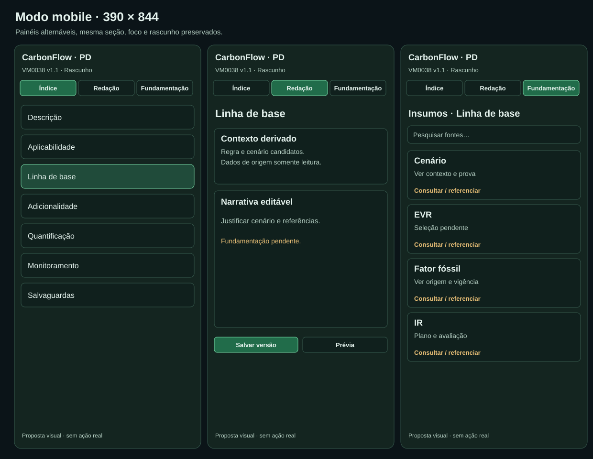

Estado sem fonte: seção apresenta objetivo, requisitos/links autorizados, lacunas e ação de aquisição; permite narrativa preparatória explícita. Estado carregando: não reutilizar dados de seção anterior; erro de rede com retry; acesso restrito sem divulgar objeto; fonte candidata com natureza/limitação; fonte resolvida com ações permitidas; obsoleta com diff e revisão. Estado congelado: leitura e histórico, reabertura conforme grant. Atalhos de teclado para índice, busca, salvar, navegação e inspeção de claim sem conflitar com navegador; foco devolvido após fechar drawer/dialog; editor não depende de drag-and-drop, mover bloco via botões/teclado. Mensagens de status acessíveis, controles com label, layout adaptável, tabelas com scroll interno e alternativa textual. Mockups não substituem teste de usabilidade/teclado/leitor de tela.

